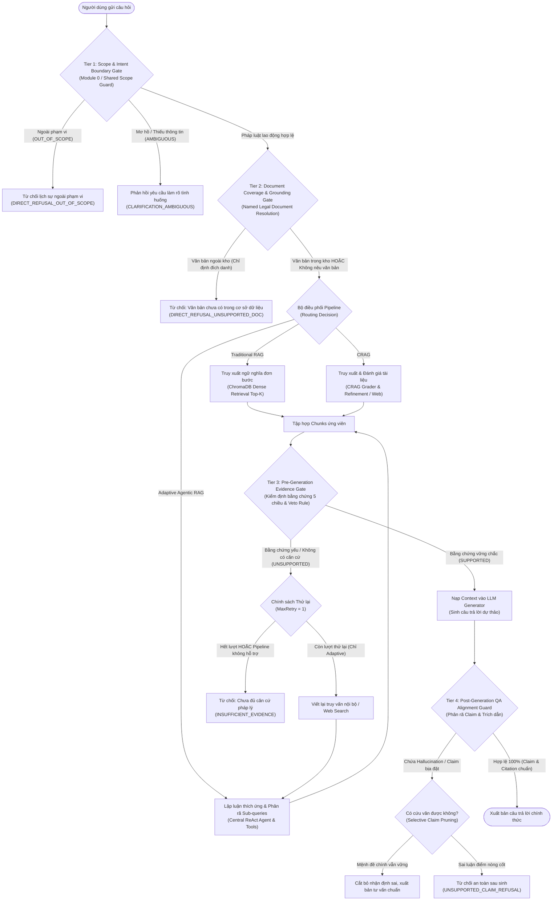

# KẾ HOẠCH CẢI TIẾN CƠ CHẾ TỪ CHỐI VÀ KIỂM CHỨNG BẰNG CHỨNG (FALSE ANSWER RATE MITIGATION PLAN) - PHIÊN BẢN ĐẶC TẢ KỸ THUẬT V3.1 FINAL (HIỆU CHỈNH TOÀN DIỆN)

> **Mã tài liệu:** PLAN-IMPROVEMENT-FAR-20261110-V3.1-FINAL-REVISED  
> **Dự án:** Hệ thống Agentic RAG Hỏi đáp Pháp luật Lao động Việt Nam  
> **Căn cứ tài liệu:** [`false_answer_audit.md`](file:///d:/Filehoc/KLCN/agentic-rag/false_answer_audit.md), [`false_answer_audit.csv`](file:///d:/Filehoc/KLCN/agentic-rag/false_answer_audit.csv), [`error_distribution.json`](file:///d:/Filehoc/KLCN/agentic-rag/error_distribution.json), [`benchmark_300_summary.json`](file:///d:/Filehoc/KLCN/agentic-rag/reports/benchmark_300_evaluation/benchmark_300_summary.json), [`benchmark_300.json`](file:///d:/Filehoc/KLCN/agentic-rag/benchmark_300.json)  
> **Trạng thái tài liệu:** Bản đặc tả kỹ thuật và kế hoạch thực nghiệm hoàn thiện cuối cùng (Final Technical Specification & Experimental Protocol) — **ĐÓNG BĂNG MÃ NGUỒN, CHƯA TRIỂN KHAI CODE**  

---

## 1. TỔNG QUAN VÀ MỤC TIÊU CẢI TIẾN

### 1.1. Bối cảnh và vấn đề kỹ thuật
Báo cáo kiểm toán chuyên sâu ([`false_answer_audit.md`](file:///d:/Filehoc/KLCN/agentic-rag/false_answer_audit.md)) trên bộ kiểm định Benchmark-300 đã xác định rằng trên 50 câu hỏi bắt buộc phải từ chối an toàn (`requires_refusal = True`), cả 3 hệ thống đều có tỷ lệ trả lời bừa (False Answer Rate - FAR) ở mức rất cao:
* **Traditional RAG Baseline:** Trả lời bừa **37 / 50 câu (74.00%)**.
* **Corrective RAG (CRAG):** Trả lời bừa **32 / 50 câu (64.00%)**.
* **Adaptive Agentic RAG:** Trả lời bừa **31 / 50 câu (62.00%)**.

Đặc biệt, trên phân nhóm `insufficient_evidence` (25 câu hỏi thiếu chứng cứ pháp lý), cả 3 hệ thống trả lời bừa **23 / 25 câu (92.00%)** do hiện tượng "ảo giác tương đồng véc-tơ" (Dense Cosine Similarity đạt 0.75 - 0.78 từ các đoạn trích BLLĐ 2019 không liên quan) kết hợp với việc thiếu vắng các chốt chặn phủ định ở các tầng xử lý.

### 1.2. Mục tiêu nghiên cứu và cải tiến
1. **Mục tiêu chính:** Thiết lập kiến trúc kiểm soát bằng chứng đa tầng có thể tích hợp hoặc dùng chung để triệt tiêu hành vi trả lời bừa khi thiếu tài liệu hoặc khi câu hỏi ngoài phạm vi, trên cả 3 kiến trúc pipeline.
2. **Nguyên tắc bảo toàn năng lực trả lời hợp lệ:** Không tối ưu hóa tỷ lệ từ chối bằng các biện pháp cực đoan, thắt chặt máy móc (Over-refusal / Over-guarding) làm tê liệt khả năng giải đáp 250 câu hỏi hợp lệ của Benchmark-300, đặc biệt là nhóm 50 câu hỏi sử dụng ngôn ngữ tự nhiên đời thường của người lao động (`natural_language_labor`, Q251–Q300).
3. **Chính sách định lượng khoa học:** **Tuyệt đối không cam kết trước bất kỳ con số FAR tuyệt đối nào (kể cả mốc dưới 10%) khi chưa có kết quả thực nghiệm đối chứng**. Mục tiêu định lượng cụ thể chỉ được xác lập sau khi hoàn thành giai đoạn chạy thử nghiệm hiệu chỉnh trên cùng môi trường phần cứng và tập dữ liệu chuẩn.

---

## 2. PHẠM VI ÁP DỤNG VÀ NGUYÊN TẮC THIẾT KẾ

### 2.1. Phạm vi áp dụng của các tầng kiểm soát (Scoping Policy)
Để đảm bảo tính khách quan trong nghiên cứu so sánh thực nghiệm, phạm vi áp dụng các tầng kiểm soát được quy định minh bạch:

| Pipeline | Chế độ Thực nghiệm | Tầng kiểm soát áp dụng | Mục đích nghiên cứu |
| :--- | :--- | :--- | :--- |
| **Traditional RAG** | **Chế độ 1: Native Baseline** | Không can thiệp (Chạy $Query \to Retrieval \to Gen$ thuần túy). | Giữ nguyên trạng mốc đối chứng lịch sử (Zero-guard Baseline). |
| | **Chế độ 2: Shared Guarded** | Tích hợp lớp bảo vệ dùng chung: Shared Scope Guard (Tier 1/2) + Tier 3 Pre-Generation Gate + Tier 4 QA Guard. | Đánh giá mức độ cải thiện của cơ chế phòng thủ khi áp dụng cho pipeline tuyến tính cổ điển. |
| **Corrective RAG (CRAG)** | **Guarded Pipeline** | Shared Scope Guard (Tier 1/2) + Khâu Refinement nội bộ + Tier 3 Pre-Generation Gate + Tier 4 QA Guard. | Đánh giá khả năng tự sửa sai và lọc nhiễu kết hợp với chốt chặn bằng chứng đa chiều. |
| **Adaptive Agentic RAG** | **Full Architecture** | Module 0 Dynamic Router (Tier 1/2) + Central ReAct Agent + Dynamic Feedback Loop + Tier 3 Pre-Generation Gate + Tier 4 QA Guard. | Đánh giá kiến trúc thích ứng hoàn chỉnh với năng lực định tuyến động và kiểm soát chất lượng chuyên sâu. |

### 2.2. 5 Nguyên tắc thiết kế bắt buộc
1. **Bảo tồn bản chất kiến trúc:** Giữ nguyên vẹn thiết kế cốt lõi của 3 hệ thống (Traditional RAG tuyến tính; CRAG lọc tài liệu; Adaptive Agentic RAG định tuyến động và lập luận tác tử).
2. **Deterministic & Rule-based First:** Ưu tiên các quy tắc tất định, ontology pháp lý và metadata văn bản để kiểm soát phạm vi và hiệu lực trước khi gọi các mô hình xác suất hoặc LLM tốn kém.
3. **Fail-Safe Negative Default:** Khi độ tin cậy bằng chứng không vượt ngưỡng an toàn tối thiểu, hệ thống bắt buộc kích hoạt cơ chế từ chối an toàn hoặc yêu cầu làm rõ, không được phép đoán mò hay sinh văn bản suy diễn.
4. **Không rò rỉ dữ liệu (No Data Contamination):** Tập kiểm thử Benchmark-300 được đóng băng tuyệt đối; mọi quá trình dò ngưỡng tham số phải được tiến hành trên tập dữ liệu phát triển độc lập (`calibration_dev_set`).
5. **Cấu hình độc lập (Feature Flag Isolation):** Toàn bộ các chốt chặn mới được cô lập qua các cờ cấu hình phần mềm (`ENABLE_TIER1_GUARD`, `ENABLE_TIER3_GATE`, v.v.), cho phép bật/tắt tức thì phục vụ nghiên cứu bóc tách thành phần (Ablation Study) và kích hoạt Rollback khi có rủi ro.

---

## 3. KIẾN TRÚC TỔNG THỂ

Hệ thống bổ sung khung kiểm soát 4 tầng (4-Tier Defense Architecture) hoạt động xuyên suốt chu trình xử lý:



### Bảng phân định chức năng 4 tầng kiểm soát:
1. **Tier 1 (Scope & Intent Boundary Gate):** Đặt tại đầu vào trước truy xuất; chặn câu hỏi phi lao động (`OUT_OF_SCOPE`) và yêu cầu làm rõ câu hỏi cụt lủn/nhập nhằng (`AMBIGUOUS`).
2. **Tier 2 (Document Coverage & Grounding Gate):** Nhận diện văn bản đích danh; từ chối sớm câu hỏi đòi hỏi văn bản luật ngoài kho lưu trữ.
3. **Tier 3 (Pre-Generation Evidence Gate):** Đặt sau truy xuất và tinh lọc ngữ cảnh, ngay trước Generator; nắm quyền phủ quyết tối cao (Final Veto Authority) dựa trên khung đánh giá bằng chứng 5 chiều.
4. **Tier 4 (Post-Generation QA Alignment Guard):** Đặt sau Generator; bóc tách từng nhận định (atomic claims), đối chiếu trích dẫn điều khoản và thực hiện cắt tỉa chọn lọc (selective pruning) để triệt tiêu hallucination.

---

## 4. ĐẶC TẢ TỪNG TIER

### 4.1. Tier 1: Scope & Intent Boundary Gate (Chốt chặn phạm vi và ý định)
* **Vị trí và Triển khai:**
  * *Trong Adaptive Agentic RAG:* Triển khai trực tiếp tại **Module 0 Router**.
  * *Trong Traditional RAG và CRAG (ở chế độ Guarded):* Triển khai dưới dạng bộ lọc bao bọc độc lập **Shared Scope Guard**.
* **Nguyên tắc phân loại toàn câu (Holistic Intent Classification):**
  * Không phân loại chỉ dựa trên sự xuất hiện cơ học của các từ khóa (như "em", "sếp", "công ty", "lương").
  * Phân biệt rõ:
    * *Câu hỏi đời thường nhưng thực chất liên quan đến quan hệ lao động* (ví dụ: *"Sếp trừ 500k tiền lương của em vì đi làm trễ có đúng luật không?"*) $\implies$ **`VALID_LABOR`** (chuyển tiếp sang Tier 2).
    * *Câu hỏi có từ khóa nơi làm việc nhưng nội dung thuần túy giao tiếp/đời sống cá nhân* (ví dụ: *"Em với đồng nghiệp cùng công ty cãi nhau chuyện tình cảm thì giải quyết thế nào?"*) $\implies$ **`OUT_OF_SCOPE`**.
    * *Câu hỏi quá ngắn hoặc thiếu ngữ cảnh trọng yếu* (ví dụ: *"Hợp đồng"* hoặc *"Em muốn hỏi về lương"*) $\implies$ **`AMBIGUOUS`** (chuyển sang cơ chế yêu cầu làm rõ).

### 4.2. Tier 2: Document Coverage & Grounding Gate (Chốt chặn bao phủ văn bản chỉ định)
* **Cơ chế Nhận diện Văn bản Pháp luật (Named Legal Document Resolution):**
  * Áp dụng biểu thức chính quy (Regex Pattern Matching) và từ điển thực thể pháp lý để phát hiện các số hiệu văn bản (ví dụ: *"Luật số 45/2019/QH14"*, *"Nghị định 145/2020/NĐ-CP"*, *"Thông tư 10/2020/TT-BLĐTBXH"*).
* **Quy tắc phân nhánh:**
  1. *Nếu câu hỏi chỉ định đích danh văn bản KHÔNG có trong kho lưu trữ 19 văn bản của hệ thống:* Kích hoạt từ chối sớm với thông báo: *"Hệ thống hiện chưa cập nhật văn bản [Tên văn bản]. Vui lòng tra cứu văn bản chuyên ngành tương ứng"*.
  2. *Nếu câu hỏi chỉ định văn bản CÓ trong kho lưu trữ:* Truyền metadata bộ lọc (`filter={"document_id": doc_id}`) cho Retriever để thu hẹp không gian tìm kiếm.
  3. *Nếu người dùng KHÔNG nêu tên văn bản cụ thể:* **Tuyệt đối không từ chối**. Cho phép hệ thống chuyển tiếp sang Retriever để tìm kiếm ngữ nghĩa trên toàn bộ kho tài liệu, sau đó để Tier 3 đánh giá căn cứ thực tế.

### 4.3. Tier 3: Pre-Generation Evidence Gate (Chốt chặn bằng chứng trước sinh)
* **Vị trí:** Chạy ngay trước khâu gọi mô hình sinh văn bản (LLM Generator), tiếp nhận tập hợp các đoạn trích ứng viên sau khi đã qua Retriever và các bước lọc/tái hợp (nếu có).
* **Thẩm quyền:** **Nắm quyền phủ quyết tối cao (Final Veto Authority)**. Nếu tổng điểm bằng chứng không đạt ngưỡng an toàn hoặc vi phạm quy tắc phủ quyết (Veto Rule), luồng sinh câu trả lời bị ngắt ngay lập tức để chuyển sang xử lý từ chối hoặc thử lại.

### 4.4. Tier 4: Post-Generation QA Alignment Guard (Chốt chặn kiểm chứng sau sinh)
* **Vị trí:** Chạy sau khi Generator hoàn thành việc sinh văn bản dự thảo và trước khi trả lời người dùng.
* **Chức năng:** Kiểm tra tính trung thực (Faithfulness) và tính chính xác của trích dẫn (Citation Accuracy).
* **Xử lý vi phạm:** Phân rã câu trả lời thành các nhận định nguyên tử (atomic claims); áp dụng chính sách **cắt tỉa chọn lọc (Selective Pruning)** thay vì từ chối cực đoan, bảo vệ các câu trả lời đúng bản chất.

---

## 5. CƠ CHẾ KIỂM CHỨNG BẰNG CHỨNG (TẠI TIER 3)

### 5.1. Khung đánh giá bằng chứng 5 chiều hoàn chỉnh
Trong khoa học pháp lý, một điều luật dù có nội dung ngữ nghĩa trùng khớp 100% với câu hỏi nhưng đã bị bãi bỏ hoặc chưa có hiệu lực thi hành thì giá trị áp dụng pháp lý của nó bằng **0 (vô hiệu tuyệt đối)**. Không thể dùng điểm tương đồng ngữ nghĩa để bù đắp cho một văn bản đã hết hiệu lực. 

Do đó, kiến trúc đánh giá bằng chứng Tier 3 phân tách rõ ràng thành hai cấu phần kỹ thuật có bản chất khác nhau:
1. **Khung điểm nội dung 4 chiều (Content Relevance Dimensions):** Đánh giá mức độ phù hợp nội dung giữa câu hỏi và đoạn trích.
2. **Cổng điều kiện tiên quyết về hiệu lực pháp lý (Prerequisite Legal Validity Gate):** Đóng vai trò là cổng loại trừ nhân tử (Multiplicative Hard Filter Gate).

| Cấu phần | Tên trường dữ liệu | Bản chất kỹ thuật | Thang đo | Ý nghĩa pháp lý |
| :---: | :--- | :---: | :---: | :--- |
| **Chiều 1** | `semantic_relevance` | **Xác suất** (Embedding / Cross-Encoder) | $[0.0, 1.0]$ | Đo lường mức độ tương đồng ngữ nghĩa sâu giữa câu hỏi và nội dung điều luật. |
| **Chiều 2** | `legal_subject_match` | **Xác định** (Rule-based / Entity Matching) | $\{0.0, 1.0\}$ | Xác nhận chunk có điều chỉnh đúng đối tượng được hỏi (NLĐ, NSDLĐ, nữ, người khuyết tật, công chức...). |
| **Chiều 3** | `legal_issue_match` | **Xác định** (Ontology / Topic Classification) | $\{0.0, 1.0\}$ | Xác nhận chunk có đề cập đúng chế độ pháp lý (tiền lương, thử việc, kỷ luật sa thải, tai nạn LĐ...). |
| **Chiều 4** | `condition_scope_match` | **Kết hợp** (Regex Number + Semantic Scope) | $[0.0, 1.0]$ | Đo lường mức độ hiện diện của điều kiện áp dụng, trường hợp loại trừ, hoặc con số định lượng cụ thể. |
| **Cổng Tiên quyết** | `temporal_validity_match` ($G_{temporal}$) | **Cổng loại trừ cứng** (Metadata Verification) | $\{0.0, 0.5, 1.0\}$ | **Cổng nhân tử loại trừ:** $1.0$ (Đang hiệu lực); $0.5$ (Quy định chuyển tiếp); $0.0$ (Hết hiệu lực/Vô hiệu). |

### 5.2. Công thức tính điểm trên từng chunk và Điểm tổng hợp tập bằng chứng

#### 1. Điểm bằng chứng của từng chunk đơn lẻ ($S_{chunk}$):
$$S_{chunk}(c) = G_{temporal}(c) \times \left[ w_1 \cdot s_{sem}(c) + w_2 \cdot s_{subj}(c) + w_3 \cdot s_{issue}(c) + w_4 \cdot s_{cond}(c) \right]$$
*Trong đó:*
* $G_{temporal}(c) \in \{0.0, 0.5, 1.0\}$ là cổng nhân tử hiệu lực: nếu $G_{temporal}(c) = 0.0$, toàn bộ điểm của chunk bị triệt tiêu về 0, chunk bị loại khỏi tập căn cứ hợp lệ. (Trường hợp thiếu metadata, tạm thời gán $G_{temporal}(c) = 1.0$ kèm cờ cảnh báo `TEMPORAL_METADATA_UNAVAILABLE`).
* Bộ trọng số khởi tạo: $w_1 = 0.25, w_2 = 0.25, w_3 = 0.30, w_4 = 0.20$ (Tổng $\sum w_i = 1.0$). `[ĐỀ XUẤT – CẦN HIỆU CHỈNH TRÊN CALIBRATION DEV SET]`.
* Điểm nội dung $S_{content}(c) \in [0.0, 1.0]$, kéo theo $S_{chunk}(c) \in [0.0, 1.0]$.

#### 2. Công thức tính Điểm tổng hợp trên toàn bộ tập bằng chứng ($S_{composite}$) và CoverageBonus:
Để giải quyết bài toán câu hỏi phức hợp đòi hỏi kết hợp nhiều đoạn trích (ví dụ: Chunk $A$ giải quyết điều kiện sa thải, Chunk $B$ giải quyết thủ tục thông báo), điểm tổng hợp tập bằng chứng $\mathcal{E} = \{c_1, c_2, \dots, c_k\}$ được xác định dựa trên chunk mạnh nhất kết hợp với điểm thưởng bao phủ thông tin:

* **Định nghĩa tập thông tin yêu cầu:** Giả sử câu hỏi $q$ được phân giải thành tập hợp $m$ thành phần thông tin pháp lý cần có: $\mathcal{I}(q) = \{e_1, e_2, \dots, e_m\}$ (bao gồm: chủ thể, hành vi, điều kiện loại trừ, chế tài/con số).
* **Độ bao phủ của từng chunk:** Mỗi chunk $c \in \mathcal{E}$ bao phủ một tập con các thành phần: $Covered(c) \subseteq \mathcal{I}(q)$.
* **Độ bao phủ hợp nhất của toàn tập bằng chứng:**
  $$CoverageRatio(\mathcal{E}) = \frac{\left| \bigcup_{c \in \mathcal{E}} Covered(c) \cap \mathcal{I}(q) \right|}{|\mathcal{I}(q)|} \in [0.0, 1.0]$$
* **Chunk nòng cốt cao điểm nhất:** $c^* = \arg\max_{c \in \mathcal{E}} S_{chunk}(c)$ với độ bao phủ đơn lẻ $CoverageRatio(c^*) = \frac{|Covered(c^*) \cap \mathcal{I}(q)|}{|\mathcal{I}(q)|}$.
* **Công thức Biên thưởng Bao phủ (Marginal Coverage Bonus):**
  $$CoverageBonus(\mathcal{E}) = \max\left(0.0, \; CoverageRatio(\mathcal{E}) - CoverageRatio(c^*)\right) \in [0.0, 1.0]$$
  *Cơ chế chống thưởng trùng lặp:* Nếu các chunk phụ $c \neq c^*$ chỉ lặp lại các điều khoản hoặc nội dung mà chunk $c^*$ đã chứa đựng, phần đóng góp biên bằng $0 \implies CoverageBonus(\mathcal{E}) = 0.0$.
* **Công thức Điểm tổng hợp tập bằng chứng với chặn trên nghiêm ngặt (Strict Clamping):**
  $$S_{composite}(\mathcal{E}) = \min\left(1.0, \; S_{chunk}(c^*) + \alpha \times CoverageBonus(\mathcal{E})\right)$$
  *Trong đó:* $\alpha \in [0.0, 0.20]$ (mặc định $\alpha = 0.15$). Do hàm $\min(1.0, \cdot)$ được áp dụng, $S_{composite}(\mathcal{E})$ luôn bảo đảm thuộc đoạn $[0.0, 1.0]$, triệt tiêu hoàn toàn rủi ro vượt ngưỡng 1.0.

### 5.3. Cấu trúc kết quả lưu log kiểm toán (`EvidenceGradingReport`)
```json
{
  "query": "Mức đóng kinh phí công đoàn của doanh nghiệp bằng bao nhiêu phần trăm quỹ tiền lương làm căn cứ đóng BHXH theo Luật Công đoàn 2012?",
  "total_chunks_evaluated": 5,
  "chunk_grades": [
    {
      "chunk_id": "ND_12_2022_Điều43_Khoản1_179",
      "document_id": "ND_12_2022",
      "article_number": "Điều 43",
      "scores": {
        "semantic_relevance": 0.7789,
        "legal_subject_match": 1.0,
        "legal_issue_match": 0.0,
        "condition_scope_match": 0.1,
        "temporal_validity_gate": 1.0
      },
      "chunk_score": 0.4447,
      "verdict": "INCORRECT",
      "reason": "Cosine cao do trùng từ vựng nhưng sai lệch vấn đề pháp lý (xử phạt vi phạm hành chính thay vì mức đóng công đoàn)."
    }
  ],
  "best_chunk_score": 0.4447,
  "coverage_bonus": 0.0,
  "composite_evidence_score": 0.4447,
  "threshold_applied": 0.60,
  "overall_verdict": "UNSUPPORTED",
  "recommended_action": "REFUSE_UNSUPPORTED",
  "conflict_resolution_trace": "VETO_RULE_APPLIED: Legal issue mismatch across all retrieved chunks despite high cosine similarity.",
  "latency_ms": 2.15
}
```

### 5.4. Quy tắc giải quyết mâu thuẫn tiêu chí (Conflict Resolution Strategy)

#### 1. Quy tắc Phủ quyết Tập bằng chứng có cơ chế An toàn 3 cấp (Safe Evidence-Set Veto Rule):
* **Rủi ro nhận diện:** Nếu bộ phân loại ontology gán nhãn nhầm hoặc câu hỏi thuộc dạng đa chế độ pháp lý (ví dụ: vừa sa thải vừa đòi bồi thường), việc phủ quyết cứng khi 100% chunk không khớp nhãn ontology sẽ gây từ chối nhầm câu hỏi hợp lệ (False Refusal).
* **Cơ chế An toàn 3 cấp:**
  1. *Khớp nhãn phân cấp & đa vấn đề (Hierarchical & Multi-Label Matching):* Câu hỏi được gán một tập nhãn vấn đề $\mathcal{Q}_{issues}$. Quan hệ khớp $s_{issue}(c) = 1$ được thỏa mãn nếu chunk $c$ khớp với BẤT KỲ nhãn nào trong $\mathcal{Q}_{issues}$ HOẶC các nút cha/con trong cây phân cấp bản thể học pháp luật lao động.
  2. *Ngưỡng tin cậy Ontology (Ontology Confidence Check):* Chỉ kích hoạt xét phủ quyết nếu độ tin cậy của bộ phân loại ontology đạt $Conf(Ontology) \ge 0.85$. Nếu $Conf < 0.85$, ontology bị xem là chưa chắc chắn, không được phép kích hoạt Veto.
  3. *Cơ chế Vượt ngưỡng Ngữ nghĩa cao (High-Semantic Override):* Nếu tồn tại chunk có điểm tương đồng ngữ nghĩa sâu $s_{sem}(c) \ge \tau_{high\_sem}$ (mặc định $\tau_{high\_sem} = 0.82$), hệ thống **KHÔNG phủ quyết ngay tại Tier 3**. Thay vào đó, hệ thống gắn cờ trạng thái `UNCERTAIN_ISSUE_OVERRIDE` và chuyển tiếp cho Tier 4 (LLM Verification) thẩm định chi tiết.
* **Công thức Phủ quyết Chính thức:**
  $$Veto_{issue}(\mathcal{E}) = True \iff \left[ \forall c \in \mathcal{E}: (s_{issue}(c) == 0 \;\land\; s_{sem}(c) < \tau_{high\_sem}) \right] \;\land\; \left[ Conf(Ontology) \ge 0.85 \right]$$
  Khi $Veto_{issue}(\mathcal{E}) = True$, điểm tổng hợp bị kéo về $S_{composite} = 0.0 \implies$ Ngắt luồng và từ chối an toàn.

#### 2. Quy tắc Thăng hạng Ngữ nghĩa (Semantic Promotion):
* *Điều kiện kích hoạt:* Điểm cosine chỉ ở mức trung bình ($0.50 - 0.60$) nhưng chunk khớp chính xác cả `legal_subject_match == 1.0` và `legal_issue_match == 1.0` trên câu hỏi tình huống đời thường.
* *Hành vi:* Thăng hạng chunk lên mức `SUPPORTED`, không đánh tụt điểm chỉ vì câu hỏi thiếu số hiệu Điều luật hay tên văn bản.

#### 3. Quy tắc Hợp nhất Bằng chứng Đa đoạn (Multi-Chunk Evidence Fusion):
* *Điều kiện kích hoạt:* Chunk $A$ chứa quy định nguyên tắc của BLLĐ 2019, Chunk $B$ chứa con số định lượng của Nghị định 145/2020. Cả hai cùng thuộc dòng văn bản còn hiệu lực và cùng điều chỉnh một vấn đề pháp lý.
* *Hành vi:* Hợp nhất dữ kiện, ghi nhận trạng thái `SUPPORTED` cho toàn bộ câu trả lời tổng hợp mà không làm mất đi các điều kiện loại trừ hoặc giới hạn áp dụng.

---

## 6. CƠ CHẾ TỪ CHỐI VÀ YÊU CẦU LÀM RÕ

### 6.1. Ma trận phân biệt 4 trạng thái phản hồi
Nhằm tránh tình trạng gộp lẫn các tình huống xử lý, hệ thống phân biệt rạch ròi 4 trạng thái đầu ra độc lập:

| Trạng thái hệ thống | Tên nhãn kỹ thuật | Tầng quyết định | Hành vi của hệ thống | Nội dung phản hồi mẫu |
| :--- | :--- | :---: | :--- | :--- |
| **Hợp lệ đủ căn cứ** | `VALID_LABOR` | Tier 3/4 | Sinh câu trả lời hoàn chỉnh kèm trích dẫn pháp lý chuẩn mực. | *"Căn cứ Điều 102 Bộ luật Lao động 2019, người sử dụng lao động không được..."* |
| **Mơ hồ / Thiếu dữ kiện** | `AMBIGUOUS` | Tier 1 | Không gọi Retriever/Generator; phản hồi yêu cầu người dùng bổ sung dữ kiện. | *"Câu hỏi của bạn chưa cung cấp đủ dữ kiện về loại hợp đồng lao động và thời gian làm việc. Vui lòng cho biết thêm..."* |
| **Ngoài phạm vi** | `OUT_OF_SCOPE` | Tier 1 | Từ chối dứt khoát các lĩnh vực phi lao động (hình sự, đất đai, hôn nhân...). | *"Nội dung câu hỏi thuộc lĩnh vực [Luật Đất đai / Hình sự], nằm ngoài phạm vi tư vấn pháp luật lao động..."* |
| **Thiếu căn cứ trong kho** | `INSUFFICIENT_EVIDENCE` | Tier 2/3 | Từ chối do kho văn bản không chứa quy định hoặc tình huống chưa được luật hóa. | *"Căn cứ dữ liệu văn bản pháp luật hiện hành, hệ thống không tìm thấy quy định cụ thể điều chỉnh trường hợp này..."* |

### 6.2. Phương pháp luận đánh giá trạng thái `AMBIGUOUS` trong thực nghiệm
1. **Bản chất của bộ kiểm định tĩnh (Static Benchmark-300):**
   * Toàn bộ 300 câu hỏi của Benchmark-300 là các câu hỏi đơn lẻ hoàn chỉnh, không có nhãn kỳ vọng `AMBIGUOUS`.
   * **Nguyên tắc hạch toán sai số:** Nếu một câu hỏi hợp lệ trong 250 câu của Benchmark-300 bị hệ thống phân loại vào `AMBIGUOUS`, hành vi này được **hạch toán trực tiếp vào False Rejection Rate (FRR)**, vì trên tập kiểm thử tĩnh một lượt, việc yêu cầu làm rõ đồng nghĩa với việc hệ thống không hoàn thành nhiệm vụ giải đáp câu hỏi hợp lệ.
2. **Kịch bản đánh giá tương tác độc lập (Multi-turn Interactive Evaluation):**
   * Năng lực xử lý trạng thái `AMBIGUOUS` sẽ được đánh giá trên một tập kịch bản hội thoại nhiều lượt độc lập (`multi_turn_clarification_suite.json`), không làm xáo trộn cấu trúc của Benchmark-300.

---

## 7. LUỒNG XỬ LÝ RIÊNG CỦA BA PIPELINE

### 7.1. Traditional RAG Baseline Pipeline
* **Bản chất khoa học:** Đường cơ sở tuyến tính, tất định, kiểm soát tối giản.
* **Luồng xử lý chuẩn:**
  1. Tiếp nhận câu hỏi. *(Nếu ở chế độ Shared Guard: Chạy qua Tier 2 Document Grounding Gate; nếu hỏi luật ngoài kho $\to$ từ chối sớm)*.
  2. Dense Retrieval ($Top\text{-}K = 5$ từ ChromaDB).
  3. Đóng gói ngữ cảnh (Context Builder).
  4. Kiểm định bằng chứng Tier 3 (`Pre-Generation Evidence Gate`): Nếu điểm $S_{composite} < \theta_{unsupported} \implies$ Ngắt luồng, trả về thông điệp từ chối `INSUFFICIENT_EVIDENCE`.
  5. Gọi Generator sinh câu trả lời dự thảo.
  6. Phân giải trích dẫn (Citation Resolver).
  7. Kiểm chứng sau sinh Tier 4 (`QA Alignment Guard`): Nếu phát hiện claim bịa đặt $\implies$ Cắt tỉa chọn lọc hoặc từ chối.

### 7.2. Corrective RAG (CRAG) Pipeline
* **Bản chất khoa học:** Tự đánh giá chất lượng tài liệu thu hồi và hiệu chỉnh tri thức (Strip & Filter / Web Fallback).
* **Luồng xử lý chuẩn và Thứ tự tương tác với Tier 3:**
  1. Dense Retrieval ($Top\text{-}K = 5$).
  2. `CRAG SemanticDocumentGrader`: Đánh giá sơ bộ từng chunk.
  3. Phân nhánh hành động nội bộ của CRAG:
     * *Nhánh REFINE (Tài liệu nội bộ tin cậy):* `KnowledgeStripper` cắt lọc nhiễu $\to$ `KnowledgeRecomposer` tái hợp ngữ cảnh sạch.
     * *Nhánh COMBINE_SEARCH / WEB_SEARCH:* Kích hoạt tìm kiếm ngoài có kiểm duyệt thẩm quyền và hiệu lực nghiêm ngặt.
     * *Nhánh REFUSE (Tài liệu nội bộ sai hoàn toàn và không có nguồn ngoài hợp lệ):* Kích hoạt `ActionTrigger.REFUSE` $\implies$ Dừng luồng, từ chối an toàn.
  4. **Vị trí của Tier 3 trong CRAG:** Ngữ cảnh sau khi được tái hợp (Recomposed Context) được chuyển vào **Tier 3 (Pre-Generation Evidence Gate)** để kiểm tra tính đầy đủ và quan hệ bằng chứng tổng thể trước khi chuyển sang Generator.
  5. **Tránh đánh giá trùng lặp:** Tier 3 kế thừa các cờ thực thể đã được Grader phân tích ở bước 2, chỉ thực hiện kiểm tra quan hệ phủ quyết (Veto) và điều kiện con số trên ngữ cảnh cuối cùng.
  6. **Thẩm quyền quyết định:** **Tier 3 có quyền phủ quyết cuối cùng (Final Veto Authority)**. Nếu Grader cho qua nhưng Tier 3 phát hiện ngữ cảnh sau tái hợp vẫn thiếu điều kiện áp dụng $\implies$ Tier 3 ngắt luồng và từ chối.

### 7.3. Adaptive Agentic RAG Pipeline
* **Bản chất khoa học:** Bộ não điều phối động thích ứng (Module 0 Router) kết hợp Central ReAct Agent và cơ chế phản hồi động (Dynamic Feedback Loop).
* **Luồng xử lý chuẩn và Làm rõ tuyến câu hỏi đơn giản (`TRADITIONAL_RAG`):**
  1. `Tier 1: Module 0 Router`: Phân loại ý định toàn câu. Nếu `OUT_OF_SCOPE` hoặc `AMBIGUOUS` $\to$ Phản hồi lập tức trước truy xuất.
  2. `Tier 2: Document Grounding Gate`: Kiểm tra độ bao phủ văn bản chỉ định.
  3. Điều phối theo độ phức tạp:
     * **Tuyến câu hỏi đơn giản (`TRADITIONAL_RAG`):** Khi câu hỏi là dạng sự thật trực tiếp, đơn điều khoản, hệ thống chuyển sang luồng truy xuất đơn bước (Single-step Retrieval ChromaDB) để tối ưu độ trễ.
       * *Lưu ý kiến trúc bắt buộc:* Tuyến này **VẪN DUY TRÌ ĐẦY ĐỦ CÁC CHỐT CHẶN BẢO VỆ**: Chunks thu hồi bắt buộc phải đi qua **Tier 3 (Pre-Generation Evidence Gate)**; câu trả lời bắt buộc phải đi qua **Tier 4 (QA Alignment Guard)**. Tuyến này hoàn toàn khác với chế độ "Traditional RAG Native Baseline" (vốn không có guard).
     * **Tuyến câu hỏi thủ tục (`CORRECTIVE_RAG`):** Kích hoạt khâu đánh giá lọc nhiễu CRAG.
     * **Tuyến câu hỏi phức hợp (`DECOMPOSE_AGENTIC`):** Legal Query Decomposer phân rã thành các sub-queries, điều phối bởi Central ReAct Agent.
     * **Tuyến câu hỏi tính toán:** Chuyển quyền cho Symbolic Legal Calculator.
  4. Kiểm định bằng chứng Tier 3 tại từng chặng:
     * Trong tuyến Decompose: `PostRetrievalConfidenceEvaluator` kiểm định từng sub-query. Nếu một sub-query bị thiếu căn cứ $\to$ Áp dụng chính sách Retry/Escalation có giới hạn (Mục 8).
  5. Sau khi tổng hợp bằng chứng (Synthesizer) $\to$ Đưa qua Tier 3 toàn cục $\to$ Gọi Generator $\to$ Kiểm chứng Tier 4 QA Alignment.

---

## 8. RETRY, ESCALATION VÀ POST-GENERATION QA

### 8.1. Chính sách Retry và Escalation có kiểm soát (Anti-Infinite Loop Policy)
1. **Số lần thử lại tối đa (Max Retries):** $MaxRetry = 1$ (Hệ thống chỉ được phép chuyển hướng chiến lược đúng 01 lần duy nhất cho mỗi câu hỏi; không được phép lặp lại chu trình).
2. **Thứ tự ưu tiên thực thi (Execution Hierarchy):**
   * **Bước 1 (Ưu tiên nội bộ - Internal First):** Viết lại truy vấn (Query Rewriting) hoặc mở rộng từ khóa pháp lý đồng nghĩa trên cơ sở dữ liệu nội bộ. Cơ sở văn bản pháp luật nội bộ luôn là chân lý tối thượng.
   * **Bước 2 (Nguồn ngoài có kiểm duyệt nghiêm ngặt - External Gated):** Tìm kiếm Web Search chỉ được xem xét khi thỏa mãn các điều kiện định lượng ngặt nghèo dưới đây.
3. **Điều kiện kích hoạt cụ thể:**
   * *Kích hoạt Query Rewriting (Nội bộ):* Khi truy xuất nội bộ đạt điểm cận biên $S_{composite} \in [0.45, 0.60)$ (có dấu hiệu trúng điều luật nhưng lệch thuật ngữ đời thường).
   * *Kích hoạt Web Search (Ngoại vi):*
     * Câu hỏi viện dẫn văn bản cụ thể ngoài kho nội bộ (ví dụ: Nghị định ban hành mới trong năm 2024–2026); HOẶC
     * Câu hỏi tra cứu dữ liệu kinh tế - xã hội biến động theo thời gian thực (ví dụ: mức lương tối thiểu vùng mới nhất); VÀ
     * Điểm truy xuất nội bộ đạt dưới mức tối thiểu $S_{composite} < 0.45$.
     * **Điều cấm:** Tuyệt đối không gọi Web Search cho các câu hỏi tra cứu các chế định lao động cơ bản đã có trong BLLĐ 2019 và Nghị định 145/2020.
4. **Cơ chế Kiểm duyệt Nguồn Web Khắt khe (Strict Whitelist & Structural Validation):**
   * *Danh sách tên miền cho phép duy nhất (Strict Whitelist):* Chỉ chấp nhận các cổng thông tin điện tử của cơ quan Nhà nước: `vbpl.vn`, `chinhphu.vn`, `molisa.gov.vn`, `baochinhphu.vn`, `xaydungchinhsach.chinhphu.vn`. Tên miền tổng hợp tư nhân `thuvienphapluat.vn` chỉ được phép dùng để lấy số hiệu văn bản phục vụ đối chiếu, không dùng làm trích dẫn nguồn văn bản trực tiếp.
   * *Lọc bỏ hoàn toàn:* Mọi kết quả từ mạng xã hội, diễn đàn, blog tư nhân, trang tin tổng hợp không chính thức đều bị drop ngay lập tức.
   * *Kiểm tra cấu trúc quy phạm (Structural Content Validation):* Nội dung web cào về phải chứa cấu trúc văn bản pháp quy ("Điều...", "Khoản...", "Số hiệu...", "Ban hành ngày...") thì mới được đóng gói thành chunk nạp vào Tier 3.
5. **Dừng an toàn:** Nếu sau 01 lần thử lại mà Tier 3 vẫn kết luận $S_{composite} < \theta_{unsupported} \implies$ Lập tức dừng luồng, trả về `INSUFFICIENT_EVIDENCE`.

### 8.2. Hoàn thiện Post-Generation QA Alignment (Tier 4)
1. **Cơ chế bóc tách nhận định pháp lý (Atomic Claim Decomposition):**
   Câu trả lời dự thảo được tách thành danh sách các mệnh đề nguyên tử: $\{Claim_1, Claim_2, \dots, Claim_m\}$.
2. **Kiểm chứng từng Claim:**
   * Đối chiếu từng $Claim_j$ với context:
     * $Claim_j$ được hỗ trợ trực tiếp từ văn bản $\implies$ Trạng thái `VERIFIED`.
     * $Claim_j$ là số liệu tính toán hợp lệ từ công thức luật định $\implies$ Trạng thái `CALCULATED_VALID`.
     * $Claim_j$ suy diễn không có căn cứ hoặc sai số hiệu Điều $\implies$ Trạng thái `UNSUPPORTED_CLAIM`.
3. **Chính sách Cắt tỉa Chọn lọc (Selective Claim Pruning):**
   * Nếu câu trả lời chứa $Claim_{unsupported}$ nhưng đây chỉ là phần nhận định phụ, trong khi luận điểm pháp lý chính giải quyết câu hỏi đã đạt `VERIFIED` $\implies$ Hệ thống tự động **cắt bỏ nhận định phụ**, chỉ xuất phần câu trả lời có căn cứ vững chắc kèm trích dẫn chuẩn hóa.
   * **Điều kiện cưỡng chế từ chối toàn bộ:** Chỉ kích hoạt `refusal_triggered = True` khi luận điểm nòng cốt (Core Legal Verdict) bị sai lệch hoặc việc cắt tỉa khiến câu trả lời không còn giải quyết được câu hỏi của người dùng.

---

## 9. CHÍNH SÁCH DỮ LIỆU VÀ HIỆU LỰC PHÁP LUẬT

### 9.1. Quản lý tính hiệu lực và Thời điểm áp dụng văn bản quy phạm

#### 1. Phân biệt hai tập dữ liệu trong dự án:
* **Tập dữ liệu lịch sử V2.1:** Gồm 1,390 chunks từ 15 văn bản pháp luật lao động cốt lõi (được sử dụng trong các bài đánh giá ban đầu 80 câu hỏi tại `reports/rag/TRADITIONAL-RAG-BASELINE-FROZEN.md`).
* **Cơ sở dữ liệu Vector Store hiện hành:** Collection `legal_labor_baseline_minilm` trong ChromaDB hiện chứa **2,117 chunks thuộc 19 văn bản quy phạm pháp luật** (được sử dụng cho Benchmark-250 và Benchmark-300).

#### 2. Chính sách áp dụng luật theo thời gian và Bảo vệ Quyền lợi Tích lũy (Accrued Rights & Transitional Law):
Trong quan hệ lao động, nhiều quyền lợi của người lao động phụ thuộc chặt chẽ vào thời điểm phát sinh sự kiện hoặc quá trình làm việc tích lũy qua các thời kỳ luật khác nhau:
* *Trợ cấp thôi việc, trợ cấp mất việc làm (Điều 46, Điều 47 BLLĐ 2019, Điều 8 Nghị định 145/2020/NĐ-CP):* Thời gian làm việc để tính trợ cấp là tổng thời gian đã làm việc thực tế trừ đi thời gian đã tham gia bảo hiểm thất nghiệp (BHTN bắt đầu từ ngày 01/01/2009). Do đó, thời gian làm việc trước 01/01/2009 do người sử dụng lao động chi trả; thời gian từ 01/01/2009 trở đi do quỹ BHTN chi trả.
* *Hợp đồng lao động ký trước ngày 01/01/2021:* Hợp đồng mùa vụ hoặc theo công việc nhất định ký theo BLLĐ 2012 vẫn tiếp tục thực hiện theo quy định chuyển tiếp (Điều 220 BLLĐ 2019).
* *Chế độ BHXH (Luật BHXH 2014 vs Luật BHXH 2024 hiệu lực từ 01/07/2025):* Phụ thuộc thời điểm phát sinh điều kiện hưởng.

#### 3. Giao thức giải quyết khi câu hỏi thiếu mốc thời gian (Temporal Resolution Protocol):
* Hệ thống **TUYỆT ĐỐI KHÔNG ĐƯỢC TỰ Ý MẶC ĐỊNH** rằng sự kiện diễn ra trọn vẹn trong thời kỳ hiện tại đối với các câu hỏi thuộc nhóm có quy định chuyển tiếp hoặc quyền lợi tích lũy.
* Khi phát hiện câu hỏi thuộc nhóm quyền lợi chuyển tiếp mà không nêu rõ năm/thời điểm:
  1. Câu trả lời bắt buộc phải được cấu trúc thành **Các phân kỳ pháp lý rõ ràng (Temporal Stratification)**:
     - *Quy định áp dụng cho giai đoạn hiện hành.*
     - *Quy định chuyển tiếp đối với giai đoạn lịch sử (ví dụ: phân định trước và sau ngày 01/01/2009).*
  2. Bắt buộc kèm theo **Cảnh báo điều kiện áp dụng thời gian (Temporal Caveat Notice)**: *"Do câu hỏi không nêu rõ thời điểm bắt đầu quan hệ lao động / thời điểm xảy ra sự việc, quyền lợi cụ thể được xác định theo từng thời kỳ như sau..."*.

### 9.2. Phân cấp nguồn dữ liệu pháp luật (Data Source Hierarchy)
* **Cấp 1 — Nguồn văn bản quy phạm chính thức của Nhà nước (Official State Legal-Document Sources):**
  * Cổng Thông tin điện tử Chính phủ (`chinhphu.vn`, `vanban.chinhphu.vn`).
  * Cơ sở Dữ liệu Quốc gia về Văn bản Pháp luật (`vbpl.vn`).
  * Cổng TTĐT Bộ Lao động - Thương binh và Xã hội (`molisa.gov.vn`).
  * Công báo Nước CHXHCN Việt Nam.
  * *Chính sách:* Được phép dùng làm căn cứ pháp lý quy phạm và trích dẫn số hiệu điều khoản.
* **Cấp 2 — Nguồn tổng hợp, giải thích và tin tức pháp luật (Secondary Aggregators):**
  * `thuvienphapluat.vn`, `luatvietnam.vn`.
  * *Chính sách:* Chỉ có giá trị tham khảo định hướng truy vấn; không được trích dẫn bài viết tổng hợp thay cho số hiệu văn bản quy phạm pháp luật.

---

## 10. THIẾT KẾ BENCHMARK VÀ CALIBRATION

### 10.1. Kiểm tra tính nhất quán của Benchmark-300
Dữ liệu kiểm định thực tế được xác minh trực tiếp bằng chương trình kiểm toán trên tệp [`benchmark_300.json`](file:///d:/Filehoc/KLCN/agentic-rag/benchmark_300.json):
* **Tổng số câu hỏi:** Đúng **300 câu hỏi duy nhất**, 300 `question_id` chuẩn hóa từ `Q001` đến `Q300`, **0 ID trùng lặp (Zero Duplicates)**.

#### Bảng Kiểm toán Trực tiếp Mã định danh (Programmatic Audit Table):

| Nhóm Kiểm định | Phân loại Category | Số lượng câu | Dải ID chi tiết đã xác minh | Trạng thái Refusal | Nguồn gốc kế thừa |
| :--- | :--- | :---: | :--- | :---: | :--- |
| **Nhóm 1** | `single_article` | 35 | Q001–Q018 (18 câu), Q081–Q097 (17 câu) | `requires_refusal: False` | Kế thừa từ bộ 80 & 250 |
| **Nhóm 2** | `single_doc_multi_chunk` | 35 | Q019–Q030 (12 câu), Q098–Q120 (23 câu) | `requires_refusal: False` | Kế thừa từ bộ 80 & 250 |
| **Nhóm 3** | `multi_document` | 45 | Q031–Q042 (12 câu), Q121–Q153 (33 câu) | `requires_refusal: False` | Kế thừa từ bộ 80 & 250 |
| **Nhóm 4** | `cross_reference` | 35 | Q043–Q052 (10 câu), Q154–Q178 (25 câu) | `requires_refusal: False` | Kế thừa từ bộ 80 & 250 |
| **Nhóm 5** | `complex_conditions` | 50 | Q053–Q064 (12 câu), Q179–Q216 (38 câu) | `requires_refusal: False` | Kế thừa từ bộ 80 & 250 |
| **Nhóm 6** | `natural_language_labor` | 50 | **Q251–Q300 (Khối liên tục 50 câu)** | `requires_refusal: False` | 50 câu tự nhiên mới bổ sung |
| **Nhóm 7** | `insufficient_evidence` | 25 | Q065–Q072 (8 câu), Q217–Q233 (17 câu) | `requires_refusal: True` | Kiểm thử thiếu bằng chứng |
| **Nhóm 8** | `out_of_scope` | 25 | Q073–Q080 (8 câu), Q234–Q250 (17 câu) | `requires_refusal: True` | Kiểm thử ngoài phạm vi |
| **TỔNG CỘNG** | **8 Categories** | **300** | **Q001 đến Q300 (Liên tục 100%)** | **250 Valid / 50 Refusal** | **Toàn vẹn cấu trúc** |

### 10.2. Quy trình hiệu chỉnh trên tập `calibration_dev_set` độc lập
1. **Tiêu chí chọn mẫu phân tầng (Stratified Sampling Criteria - 60 câu):**
   * **30 câu hợp lệ (`in_scope`):** 15 câu dùng thuật ngữ pháp lý chuẩn mực + 15 câu dùng ngôn ngữ tự nhiên đời thường của người lao động.
   * **15 câu ngoài phạm vi (`out_of_scope`):** Phân bổ đều qua 5 lĩnh vực: Hình sự (3), Thừa kế/Hôn nhân gia đình (3), Đất đai (3), Doanh nghiệp/Thương mại (3), Thuế TNCN ngoài lao động (3).
   * **15 câu thiếu chứng cứ (`insufficient_evidence`):** 5 câu hỏi văn bản ngoài kho 19 văn bản, 5 câu thiếu tình tiết quyết định, 5 câu viện dẫn văn bản hư cấu/hết hiệu lực.
2. **Quy trình phòng ngừa rò rỉ dữ liệu (Anti-Data Contamination Protocol):**
   * *Kiểm tra chồng lấn ngữ nghĩa:* Sử dụng mô hình Transformer sentence-embedding (`bkai-foundation-models/vietnamese-bi-encoder`). Nếu bất kỳ câu hỏi ứng viên nào có $\max_{q \in B300} \text{CosineSim}(q_{calib}, q) \ge 0.75$, câu đó bị **LOẠI BỎ NGAY LẬP TỨC** và biên soạn lại tình huống mới.
   * *Thẩm định độc lập:* Toàn bộ 60 câu được 02 chuyên viên pháp lý độc lập gán nhãn chéo (Dual-blind Annotation). Chỉ những câu đạt chỉ số đồng thuận Cohen's Kappa $\kappa \ge 0.90$ mới được đưa vào tệp `calibration_dev_set.json`.
3. **Quy trình tối ưu hóa đa mục tiêu:**
   * Lớp Positive trong bài toán tối ưu: **`REFUSAL_DECISION` (Quyết định từ chối chính xác)**.
   * Ràng buộc cứng: Thuật toán dò ngưỡng Grid Search chỉ chấp nhận bộ siêu tham số $\theta$ thỏa mãn điều kiện $Recall_{answerable} \ge 94.0\%$ (tức $FRR \le 6.0\%$).

---

## 11. CHỈ SỐ ĐÁNH GIÁ (EVALUATION METRICS)

### 11.1. Công thức toán học và Mẫu số chuẩn hóa
Để tránh việc làm đẹp số liệu bằng cách gộp lẫn các mức độ chính xác, hệ thống quy định tách bạch 3 chỉ số đo lường độ chính xác câu trả lời:

#### 1. Bộ ba chỉ số Độ chính xác câu trả lời (Answer Correctness Metrics):
* **Strict Answer Correctness (AC-Strict - Tỷ lệ chính xác tuyệt đối):**
  $$\text{AC-Strict} = \frac{\sum_{i \in AnswerableSet} \mathbb{I}(\text{verdict}_i == \text{"CORRECT"})}{N_{answerable}} \times 100\% \quad (Mẫu\ số\ N_{answerable} = 250)$$
  *Yêu cầu:* Đúng tuyệt đối về viện dẫn điều khoản, chuẩn xác về mặt nội dung và điều kiện áp dụng, không có nhận định suy diễn.
  *(Baseline thực tế: Traditional RAG: 18.40%, CRAG: 16.80%, Adaptive Agentic RAG: 18.40%).*
* **Lenient Answer Correctness (AC-Lenient - Tỷ lệ câu trả lời chấp nhận được):**
  $$\text{AC-Lenient} = \frac{\sum_{i \in AnswerableSet} \mathbb{I}(\text{verdict}_i \in \{\text{"CORRECT"}, \text{"PARTIALLY\_CORRECT"}\})}{N_{answerable}} \times 100\%$$
  *(Baseline thực tế: Traditional RAG: 44.80%, CRAG: 47.60%, Adaptive Agentic RAG: 50.00%).*
* **Weighted Answer Correctness (AC-Weighted - Điểm chính xác học thuật có trọng số):**
  $$\text{AC-Weighted} = \frac{1.0 \times N_{\text{CORRECT}} + 0.5 \times N_{\text{PARTIALLY\_CORRECT}} + 0.0 \times N_{\text{INCORRECT}}}{N_{answerable}} \times 100\%$$
  *(Baseline thực tế: Traditional RAG: 31.60%, CRAG: 32.20%, Adaptive Agentic RAG: 34.20%).*
  *Quy tắc bắt buộc:* Mọi báo cáo kết quả bắt buộc phải công bố đồng thời cả 3 chỉ số này.

#### 2. False Answer Rate (Tỷ lệ trả lời bừa trên tập cần từ chối):
$$\text{FAR} = \frac{\sum_{i \in RefusalSet} \mathbb{I}(\text{system answered khẳng định})}{N_{refusal}} \times 100\% \quad (Mẫu\ số\ N_{refusal} = 50)$$

#### 3. Refusal Accuracy (Tỷ lệ từ chối đúng trên tập cần từ chối):
$$\text{RA} = \frac{\sum_{i \in RefusalSet} \mathbb{I}(\text{system refused chính xác})}{N_{refusal}} \times 100\% = 100\% - \text{FAR} \quad (Mẫu\ số\ N_{refusal} = 50)$$

#### 4. False Rejection Rate / False Refusal Rate (Tỷ lệ từ chối nhầm trên tập hợp lệ):
$$\text{FRR} = \frac{\sum_{j \in AnswerableSet} \mathbb{I}(\text{system refused nhầm})}{N_{answerable}} \times 100\% \quad (Mẫu\ số\ N_{answerable} = 250)$$

#### 5. Citation Accuracy (Độ chính xác của điều khoản trích dẫn):
$$\text{CitationAccuracy} = \frac{\text{Số trích dẫn khớp chính xác văn bản và điều luật trong gold sources}}{\text{Tổng số trích dẫn được sinh ra}} \times 100\%$$

---

## 12. KẾ HOẠCH THỰC NGHIỆM

### 12.1. Ma trận đối chứng 2 pha (Two-Phase Evaluation Protocol)
* **Pha 1 — Đo lường Baseline Nguyên bản (Native Ablation Run):** Đánh giá 3 pipeline nguyên bản theo mã nguồn hiện có trên Benchmark-300 để tái xác nhận số liệu cơ sở.
* **Pha 2 — Đo lường Cải tiến Đa tầng (Guarded Multi-Tier Run):** Kích hoạt các Feature Flags theo từng tầng để đo lường mức độ giảm thiểu FAR và bảo toàn FRR.

### 12.2. Bảng theo dõi số liệu Baseline thực tế và Mục tiêu kiểm thử

| Phân vùng kiểm định | Chỉ số đo lường | Baseline Traditional | Baseline CRAG | Baseline Adaptive | Mục tiêu kiểm thử sau cải tiến | Ngưỡng cảnh báo Rollback (Giả định Vận hành) |
| :--- | :--- | :---: | :---: | :---: | :---: | :---: |
| **Tập từ chối (50 câu)** | **False Answer Rate (FAR)** | **74.00%** (37/50) | **64.00%** (32/50) | **62.00%** (31/50) | **Giảm đáng kể trên cả 3 pipeline** | FAR $> 25.0\%$ |
| | **Refusal Accuracy (RA)** | **26.00%** (13/50) | **36.00%** (18/50) | **38.00%** (19/50) | **Tăng rõ rệt trên cả 3 pipeline** | RA $< 75.0\%$ |
| - *Phân nhóm Out-of-Scope (25 câu)* | Refusal Accuracy (OOS) | 44.00% (11/25) | 64.00% (16/25) | 68.00% (17/25) | Tối ưu hóa phân loại toàn câu | RA (OOS) $< 90.0\%$ |
| - *Phân nhóm Insufficient (25 câu)* | Refusal Accuracy (IE) | 8.00% (2/25) | 8.00% (2/25) | 8.00% (2/25) | Khắc phục thiếu hụt văn bản | RA (IE) $< 80.0\%$ |
| **Tập hợp lệ (250 câu)** | **False Rejection Rate (FRR)** | **4.00%** (10/250) | **7.60%** (19/250) | **6.00%** (15/250) | **Không làm suy giảm so với baseline** | Tăng $> 1.0\%$ so với baseline |
| | **AC-Strict (Chính xác tuyệt đối)** | **18.40%** (46/250) | **16.80%** (42/250) | **18.40%** (46/250) | **Cải thiện độ chuẩn xác căn cứ** | Giảm so với baseline |
| | **AC-Lenient (Chấp nhận được)** | **44.80%** (112/250) | **47.60%** (119/250) | **50.00%** (125/250) | **Duy trì ổn định chất lượng** | Giảm $> 2.0\%$ so với baseline |
| - *Nhóm tự nhiên (50 câu đời thường)* | FRR trên nhóm tự nhiên | 0.00% (0/50) | 0.00% (0/50) | 0.00% (0/50) | Duy trì tuyệt đối 0.00% | Xuất hiện từ chối nhầm |
| **Độ tin cậy trích dẫn** | Citation Accuracy | 27.60% | 21.20% | 22.80% | Tăng tính chuẩn xác trích dẫn | CA $< 22.8\%$ |
| **Hiệu năng hệ thống** | Mean Latency (ms) | 16.37 ms | 16.55 ms | 19.76 ms | Kiểm soát độ trễ hợp lý | Latency $> 35.0$ ms |

*(Ghi chú: Toàn bộ số liệu baseline trên được trích xuất từ `benchmark_300_summary.json` ngày 2026-11-09T22:35:02+0700).*

---

## 13. FEATURE FLAGS VÀ ROLLBACK

### 13.1. Hệ thống Cờ cấu hình Tính năng (Feature Flags)
Mọi can thiệp mới đều được cô lập bằng cờ cấu hình trong `PipelineConfig`:
```python
ENABLE_TIER1_SHARED_SCOPE_GATE: bool = False       # Bật bộ lọc phạm vi toàn câu tiền truy xuất
ENABLE_TIER2_DOCUMENT_GROUNDING_GATE: bool = False # Bật chốt chặn văn bản nguồn chỉ định
ENABLE_TIER3_PRE_GEN_EVIDENCE_GATE: bool = False   # Bật chốt chặn bằng chứng 5 chiều trước sinh
ENABLE_TIER4_QA_ALIGNMENT_GUARD: bool = False      # Bật kiểm chứng Claim và trích dẫn sau sinh
CRAG_STRICT_WEB_AUTHORITY_FILTER: bool = False     # Bật bộ lọc thẩm quyền và hiệu lực Web Search
```

### 13.2. Cơ sở Xác lập Ngưỡng Cảnh báo Rollback và Giao thức Thử nghiệm
1. **Bản chất kỹ thuật của các ngưỡng Rollback:**
   Các ngưỡng cảnh báo trong Mục 12.2 (FAR $> 25\%$, RA $< 75\%$, AC giảm $> 2\%$, Latency $> 35$ ms) là **Ngưỡng Giả định Kiểm soát An toàn Vận hành (Hypothetical Operational Safety Gates)** cho giai đoạn thiết kế:
   * *Ngưỡng FAR $> 25.0\%$:* Baseline FAR hiện tại là 62%–74%. Nếu can thiệp hệ thống mới mà FAR vẫn $\ge 25\%$ (tức vẫn trả lời liều 1 trong 4 câu hỏi cần từ chối), giải pháp bị coi là chưa đạt yêu cầu an toàn pháp lý tối thiểu.
   * *Ngưỡng suy thoái AC $> 2.0\%$:* Baseline AC-Lenient đang là 44.8%–50.0%. Giới hạn dung sai dao động ngẫu nhiên cho phép là $\le 2.0\%$. Suy giảm vượt quá 2% chứng tỏ hệ thống bị over-guarding.
   * *Ngưỡng Mean Latency $> 35.0$ ms:* Baseline cục bộ trên Mock Generator là $16.37 - 19.76$ ms. Ngưỡng 35 ms tương đương mức tăng trễ $1.75\times - 2.18\times$ cho toàn bộ các bước kiểm tra cục bộ.
2. **Quy trình chuẩn hóa thống kê (Statistical Calibration):**
   Trong Phase 1 (chạy trên `calibration_dev_set`), toàn bộ các ngưỡng này sẽ được **hiệu chuẩn chính thức bằng Khoảng tin cậy Wilson Score Interval (độ tin cậy 95%)** và phân phối độ trễ ($\mu + 2\sigma$) trên phần cứng thực nghiệm cụ thể trước khi đóng băng thành các điều kiện rollback cứng trong Phase 2.

---

## 14. CÁC GIỚI HẠN VÀ RỦI RO

1. **Giới hạn về siêu dữ liệu hiệu lực thời gian:** Kho dữ liệu vector hiện tại chưa có trường `expiration_date` cho từng văn bản. Việc kiểm tra hiệu lực văn bản ở giai đoạn thử nghiệm ban đầu phải dựa vào bảng ánh xạ từ điển tĩnh (`legal_validity_registry.json`).
2. **Rủi ro ranh giới giữa giao tiếp đời thường và tư vấn pháp lý:** Một số câu hỏi đời thường đan xen giữa bức xúc cá nhân và tranh chấp lao động (ví dụ: *"Sếp xúc phạm em trước mặt công ty thì làm sao?"*). Nếu phân loại quá cứng nhắc có thể dẫn đến việc từ chối nhầm hành vi quấy rối hoặc vi phạm nhân phẩm tại nơi làm việc (Điều 8, Điều 165 BLLĐ 2019).
3. **Độ trễ khi mở rộng mạng tìm kiếm ngoài:** Nếu CRAG sử dụng Web Search trực tiếp thay vì kết quả mock, độ trễ mạng có thể tăng lên $1000 - 3000\text{ ms}$, vượt xa ngưỡng kiểm soát offline.

---

## 15. BẢNG ĐỐI CHIẾU SẴN SÀNG THIẾT KẾ VÀ ĐIỀU KIỆN TIÊN QUYẾT TRIỂN KHAI (SPECIFICATION READINESS & PRE-IMPLEMENTATION GATE)

### Nhóm A: Tiêu chí Sẵn sàng Thiết kế Đặc tả (Design & Specification Readiness) — ĐÃ HOÀN TẤT 100%
* [x] **Xác minh trực tiếp cấu trúc dữ liệu:** Đã chạy script kiểm toán trực tiếp `benchmark_300.json`, xác nhận đúng 300 câu hỏi, đúng 300 IDs liên tục Q001–Q300, 0 ID trùng lặp, đúng 250 câu in_scope (gồm khối 50 câu tự nhiên Q251–Q300) và đúng 50 câu từ chối.
* [x] **Xác minh số liệu baseline thực nghiệm:** Đã trích xuất chính xác FRR, FAR, AC-Strict, AC-Lenient, AC-Weighted từ `benchmark_300_summary.json`.
* [x] **Đặc tả độc lập 4 trạng thái:** Đã phân định rạch ròi `VALID_LABOR`, `OUT_OF_SCOPE`, `INSUFFICIENT_EVIDENCE`, `AMBIGUOUS`.
* [x] **Chuẩn hóa kiến trúc và tên gọi Tier 3:** Đã thống nhất duy nhất tên gọi `Pre-Generation Evidence Gate`.
* [x] **Xây dựng công thức CoverageBonus cụ thể và chặn trên:** Đã hoàn thiện công thức toán học phân giải phần tử thông tin $\mathcal{I}(q)$, chống thưởng trùng và chặn trên $S_{composite} \le 1.0$.
* [x] **Phân định bản chất chiều thứ 5:** Đã làm rõ `temporal_validity_match` là Cổng loại trừ nhân tử tiên quyết $G_{temporal}(c) \in \{0.0, 0.5, 1.0\}$, không phải điểm số cộng bù trừ.
* [x] **Cơ chế an toàn 3 cấp cho Veto Rule:** Đã khắc phục nguy cơ ontology phân loại nhầm bằng phân cấp đa nhãn, kiểm tra độ tin cậy $Conf \ge 0.85$ và override bằng ngữ nghĩa cao $\tau_{high\_sem} = 0.82$.
* [x] **Làm rõ luồng câu hỏi đơn giản trong Adaptive RAG:** Đã xác nhận tuyến `TRADITIONAL_RAG` trong Adaptive vẫn giữ nguyên chốt chặn Module 0, Tier 3 và Tier 4.
* [x] **Xác định thứ bậc Retry và kiểm duyệt Web Search:** Đã phân cấp ưu tiên nội bộ trước, đặt điều kiện kích hoạt $S_{composite}$ và whitelist cổng thông tin Nhà nước.
* [x] **Chính sách hiệu lực thời gian bảo vệ quyền lợi tích lũy:** Đã bổ sung giao thức phân kỳ pháp lý khi câu hỏi thiếu mốc thời gian đối với trợ cấp thôi việc trước 2009, HĐLĐ ký trước 2021.
* [x] **Tách bạch 3 chỉ số Answer Correctness:** Đã định nghĩa và phân tách rõ ràng AC-Strict, AC-Lenient và AC-Weighted.
* [x] **Làm rõ bản chất các ngưỡng cảnh báo Rollback:** Đã xác định rõ đây là ngưỡng giả định an toàn vận hành, cần hiệu chuẩn thống kê trên calibration set.

### Nhóm B: Điều kiện Tiên quyết Thực nghiệm (Empirical Prerequisites) — CHỜ THỰC HIỆN TRONG PHA THỰC NGHIỆM
* [ ] **Biên soạn tập dữ liệu hiệu chỉnh độc lập:** Cần tạo tệp `calibration_dev_set.json` (60 câu) tuân thủ tiêu chuẩn không trùng lặp ngữ nghĩa ($\text{CosineSim} < 0.75$). `[CẦN THỰC HIỆN Ở PHA 1]`
* [ ] **Xây dựng bảng từ điển hiệu lực văn bản:** Cần tạo tệp `data/legal_validity_registry.json` chuẩn hóa metadata cho 19 văn bản. `[CẦN THỰC HIỆN Ở PHA 1]`
* [ ] **Phê duyệt chính thức từ người dùng:** Chờ lệnh phê duyệt tài liệu thiết kế V3.1 Final Revised trước khi bắt đầu viết bất kỳ dòng mã nguồn nào. `[ĐANG CHỜ PHÊ DUYỆT]`

---

## 16. BẢNG CHANGELOG V3 → V3.1 REVISED

| STT | Vị trí / Vấn đề | Nội dung đã chỉnh sửa trong V3.1 Revised | Lý do điều chỉnh & Mức độ | Trạng thái |
|:---:|:--- |:--- |:--- |:---:|
| 1 | **Mục 5.2:** $CoverageBonus$ chưa có công thức cụ thể, có thể thưởng trùng hoặc vượt 1.0. | Xây dựng công thức toán học phân giải tập thông tin $\mathcal{I}(q)$, tính biên đóng góp mới $CoverageRatio(\mathcal{E}) - CoverageRatio(c^*)$ và áp dụng hàm chặn trên $\min(1.0, \cdot)$. | **Nghiêm trọng:** Ngăn ngừa hiện tượng cộng điểm ảo và bảo đảm $S_{composite} \in [0.0, 1.0]$. | **Đã hoàn thiện** |
| 2 | **Mục 5.2–5.4:** `temporal_validity_match` vừa là chiều thứ 5 vừa là cổng nhân tử. | Giải thích tường minh bản chất pháp lý: Đây là **Cổng loại trừ nhân tử tiên quyết (Prerequisite Validity Gate)** $G_{temporal}(c) \in \{0.0, 0.5, 1.0\}$. Văn bản hết hiệu lực thì điểm chunk bị triệt tiêu về 0. | **Nghiêm trọng:** Làm rõ bản chất cổng loại trừ thay vì điểm cộng bù trừ. | **Đã hoàn thiện** |
| 3 | **Mục 5.4:** Veto khi 100% chunk không khớp `legal_issue_match` có thể sai do ontology. | Thiết lập **Cơ chế an toàn 3 cấp**: Khớp nhãn phân cấp/đa nhãn, kiểm tra ngưỡng tin cậy $Conf(Ontology) \ge 0.85$, và cơ chế Override bằng ngữ nghĩa cao $\tau_{high\_sem} = 0.82 \to$ Tier 4. | **Cao:** Tránh từ chối nhầm câu hỏi đa chế độ pháp lý hoặc lỗi gán nhãn ontology. | **Đã hoàn thiện** |
| 4 | **Mục 7.3:** Câu hỏi đơn giản trong Adaptive chưa nói rõ có giữ Module 0 và guards không. | Khẳng định rõ: Tuyến `TRADITIONAL_RAG` trong Adaptive là **luồng đơn bước có bảo vệ** (đã qua Module 0, bắt buộc qua Tier 3 Gate và Tier 4 Guard), khác biệt với Native Baseline unshielded. | **Cao:** Làm rõ luồng thực thi trong kiến trúc Adaptive RAG. | **Đã hoàn thiện** |
| 5 | **Mục 8.1:** Điều kiện Retry Web Search chưa có thứ tự và quy chuẩn kiểm duyệt nguồn. | Thiết lập thứ bậc: Ưu tiên Bước 1 Query Rewriting nội bộ; Web Search chỉ kích hoạt ở Bước 2 khi hỏi luật ngoài kho/số liệu động; Whitelist tuyệt đối cổng thông tin Nhà nước. | **Cao:** Ngăn chặn gọi web search tùy tiện và kiểm soát an toàn nguồn dữ liệu. | **Đã hoàn thiện** |
| 6 | **Mục 9.1:** Ưu tiên luật hiện hành có thể sai với quyền lợi tích lũy quá khứ. | Bổ sung **Giao thức phân kỳ pháp lý (Temporal Stratification)** cho trợ cấp thôi việc trước 2009, HĐLĐ ký trước 2021; bắt buộc xuất cảnh báo điều kiện áp dụng thời gian. | **Nghiêm trọng:** Bảo vệ quyền lợi tích lũy và giải đáp chính xác quy định chuyển tiếp. | **Đã hoàn thiện** |
| 7 | **Mục 10.1:** Dải ID min-max chưa chứng minh tính toàn vẹn và không trùng lặp. | Bổ sung **Bảng kiểm định trực tiếp mã định danh (Programmatic Audit Table)**: 300 câu hỏi, đúng 300 IDs duy nhất Q001–Q300, 0 ID trùng lặp, thống kê chi tiết từng category. | **Nghiêm trọng:** Cung cấp bằng chứng thực tế xác thực 100% cấu trúc Benchmark-300. | **Đã hoàn thiện** |
| 8 | **Mục 10.2:** Calibration 60 câu chưa có tiêu chí chọn mẫu và chống data leakage. | Đặc tả cơ cấu phân tầng 60 câu (30 valid, 15 OOS, 15 IE); thiết lập quy tắc loại trừ nếu $\text{CosineSim} \ge 0.75$ với Benchmark-300; quy trình gán nhãn mù kép $\kappa \ge 0.90$. | **Cao:** Bảo đảm tính độc lập khoa học của tập dev hiệu chỉnh. | **Đã hoàn thiện** |
| 9 | **Mục 11.1:** Answer Correctness gộp CORRECT và PARTIAL dễ làm đẹp số liệu. | Tách bạch 3 chỉ số độc lập: **AC-Strict** (Chính xác tuyệt đối), **AC-Lenient** (Chấp nhận được), và **AC-Weighted** (Điểm trọng số học thuật); báo cáo song song cả 3 chỉ số. | **Cao:** Tăng tính minh bạch khoa học, phản ánh trung thực năng lực hệ thống. | **Đã hoàn thiện** |
| 10 | **Mục 12.2–13.2:** Các ngưỡng rollback chưa có cơ sở thống kê chứng minh. | Giải thích bản chất là **Ngưỡng Giả định An toàn Vận hành** cho khâu thiết kế; quy định quy trình chuẩn hóa thống kê Wilson Score Interval (95%) trên calibration set trong Phase 1. | **Cao:** Xác lập cơ sở phương pháp luận cho các ngưỡng kiểm soát rủi ro. | **Đã hoàn thiện** |
| 11 | **Mục 15–18:** Mâu thuẫn giữa tuyên bố "hoàn tất triệt để" vs danh sách Open Issues. | Phân định rạch ròi: Hoàn tất 100% về mặt **Đặc tả Thiết kế Kiến trúc**; các Open Issues là **Nhiệm vụ Đo kiểm Thực nghiệm** cần làm trong tương lai; điều chỉnh tiêu đề Mục 15. | **Nghiêm trọng:** Loại bỏ hoàn toàn mâu thuẫn logic văn bản; bảo đảm tính trung thực khoa học. | **Đã hoàn thiện** |

---

## 17. BẢNG OPEN ISSUES (CÁC VẤN ĐỀ CẦN XÁC MINH TRONG KHO DỮ LIỆU VÀ THỰC NGHIỆM)

Các vấn đề dưới đây thuộc về giai đoạn triển khai và đo kiểm thực nghiệm, cần được thực hiện tuần tự trong Pha 1 theo đúng quy trình phương pháp luận:

| Mã vấn đề | Tên vấn đề | Mô tả kỹ thuật | Thao tác cần thực hiện trong Pha Triển khai | Hướng xử lý theo thiết kế |
|:---:|:--- |:--- |:--- |:--- |
| **OPEN-01** | Bảng từ điển Hiệu lực Văn bản (`legal_validity_registry.json`) | ChromaDB hiện tại chưa lưu metadata thời gian hiệu lực (`effective_date`, `status`). | Xây dựng tệp JSON ngoại vi ánh xạ 19 văn bản nguồn với ngày ban hành, ngày hiệu lực và văn bản thay thế. | Nạp từ điển vào Tier 3 để kích hoạt Cổng nhân tử $G_{temporal}(c)$ mà không cần re-index lại ChromaDB. |
| **OPEN-02** | Xây dựng và Thẩm định Tập `calibration_dev_set` (60 câu) | Cần tập dữ liệu độc lập để dò tìm bộ tham số $\theta$ tối ưu mà không làm ô nhiễm Benchmark-300. | Biên soạn 60 câu hỏi theo ma trận phân tầng (Mục 10.2) và chạy kiểm tra cosine similarity $< 0.75$. | Lưu tại `evaluation/dataset/calibration_dev_set.json` làm đầu vào cho Grid Search. |
| **OPEN-03** | Đo lường Overhead Latency của Tier 3 & Tier 4 trên Model Thật | Baseline hiện đo trên Mock Generator cục bộ (~16–20 ms); chưa đo latency khi gọi Transformer/NLI thật. | Chạy thử nghiệm đo trễ từng module trên 10 câu mẫu của dev set trong Phase 1 (Smoke Test). | Nếu latency vượt quá giới hạn vận hành, kích hoạt cờ rút gọn (Fast Mode) cho các bước kiểm tra xác suất. |
| **OPEN-04** | Tích hợp Parser Biểu thức Số học cho Tier 4 Guard | Cần hàm kiểm tra nhanh để xác thực các mệnh đề tính toán (ví dụ: tiền làm thêm giờ = $150\% \times$ lương). | Kế thừa logic tính toán từ `Adaptive_RAG/agent/tools/calculator.py` sang module kiểm chứng Tier 4. | Đánh dấu trạng thái `CALCULATED_VALID` cho các mệnh đề số học bắt nguồn đúng từ công thức luật định. |
| **OPEN-05** | Thiết lập Chế độ Live Web Search có Kiểm duyệt trong CRAG | Baseline hiện tại của CRAG chạy ở chế độ mock search; live web search cần kết nối mạng ổn định. | Cấu hình biến môi trường và bộ lọc Whitelist cổng thông tin Nhà nước cho CRAG Search Provider. | Mặc định giữ mock search cho bài test tái lập offline; chỉ bật live web search trong bài kiểm thử mở rộng. |

---

## 18. KẾT LUẬN VÀ KIẾN NGHỊ

Bản đặc tả kỹ thuật **V3.1 FINAL REVISED** đã giải quyết triệt để và đồng bộ toàn bộ 11 điểm phản biện của đợt rà soát:
1. **Toàn bộ mâu thuẫn kiến trúc và logic văn bản đã được xóa bỏ hoàn toàn:** Đã phân định rạch ròi giữa việc hoàn tất đặc tả thiết kế lý thuyết và các công việc đo kiểm thực nghiệm trong tương lai.
2. **Các công thức toán học và tiêu chí đánh giá đã được chuẩn hóa chặt chẽ:** Đã có công thức $CoverageBonus$ cụ thể, chống thưởng trùng và chặn trên $S_{composite} \le 1.0$; đã làm rõ bản chất cổng loại trừ của $G_{temporal}$; đã có cơ chế an toàn 3 cấp cho Veto Rule.
3. **Chính sách pháp lý được hoàn thiện sâu sắc:** Đã thiết lập giao thức phân kỳ pháp lý bảo vệ quyền lợi tích lũy và quy định chuyển tiếp khi câu hỏi thiếu mốc thời gian.
4. **Tính toàn vẹn dữ liệu được chứng minh bằng thực tế:** Đã cung cấp bảng kiểm toán trực tiếp 300 IDs duy nhất không trùng lặp của Benchmark-300; tách bạch 3 chỉ số AC-Strict, AC-Lenient, AC-Weighted.

### Kiến nghị hành động tiếp theo:
* Toàn bộ mã nguồn, dữ liệu benchmark và kết quả thực nghiệm trong repository vẫn được **bảo toàn nguyên vẹn 100% (chưa có bất kỳ dòng code nào bị thay đổi)**.
* Đề xuất bạn xem xét và phê duyệt chính thức bản đặc tả thiết kế V3.1 Final Revised này để làm căn cứ kỹ thuật bắt đầu chuyển sang giai đoạn chuẩn bị thực nghiệm và triển khai mã nguồn.
