# BÁO CÁO TOÀN DIỆN: RÀ SOÁT QUAN HỆ HIỆU LỰC PHÁP LUẬT VÀ PHÒNG NGỪA RỦI RO SỬ DỤNG QUY ĐỊNH CŨ TRONG HỆ THỐNG AGENTIC RAG

**Dự án:** Agentic RAG tích hợp Corrective RAG hỗ trợ tra cứu pháp luật lao động Việt Nam  
**Ngày thực hiện:** 08/11/2026  
**Chuyên đề:** Thẩm định Hiệu lực Quy phạm (Legal Validity Audit) & Lập luận Pháp lý theo Thời gian (Temporal Legal Reasoning)  
**Trạng thái rà soát:** Hoàn thành rà soát 19/19 văn bản, 2.117 chunks và 80 câu hỏi kiểm thử nền tảng  

---

## 1. TỔNG QUAN VÀ MỤC ĐÍCH RÀ SOÁT

Trong các hệ thống RAG (Retrieval-Augmented Generation) thông thường, cơ chế tìm kiếm ngữ nghĩa (Semantic Search / Dense Retrieval) hoạt động thuần túy dựa trên độ tương đồng giữa câu hỏi và nội dung văn bản. Cách tiếp cận này tiềm ẩn rủi ro chí tử khi áp dụng vào lĩnh vực pháp luật: **Một điều luật đã hết hiệu lực hoặc đã bị sửa đổi có thể có độ tương đồng ngữ nghĩa cực cao với câu hỏi của người dùng, dẫn đến việc mô hình tự tin trích dẫn quy định cũ đã lỗi thời để trả lời cho tình huống hiện hành.**

Báo cáo này được thực hiện nhằm mục tiêu:
1. Xác lập chính xác tình trạng pháp lý và mối quan hệ hiệu lực của toàn bộ **19 văn bản quy phạm pháp luật** đang lưu trữ trong cơ sở dữ liệu và ChromaDB Vector Store.
2. Kiểm chứng nguồn gốc pháp lý từ các cơ sở dữ liệu quốc gia chính thống (`vbpl.vn`, `vanban.chinhphu.vn`, `congbao.chinhphu.vn`).
3. Đánh giá nguy cơ trả lời sai trong **80 câu hỏi kiểm thử nền tảng** (`Q001` - `Q080`).
4. Phân tích kiến trúc hiện tại của hệ thống RAG (Retriever, Vector Store, Prompt, Guardrails, CRAG, Adaptive Router) để chỉ ra các điểm nghẽn có thể dẫn đến việc chọn sai phiên bản pháp luật.
5. Đề xuất quy tắc và giải pháp kỹ thuật tích hợp cơ chế **Temporal Legal Reasoning** (Lập luận pháp lý theo thời gian) mà không làm mất đi khả năng tra cứu các sự kiện lịch sử trong quá khứ.
6. Thiết lập bộ dữ liệu kiểm thử chuyên biệt gồm **14 tình huống hiệu lực phức tạp** (`temporal_legal_testset.json`).

---

## 2. PHÂN LOẠI HIỆU LỰC 19 VĂN BẢN TRONG CORPUS

Qua đối chiếu trực tiếp với Cổng Thông tin điện tử Chính phủ và Cơ sở dữ liệu Quốc gia về Văn bản Pháp luật tính đến mốc thời gian hiện tại (**năm 2026**), tình trạng hiệu lực của 19 văn bản được phân định như sau:

### 2.1. Nhóm Văn bản Còn hiệu lực toàn bộ (`in_force`) - 14 văn bản
Các văn bản đang phát sinh hiệu lực đầy đủ trên toàn bộ các điều khoản:
1. `BLLD_2019` (Bộ luật Lao động 45/2019/QH14 - hiệu lực từ 01/01/2021).
2. `LUAT_BHXH_2024` (Luật Bảo hiểm xã hội 41/2024/QH15 - hiệu lực từ 01/07/2025).
3. `LUAT_VIEC_LAM_2013` (Luật Việc làm 38/2013/QH13 - hiệu lực từ 01/01/2015).
4. `ND_12_2022` (Nghị định 12/2022/NĐ-CP về xử phạt VPHC lao động, BHXH - hiệu lực từ 17/01/2022).
5. `ND_135_2020` (Nghị định 135/2020/NĐ-CP về tuổi nghỉ hưu - hiệu lực từ 01/01/2021).
6. `ND_145_2020` (Nghị định 145/2020/NĐ-CP hướng dẫn BLLĐ - hiệu lực từ 01/02/2021).
7. `ND_219_2025` (Nghị định 219/2025/NĐ-CP về người lao động nước ngoài - hiệu lực từ 07/08/2025).
8. `ND_74_2024` (Nghị định 74/2024/NĐ-CP mức lương tối thiểu vùng - hiệu lực từ 01/07/2024).
9. `ND_99_2024` (Nghị định 99/2024/NĐ-CP sửa đổi điểm p khoản 1 Điều 2 NĐ 83/2022 - hiệu lực từ 26/07/2024).
10. `QD_992_2025` (Quyết định 992/QĐ-TTg kiện toàn Hội đồng tiền lương quốc gia - hiệu lực từ 22/05/2025).
11. `TT_09_2020` (Thông tư 09/2020/TT-BLĐTBXH về lao động chưa thành niên - hiệu lực từ 15/03/2021).
12. `TT_10_2020` (Thông tư 10/2020/TT-BLĐTBXH về HĐLĐ và bảo vệ thai sản - hiệu lực từ 01/01/2021).
13. `TT_11_2020` (Thông tư 11/2020/TT-BLĐTBXH danh mục nghề nặng nhọc độc hại - hiệu lực từ 01/03/2021).
14. `TT_20_2023` (Thông tư 20/2023/TT-BCT thời giờ làm việc đặc biệt trên biển - hiệu lực từ 25/12/2023).

### 2.2. Nhóm Văn bản Còn hiệu lực một phần (`partially_in_force`) - 3 văn bản
Văn bản chưa bị bãi bỏ toàn bộ, nhưng có một số chương, điều, khoản đã bị sửa đổi hoặc thay thế:
1. **`ND_152_2020` (Nghị định 152/2020/NĐ-CP):**
   - *Phần đã bị thay thế:* Nội dung về người lao động nước ngoài làm việc tại Việt Nam (từ Điều 1 đến Điều 18 và Điều 30, 31) đã bị thay thế bởi Nghị định 219/2025/NĐ-CP từ ngày 07/08/2025.
   - *Phần vẫn còn hiệu lực:* Chương IV (từ Điều 19 đến Điều 29) về tuyển dụng, quản lý người lao động Việt Nam làm việc cho tổ chức, cá nhân nước ngoài tại Việt Nam.
2. **`LUAT_ATVSLD_2015` (Luật An toàn, vệ sinh lao động 84/2015/QH13):**
   - Vẫn còn hiệu lực hầu hết các điều khoản.
   - Khoản 7 Điều 42 và Khoản 1 Điều 43 về chi Quỹ bảo hiểm TNLĐ-BNN đã được sửa đổi bởi Điều 139 Luật Bảo hiểm xã hội 2024 từ ngày 01/07/2025.
3. **`ND_83_2022` (Nghị định 83/2022/NĐ-CP):**
   - Còn hiệu lực toàn bộ các điều khoản về tiêu chuẩn, điều kiện nghỉ hưu cao hơn của cán bộ lãnh đạo.
   - Riêng điểm p khoản 1 Điều 2 đã được sửa đổi nội dung bởi Nghị định 99/2024/NĐ-CP từ ngày 26/07/2024.

### 2.3. Nhóm Văn bản Bị thay thế / Hết hiệu lực thi hành (`replaced` / `expired`) - 2 văn bản
Văn bản đã hết hiệu lực áp dụng cho các sự kiện mới, nhưng **bắt buộc phải lưu trữ** trong corpus vì phục vụ tra cứu sự kiện quá khứ và các quy định chuyển tiếp:
1. **`LUAT_BHXH_2014` (Luật Bảo hiểm xã hội 58/2014/QH13):**
   - Hết hiệu lực thi hành kể từ ngày 01/07/2025 (Khoản 2 Điều 140 Luật BHXH 2024).
   - *Giá trị pháp lý còn lại:* Áp dụng cho mọi sự kiện, quan hệ lao động, chế độ BHXH giải quyết trước 01/07/2025; là căn cứ cho quy định chuyển tiếp tại Điều 141 Luật BHXH 2024 (chế độ khu vực trước 1995, người bị tạm đình chỉ trước 2016, người đang hưởng trợ cấp mất sức lao động).
2. **`ND_70_2023` (Nghị định 70/2023/NĐ-CP):**
   - Hết hiệu lực thi hành kể từ ngày 07/08/2025 do bị thay thế bởi Nghị định 219/2025/NĐ-CP (Khoản 2 Điều 35).
   - *Giá trị pháp lý còn lại:* Áp dụng cho các thủ tục, giấy phép lao động được thực hiện trong giai đoạn 18/09/2023 đến 06/08/2025; chuyển tiếp giá trị sử dụng giấy phép lao động đã cấp theo Điều 34 NĐ 219/2025.

---

## 3. MA TRẬN QUAN HỆ PHÁP LÝ VÀ ĐIỀU KHOẢN CHUYỂN TIẾP

```mermaid
graph TD
    subgraph "Lĩnh vực Bảo hiểm Xã hội"
        BHXH2014["LUAT_BHXH_2014<br/>(Hết hiệu lực từ 01/07/2025)"] -->|Thay thế từ 01/07/2025<br/>Kèm chuyển tiếp Điều 141| BHXH2024["LUAT_BHXH_2024<br/>(Hiệu lực từ 01/07/2025)"]
        BHXH2024 -->|Sửa đổi Điều 42, 43| ATVSLD["LUAT_ATVSLD_2015<br/>(Partially in force)"]
    end

    subgraph "Lĩnh vực Lao động Nước ngoài"
        ND152["ND_152_2020<br/>(Chương I-III: Thay thế<br/>Chương IV: Còn hiệu lực)"] -->|Sửa đổi ngày 18/09/2023| ND70["ND_70_2023<br/>(Hết hiệu lực từ 07/08/2025)"]
        ND70 -->|Thay thế toàn diện từ 07/08/2025<br/>Chuyển tiếp GPLĐ Điều 34| ND219["ND_219_2025<br/>(Hiệu lực từ 07/08/2025)"]
        ND152 -.->|Thay thế phần NLĐ nước ngoài| ND219
    end

    subgraph "Lĩnh vực Tiền lương & Nghỉ hưu"
        BLLD["BLLD_2019<br/>(Luật gốc hiện hành)"] -->|Hướng dẫn Điều 91| ND74["ND_74_2024<br/>(Lương tối thiểu vùng từ 01/07/2024)"]
        BLLD -->|Hướng dẫn Điều 169| ND135["ND_135_2020<br/>(Tuổi nghỉ hưu theo lộ trình)"]
        BLLD -->|Hướng dẫn Điều 169 khoản 4| ND83["ND_83_2022<br/>(Nghỉ hưu tuổi cao hơn)"]
        ND83 -->|Sửa đổi điểm p khoản 1 Điều 2| ND99["ND_99_2024<br/>(Hiệu lực từ 26/07/2024)"]
    end
```



### Chi tiết các Quy định Chuyển tiếp Trọng yếu:
1. **Chuyển tiếp Luật Bảo hiểm xã hội 2024 (Điều 141):**
   - *Thời gian đóng trước 1995:* Người tham gia BHXH trước 01/01/1995 tại nơi có phụ cấp khu vực được hưởng trợ cấp khu vực một lần khi hưởng lương hưu.
   - *Bảo lưu chế độ cũ:* Các đối tượng đang hưởng trợ cấp mất sức lao động, TNLĐ-BNN hằng tháng trước ngày Luật 2024 có hiệu lực tiếp tục được hưởng và điều chỉnh mức hưởng theo quy định của Chính phủ.
   - *Người đã đủ điều kiện trước 01/07/2025:* Vẫn được giải quyết chế độ theo quy định của Luật BHXH 2014.
2. **Chuyển tiếp Giấy phép lao động (Điều 34 Nghị định 219/2025/NĐ-CP):**
   - Giấy xác nhận miễn GPLĐ và Giấy phép lao động đã được cấp theo Nghị định 152/2020/NĐ-CP (được sửa đổi bởi Nghị định 70/2023/NĐ-CP) **tiếp tục được sử dụng đến khi hết thời hạn ghi trên giấy phép**, không bắt buộc phải làm lại thủ tục cấp mới khi Nghị định 219 có hiệu lực.

---

## 4. NGUY CƠ TRẢ LỜI SAI TRONG 80 CÂU HỎI KIỂM THỬ HIỆN TẠI

Qua rà soát chi tiết toàn bộ 80 câu hỏi tại [legal_qa.json](file:///d:/Filehoc/KLCN/agentic-rag/evaluation/dataset/legal_qa.json), kết quả phát hiện:
- **75/80 câu hỏi (93.75%):** Hoàn toàn an toàn, trích dẫn các văn bản hiện hành không có tranh chấp hiệu lực (`BLLD_2019`, `ND_145_2020`, `ND_12_2022`, `ND_135_2020`, `TT_09_2020`, `TT_10_2020`, `TT_11_2020`, `TT_20_2023`).
- **5/80 câu hỏi (6.25%):** Xuất hiện nguy cơ lỗi thời do sử dụng căn cứ từ `ND_152_2020` và `ND_70_2023` cho các quy định đã bị thay thế bởi `ND_219_2025`:

| Mã câu hỏi | Câu hỏi | Căn cứ hiện tại trong gold_sources | Nguy cơ pháp lý | Đề xuất giải pháp an toàn |
|---|---|---|---|---|
| **Q030** | Điều kiện và hồ sơ đề nghị cấp GPLĐ cho người nước ngoài theo NĐ 152/2020/NĐ-CP? | `ND_152_2020` Điều 8, Điều 9 | Nội dung Điều 8, 9 NĐ 152/2020 đã bị thay thế bởi NĐ 219/2025 (Điều 8, 9, 10). Nếu người dùng hỏi tình huống hiện hành năm 2026, câu trả lời sẽ bị lỗi thời. | Cần bổ sung trong `reference_answer` ghi chú: "Quy định này áp dụng theo NĐ 152/2020; từ ngày 07/08/2025, thủ tục cấp mới thực hiện theo Nghị định 219/2025/NĐ-CP." |
| **Q038** | Các trường hợp NLĐ nước ngoài không thuộc diện cấp GPLĐ theo BLLĐ và NĐ 152/2020? | `BLLD_2019` Điều 154; `ND_152_2020` Điều 7 | Điều 7 NĐ 152/2020 đã được mở rộng và thay thế bởi Điều 7, Điều 8 NĐ 219/2025/NĐ-CP. | Bổ sung ghi chú đối chiếu với Nghị định 219/2025/NĐ-CP. |
| **Q043** | NĐ 70/2023/NĐ-CP sửa đổi quy định nào về giải trình nhu cầu sử dụng lao động nước ngoài tại NĐ 152/2020? | `ND_152_2020` Điều 4; `ND_70_2023` Điều 1 khoản 2 | Đáp án mô tả chính xác lịch sử lập pháp năm 2023 (rút ngắn từ 30 xuống 15 ngày), nhưng hiện tại NĐ 70/2023 đã hết hiệu lực từ 07/08/2025. | Giữ nguyên câu hỏi lịch sử nhưng bổ sung cảnh báo tình trạng hiệu lực trong đáp án tham chiếu. |
| **Q047** | NĐ 70/2023/NĐ-CP sửa đổi điều kiện xác định chuyên gia và lao động kỹ thuật tại NĐ 152/2020 như thế nào? | `ND_152_2020` Điều 3; `ND_70_2023` Điều 1 khoản 1 | Tương tự Q043, NĐ 70/2023 đã hết hiệu lực từ 07/08/2025. | Bổ sung chú thích chuyển tiếp hiệu lực. |
| **Q052** | Thời hạn và thủ tục cấp lại GPLĐ theo NĐ 152/2020 sửa đổi bởi NĐ 70/2023? | `ND_152_2020` Điều 13; `ND_70_2023` Điều 1 | Thủ tục cấp lại GPLĐ hiện nay được điều chỉnh bởi Điều 15, 16 Nghị định 219/2025/NĐ-CP. | Cập nhật đáp án có đối chiếu NĐ 219/2025/NĐ-CP. |

*Lưu ý nguyên tắc:* Toàn bộ 80 câu hỏi trong `legal_qa.json` được giữ nguyên vẹn để bảo toàn tính độc lập của tập dữ liệu kiểm thử gốc. Chi tiết rà soát và đề xuất đã được lưu đầy đủ tại [question_validity_audit.xlsx](file:///d:/Filehoc/KLCN/agentic-rag/evaluation/validity_audit/question_validity_audit.xlsx) với trạng thái mặc định là `pending_review`.

---

## 5. KIỂM TRA HỆ THỐNG RAG HIỆN TẠI VÀ NGUY CƠ GÂY LỖI CHỌN SAI QUY ĐỊNH

Qua rà soát mã nguồn thực tế của hệ thống tại các module `RAG/` và `Adaptive_RAG/`, phát hiện **5 khiếm khuyết kỹ thuật** có thể khiến hệ thống trả lời bằng quy định cũ:

### 1. Vector Store Metadata còn thiếu trường quan hệ hiệu lực
- Trong ChromaDB (`legal_labor_baseline_minilm`), metadata của mỗi chunk chỉ có `legal_status`, `effective_from`, `effective_to`.
- Thiếu các trường quan trọng: `amended_by`, `replaced_by`, `repealed_by`, `validity_scope`, `transitional_note`.
- Đặc biệt: `effective_to` của `LUAT_BHXH_2014`, `ND_152_2020`, `ND_70_2023` hiện đang để trống (`""`), dẫn đến việc hệ thống coi các văn bản này là "đang có hiệu lực vô thời hạn".

### 2. Retriever mặc định TẮT lọc theo thời gian (`auto_temporal=False`)
- Trong `DenseTopKRetriever` và `HybridRetriever`, tham số `auto_temporal: bool = False`.
- Khi pipeline chính (`traditional_rag.py`, `improved_rag.py`) gọi `retrieve()`, hàm không truyền `auto_temporal=True` hay `as_of_date`. Vì vậy, cơ chế lọc thời gian trong `temporal_filter.py` **bị vô hiệu hóa hoàn toàn trong quá trình thực thi thông thường**.

### 3. CRAG Document Grader chỉ chấm điểm liên quan ngữ nghĩa
- Module `RAG/corrective/evaluator.py` chỉ đánh giá độ tương đồng văn bản (Cosine similarity hoặc Prompt kiểm tra tính liên quan).
- Một chunk từ Điều 54 Luật BHXH 2014 (yêu cầu 20 năm đóng BHXH) có độ tương quan ngữ nghĩa cực cao với câu hỏi "điều kiện hưởng lương hưu", nên Document Grader sẽ chấm điểm cao và đưa vào ngữ cảnh tổng hợp, lấn át quy định 15 năm của Luật BHXH 2024.

### 4. System Prompt cấm LLM tự suy luận hiệu lực nhưng không cung cấp chỉ dẫn ưu tiên
- Trong `RAG/prompts/legal_prompts.py`, quy tắc số 8 nêu: *"Không tự tiện khẳng định một điều luật 'đang có hiệu lực' hay 'đã hết hiệu lực' trừ khi metadata trong nguồn quy định rõ ràng điều đó."*
- Do metadata của chunk cũ vẫn ghi `legal_status: Còn hiệu lực`, LLM sẽ mặc nhiên khẳng định điều luật cũ đó đang có hiệu lực và cung cấp cho người dùng.

### 5. Adaptive Query Classifier không nhận diện ý định phiên bản thời gian
- Trong `Adaptive_RAG/classifier/`, bộ phân loại chỉ nhận diện độ phức tạp câu hỏi (SIMPLE, MODERATE, COMPLEX) và các ràng buộc thời gian lao động (như "thử việc 60 ngày", "làm đêm"), mà **không bóc tách được thời điểm sự kiện pháp lý** (VD: "năm 2023" vs "hiện nay 2026").

---

## 6. ĐỀ XUẤT QUY TẮC CHỌN CĂN CỨ VÀ GIẢI PHÁP KỸ THUẬT CHO HỆ THỐNG RAG

Để khắc phục triệt để nguy cơ sử dụng quy định cũ mà vẫn đảm bảo khả năng tra cứu các sự kiện lịch sử, đề xuất mô hình **4 kịch bản lập luận pháp lý theo thời gian (Temporal Legal Reasoning Framework)**:

### 6.1. Quy tắc 4 Kịch bản Thời gian (Scenarios A, B, C, D)

```mermaid
flowchart TD
    Q[Câu hỏi người dùng] --> Intent[Temporal Intent Extraction]
    
    Intent -->|Có từ khóa: hiện nay, mới nhất, hiện hành| CaseA[Trường hợp A: Pháp luật hiện hành]
    Intent -->|Có mốc quá khứ: năm 2022, tháng 5/2023| CaseB[Trường hợp B: Thời điểm trong quá khứ]
    Intent -->|Sự kiện kéo dài qua mốc đổi luật: đóng từ 2018 đến 2026| CaseC[Trường hợp C: Chuyển tiếp thời gian]
    Intent -->|Không nêu thời gian cụ thể| CaseD[Trường hợp D: Không xác định thời điểm]
    
    CaseA --> FilterA[Lọc: Target Date = Ngày hiện tại 2026<br/>Ưu tiên văn bản thay thế mới nhất<br/>Loại bỏ chunk bị replaced_by trước 2026]
    CaseB --> FilterB[Lọc: Target Date = Thời điểm sự kiện<br/>Áp dụng văn bản có hiệu lực tại ngày đó<br/>Loại bỏ văn bản ban hành sau thời điểm đó]
    CaseC --> FilterC[Kiểm tra điều khoản chuyển tiếp Điều 141 BHXH, Điều 34 NĐ 219<br/>Phân tách 2 giai đoạn trước/sau]
    CaseD --> FilterD[Mặc định áp dụng Hiện hành (Trường hợp A)<br/>Nếu câu hỏi có ranh giới thay đổi luật: Chủ động phân 2 trường hợp]
```

- **Trường hợp A (Hiện hành):** Mặc định neo thời điểm tại ngày tra cứu hiện tại. Tự động áp dụng bộ lọc `effective_from <= TargetDate` và `(effective_to is Null OR effective_to > TargetDate)`. Nếu phát hiện chunk thuộc văn bản đã có trong danh sách `replaced_by`, tự động hạ trọng số hoặc thay thế bằng chunk từ văn bản mới.
- **Trường hợp B (Quá khứ):** Trích xuất năm/tháng từ câu hỏi, đặt `TargetDate = Thời điểm sự kiện`. Chỉ tìm kiếm các văn bản có hiệu lực tại thời điểm đó (VD: hỏi năm 2023 thì chỉ chọn Luật BHXH 2014 và NĐ 70/2023; bỏ qua Luật BHXH 2024 và NĐ 219/2025).
- **Trường hợp C (Sự kiện kéo dài / Chuyển tiếp):** Kích hoạt Agentic Planner phân rã truy vấn thành 2 chặng: chặng quá khứ (áp dụng luật cũ) và chặng hiện tại (áp dụng luật mới + điều khoản chuyển tiếp).
- **Trường hợp D (Không rõ thời điểm):** Mặc định xử lý theo Hiện hành. Tuy nhiên, nếu câu hỏi rơi vào các điều khoản có sự thay đổi lớn (như số năm đóng BHXH hưởng lương hưu 15 vs 20 năm), hệ thống phải trình bày cả 2 trường hợp hoặc hỏi lại người dùng mốc thời gian nghỉ việc.

### 6.2. Kế hoạch Triển khai Kỹ thuật (Theo Thứ tự Ưu tiên)
1. **Ưu tiên 1 (Làm ngay - Không ảnh hưởng dữ liệu):**
   - Bổ sung chỉ dẫn trong `RAG/prompts/legal_prompts.py`: Yêu cầu LLM khi câu hỏi không nêu thời gian thì phải ưu tiên câu trả lời theo văn bản ban hành mới nhất đang có hiệu lực; khi phát hiện câu hỏi quá khứ thì phải đối chiếu với văn bản có hiệu lực tại thời điểm đó.
2. **Ưu tiên 2 (Cập nhật Pipeline):**
   - Bật mặc định `auto_temporal=True` trong `traditional_rag.py` và `improved_rag.py`.
   - Nâng cấp `temporal_filter.py`: Tích hợp tệp `legal_validity_relationships.json` để kiểm tra quan hệ `replaced_by` và `amended_by` thay vì chỉ so sánh chuỗi ngày tháng thuần túy.
3. **Ưu tiên 3 (Làm giàu Metadata Vector Store):**
   - Bổ sung trường `replaced_by` và `effective_to` chuẩn xác vào metadata của ChromaDB: cập nhật `LUAT_BHXH_2014` (effective_to: 01/07/2025, replaced_by: LUAT_BHXH_2024), `ND_70_2023` (effective_to: 07/08/2025, replaced_by: ND_219_2025).

---

## 7. BỘ KIỂM THỬ HIỆU LỰC CHUYÊN BIỆT (`temporal_legal_testset.json`)

Đã thiết lập bộ câu hỏi kiểm thử chuyên sâu gồm **14 kịch bản đối chuẩn** bao phủ toàn diện 7 nhóm bài toán hiệu lực:

1. `TLT_001` & `TLT_002` (Kịch bản 1): Câu hỏi hiện hành khi văn bản cũ đã bị thay thế (Số năm đóng BHXH hưởng lương hưu theo Luật 2024; Mức lương tối thiểu theo NĐ 74/2024).
2. `TLT_003` & `TLT_004` (Kịch bản 2): Câu hỏi quá khứ trước khi có luật mới (Rút BHXH một lần năm 2023; Báo cáo giải trình lao động nước ngoài tháng 11/2023).
3. `TLT_005` & `TLT_006` (Kịch bản 3): Câu hỏi về điều khoản bị sửa đổi một phần (Nghỉ hưu tuổi cao hơn theo NĐ 99/2024 sửa NĐ 83/2022; Quản lý NLĐ Việt Nam cho tổ chức nước ngoài theo Chương IV NĐ 152/2020 vẫn còn hiệu lực).
4. `TLT_007` & `TLT_008` (Kịch bản 4): Câu hỏi về quy định chuyển tiếp (Thời hạn sử dụng GPLĐ cũ qua mốc 07/08/2025 theo Điều 34 NĐ 219/2025; Chế độ trợ cấp khu vực đóng BHXH trước 1995 theo Điều 141 Luật BHXH 2024).
5. `TLT_009` & `TLT_010` (Kịch bản 5): So sánh hai văn bản cùng điều chỉnh một vấn đề tại hai thời điểm (So sánh điều kiện hưu trí 2023 vs 2025; So sánh thời hạn giải trình lao động nước ngoài trước và sau ngày 18/09/2023).
6. `TLT_011` & `TLT_012` (Kịch bản 6): Câu hỏi không nêu thời điểm -> Mặc định hiện hành (Đơn phương chấm dứt HĐLĐ theo BLLĐ 2019; Xử phạt chậm đóng BHXH theo NĐ 12/2022).
7. `TLT_013` & `TLT_014` (Kịch bản 7): Câu hỏi thiếu dữ kiện cần phân nhánh giả định ("Đóng BHXH 16 năm đủ tuổi có được hưởng lương hưu không?" -> Phân tách trước/sau 01/07/2025; Hành vi không giải trình tuyển dụng nước ngoài xử phạt theo thời điểm nào).

Tập dữ liệu đã lưu trữ tại [temporal_legal_testset.json](file:///d:/Filehoc/KLCN/agentic-rag/evaluation/validity_audit/temporal_legal_testset.json).

---

## 8. CÁC VẤN ĐỀ NGHIÊM TRỌNG CẦN XỬ LÝ TRƯỚC KHI ĐÁNH GIÁ CHÍNH THỨC BENCHMARK 250

Trước khi đưa bộ dữ liệu `Benchmark-250` vào làm thước đo đánh giá chính thức cho luận văn, nhóm nghiên cứu cần lưu ý các vấn đề cốt tử sau:

1. **Rà soát 5 câu hỏi liên quan đến lao động nước ngoài trong Benchmark (`Q030`, `Q038`, `Q043`, `Q047`, `Q052`):**
   - Cần tổ chức phiên họp với chuyên gia pháp lý để quyết định: Giữ nguyên dưới dạng câu hỏi lịch sử lập pháp (kèm ghi chú hiệu lực), hay cập nhật đáp án tham chiếu theo quy định mới nhất của Nghị định 219/2025/NĐ-CP.
2. **Kích hoạt Temporal Filter trong Pipeline đánh giá:**
   - Nếu chạy đánh giá Traditional RAG mà không bật `auto_temporal=True`, hệ thống sẽ trích xuất ngẫu nhiên giữa `LUAT_BHXH_2014` và `LUAT_BHXH_2024`, làm sai lệch kết quả đo lường độ chính xác (Precision/Recall).
3. **Cập nhật trường `effective_to` trong ChromaDB:**
   - Cần chạy một script bảo trì cập nhật trường `effective_to = "01/07/2025"` cho các chunk của `LUAT_BHXH_2014`, và `effective_to = "07/08/2025"` cho các chunk thuộc Chương I-III của `ND_152_2020` và `ND_70_2023` để bộ lọc thời gian hoạt động hiệu quả.
4. **Không tùy tiện xóa bỏ văn bản cũ:**
   - Tuyệt đối không xóa bỏ các chunk của `LUAT_BHXH_2014` hay `ND_152_2020` ra khỏi Vector Store, vì việc xóa bỏ sẽ làm hệ thống mất hoàn toàn năng lực trả lời các câu hỏi về quá khứ và các câu hỏi chuyển tiếp (vốn chiếm tỷ trọng quan trọng trong thực tiễn tư vấn pháp lý).

---
*Báo cáo được khởi tạo tự động bởi Antigravity Legal Validity Suite.*
