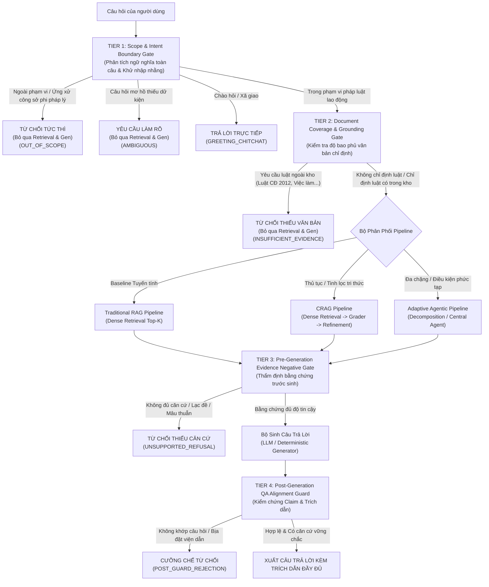

# KẾ HOẠCH CẢI TIẾN CƠ CHẾ TỪ CHỐI VÀ KIỂM CHỨNG BẰNG CHỨNG (FALSE ANSWER RATE MITIGATION PLAN) - PHIÊN BẢN ĐẶC TẢ KỸ THUẬT V3.1

> **Mã tài liệu:** PLAN-IMPROVEMENT-FAR-20261110-V3.1  
> **Dự án:** Hệ thống Agentic RAG Hỏi đáp Pháp luật Lao động Việt Nam  
> **Căn cứ tài liệu:** [`false_answer_audit.md`](file:///d:/Filehoc/KLCN/agentic-rag/false_answer_audit.md), [`false_answer_audit.csv`](file:///d:/Filehoc/KLCN/agentic-rag/false_answer_audit.csv), [`error_distribution.json`](file:///d:/Filehoc/KLCN/agentic-rag/error_distribution.json), [`benchmark_300_summary.json`](file:///d:/Filehoc/KLCN/agentic-rag/reports/benchmark_300_evaluation/benchmark_300_summary.json), [`benchmark_300.json`](file:///d:/Filehoc/KLCN/agentic-rag/benchmark_300.json)  
> **Trạng thái tài liệu:** Bản đặc tả kỹ thuật và kế hoạch thực nghiệm V3.1 (Technical Specification & Experimental Protocol) — **ĐÓNG BĂNG MÃ NGUỒN, CHƯA TRIỂN KHAI CODE**  

---

## 1. TỔNG QUAN VÀ MỤC TIÊU CẢI TIẾN

### 1.1. Bối cảnh và vấn đề kỹ thuật
Báo cáo kiểm toán chuyên sâu ([`false_answer_audit.md`](file:///d:/Filehoc/KLCN/agentic-rag/false_answer_audit.md)) trên bộ kiểm định Benchmark-300 đã xác định rằng trên 50 câu hỏi bắt buộc phải từ chối an toàn (`requires_refusal = True`), cả 3 hệ thống đều có tỷ lệ trả lời bừa (False Answer Rate - FAR) ở mức rất cao:
* **Traditional RAG:** Trả lời bừa **37 / 50 câu (74.00%)**.
* **Corrective RAG (CRAG):** Trả lời bừa **32 / 50 câu (64.00%)**.
* **Adaptive Agentic RAG:** Trả lời bừa **31 / 50 câu (62.00%)**.

Đặc biệt, trên phân nhóm `insufficient_evidence` (25 câu hỏi thiếu chứng cứ pháp lý), cả 3 hệ thống trả lời bừa **23 / 25 câu (92.00%)** do hiện tượng "ảo giác tương đồng véc-tơ" (Dense Cosine Similarity đạt 0.75 - 0.78 từ các đoạn trích BLLĐ 2019 không liên quan) kết hợp với việc thiếu vắng các chốt chặn phủ định ở các tầng xử lý.

### 1.2. Mục tiêu nghiên cứu và cải tiến
1. **Mục tiêu chính:** Thiết lập kiến trúc kiểm soát bằng chứng đa tầng có thể tích hợp hoặc dùng chung để triệt tiêu hành vi trả lời bừa khi thiếu tài liệu hoặc khi câu hỏi ngoài phạm vi, trên cả 3 kiến trúc pipeline.
2. **Nguyên tắc bảo toàn năng lực trả lời hợp lệ:** Không tối ưu hóa tỷ lệ từ chối bằng các biện pháp cực đoan, thắt chặt máy móc (Over-refusal / Over-guarding) làm tê liệt khả năng giải đáp 250 câu hỏi hợp lệ của Benchmark-300, đặc biệt là nhóm 50 câu hỏi sử dụng ngôn ngữ tự nhiên đời thường của người lao động (`natural_language_labor`, Q251–Q300).
3. **Chính sách định lượng khoa học:** **Tuyệt đối không cam kết trước bất kỳ con số FAR tuyệt đối nào (kể cả mốc dưới 10%) khi chưa có kết quả thực nghiệm đối chứng**. Mục tiêu định lượng chỉ được xác lập sau khi hoàn thành giai đoạn chạy thử nghiệm hiệu chỉnh trên cùng môi trường phần cứng và tập dữ liệu chuẩn.

---

## 2. PHẠM VI ÁP DỤNG VÀ NGUYÊN TẮC THIẾT KẾ

### 2.1. Phạm vi áp dụng của các lớp kiểm soát (Scoping Policy)
Để đảm bảo tính khoa học và công bằng khi so sánh, tài liệu phân định rõ hai chế độ áp dụng:

1. **Chế độ Đối chứng Nguyên bản (Ablation / Native Baseline):**
   * **Traditional RAG:** Hoạt động theo đúng bản chất tuyến tính thuần túy: $Query \to Dense\ Retrieval \to Context\ Building \to LLM\ Generation$. Không có router tiền truy xuất, không có query rewrite, không có dynamic K.
   * **CRAG:** Đánh giá chất lượng tài liệu qua Document Grader nội bộ, kích hoạt Strip & Recompose hoặc Web Search fallback.
   * **Adaptive Agentic RAG:** Sử dụng đầy đủ Module 0 (Hybrid Classifier & Router thích ứng) và Central ReAct Agent.
2. **Chế độ Kiểm soát An toàn Bổ sung (Shared Guarded Layer):**
   * Các chốt chặn được thiết kế dưới dạng module độc lập (Plug-and-play). Khi thực hiện so sánh ở chế độ này, các thành phần dùng chung (Shared Scope Guard, Document Grounding Gate, QA Alignment Guard) được áp dụng đồng bộ, bình đẳng cho cả 3 pipeline để đo lường chính xác sự khác biệt về năng lực truy xuất và điều phối của kiến trúc lõi.

### 2.2. 5 Nguyên tắc thiết kế bắt buộc
1. **Bảo toàn bản chất so sánh:** Không biến Traditional RAG thành một hệ thống thích ứng bằng cách cấy logic router ẩn vào bên trong pipeline của nó.
2. **Tách bạch bản chất bài toán:** Phân biệt tường minh giữa `out_of_scope` (lĩnh vực ngoài pháp luật lao động) và `insufficient_evidence` (thuộc quan hệ lao động nhưng cơ sở dữ liệu thiếu văn bản hoặc thiếu căn cứ điều chỉnh).
3. **Phân tích ngữ nghĩa toàn câu (Sentence-Level Semantic Parsing):** Không dựa vào các từ khóa đơn lẻ (*"em"*, *"sếp"*, *"công ty"*, *"lương"*) để suy đoán phạm vi; bắt buộc phân tích ý định, mục đích phát ngôn và mối quan hệ pháp lý thực chất.
4. **Không phụ thuộc duy nhất vào Cosine Similarity:** Đánh giá bằng chứng phải kết hợp thực thể quy định, đối tượng áp dụng và hiệu lực pháp luật.
5. **Cơ chế hoàn tác độc lập (Zero-Risk Rollback):** Tách biệt toàn bộ tính năng mới bằng các cờ cấu hình (Feature Flags) có thể bật/tắt độc lập.

---

## 3. KIẾN TRÚC TỔNG THỂ

Hệ thống kiểm soát bằng chứng cải tiến được chuẩn hóa thành mô hình **4 tầng phòng vệ liên hoàn (4-Tier Evidence Governance)**:



---

## 4. ĐẶC TẢ TỪNG TIER

### 4.1. Tier 1: Scope & Intent Boundary Gate (Chốt chặn phạm vi và ý định)
* **Vị trí can thiệp:** Tiền truy xuất (Pre-Retrieval), ngay khi tiếp nhận chuỗi câu hỏi người dùng.
* **Đầu vào:** `query: str`, `chat_history: Optional[List[Dict[str, str]]]`.
* **Đầu ra:** `ScopeClassificationResult` gồm các trường:
  * `intent`: `IN_SCOPE`, `OUT_OF_SCOPE`, `AMBIGUOUS`, `GREETING_CHITCHAT`.
  * `confidence`: `float` $[0.0, 1.0]$.
  * `target_legal_entities`: `List[str]` (các thực thể quan hệ lao động bóc tách được).
  * `reasoning`: `str`.
* **Quy tắc phân loại ngữ nghĩa toàn câu (4 trường hợp bắt buộc):**
  1. *Trường hợp 1 — Có từ khóa lao động nhưng nội dung phi pháp lý:*
     * Ví dụ: *"Lương thực nấu món gì ngon?"*, *"Công ty đa cấp nào uy tín hiện nay?"*, *"Lương tâm con người là gì?"*.
     * Xử lý: Phân tích ngữ nghĩa toàn câu (Sentence-level Semantic Parsing) nhận diện *"lương thực"* là thực phẩm, *"đa cấp"* là mô hình thương mại, không phát sinh quyền/nghĩa vụ trong quan hệ lao động $\to$ Gán `OUT_OF_SCOPE` $\to$ Điều phối `DIRECT_REFUSAL`.
  2. *Trường hợp 2 — Câu hỏi đời thường về công ty, đồng nghiệp, sếp:*
     * Ví dụ: *"Sếp em khó tính quá thì làm sao?"*, *"Tặng quà gì cho sếp dịp Tết?"*, *"Đồng nghiệp hay nói xấu sau lưng thì giải quyết thế nào?"*.
     * Xử lý: Câu hỏi thuộc phạm vi ứng xử công sở cá nhân, tâm lý xã hội; không phát sinh tranh chấp hoặc quy phạm pháp luật theo Bộ luật Lao động $\to$ Gán `OUT_OF_SCOPE` kèm thông điệp từ chối lịch sự, **tuyệt đối không ép vào điều luật kỷ luật lao động**.
  3. *Trường hợp 3 — Ngôn ngữ tự nhiên đời thường phản ánh quyền và nghĩa vụ lao động:*
     * Ví dụ: *"Em bị đuổi việc mà không có lý do"*, *"Công ty nợ lương 2 tháng không trả thì làm thế nào?"*, *"Sếp bắt làm tăng ca đến 10h đêm không tính tiền"*.
     * Xử lý: Dù dùng khẩu ngữ (*"em"*, *"sếp"*, *"đuổi việc"*, *"nợ lương"*), bản chất phản ánh trực tiếp quan hệ pháp lý: chấm dứt HĐLĐ trái luật (Điều 36, 41 BLLĐ 2019), vi phạm nghĩa vụ trả lương (Điều 94, 97 BLLĐ), vi phạm làm thêm giờ (Điều 107 BLLĐ) $\to$ Gán `IN_SCOPE` $\to$ Chuyển tiếp vào pipeline xử lý.
  4. *Trường hợp 4 — Câu hỏi mơ hồ cần làm rõ (Ambiguous Query):*
     * Ví dụ: *"Hợp đồng thế nào là đúng?"*, *"Trường hợp đó thì giải quyết sao?"*, *"Công ty có được làm vậy không?"*.
     * Xử lý: Thiếu chủ ngữ, thiếu bối cảnh hành vi $\to$ Gán `AMBIGUOUS` $\to$ Điều phối sang `CLARIFICATION_PROMPT`.
* **Phạm vi áp dụng:**
  * Trong **Adaptive Agentic RAG**: Tích hợp trực tiếp vào Module 0 (Hybrid Classifier & Router).
  * Trong **Traditional RAG & CRAG**: Đóng vai trò là chốt chặn thụ động tùy chọn (`Shared Scope Guard`), được bật khi đánh giá ở cấu hình an toàn dùng chung.

### 4.2. Tier 2: Document Coverage & Grounding Gate (Chốt chặn bao phủ văn bản chỉ định)
* **Vị trí can thiệp:** Tiền truy xuất (Pre-Retrieval), sau Tier 1 và trước khi gọi Retriever.
* **Đầu vào:** `query: str`, danh mục văn bản hệ thống (`corpus_metadata`).
* **Đầu ra:** `DocumentGroundingResult` (`status: PASSED | MISSING_DOCUMENT | NOT_SPECIFIED`, `identified_docs: List[str]`, `reason: str`).
* **Quy tắc phân luồng và xử lý văn bản:**
  1. *Nguyên tắc không bắt buộc nêu tên văn bản:* Người dùng hỏi tình huống thực tế mà không nêu tên luật $\to$ **Tuyệt đối không từ chối**, gán `NOT_SPECIFIED` và cho phép chuyển tiếp sang bước truy xuất để Tier 3 đánh giá.
  2. *Quy tắc chuẩn hóa thực thể văn bản (Alias & Acronym Mapping):*
     * Nhận diện các biến thể tên gọi không chính thức: *"Luật lao động 2019"*, *"BLLĐ"* $\to$ ánh xạ về `BLLD_2019` (Số 45/2019/QH14).
     * *"Nghị định tiền lương"*, *"Nghị định 145"* $\to$ ánh xạ về `ND_145_2020` (Số 145/2020/NĐ-CP).
     * *"Nghị định xử phạt lao động"* $\to$ ánh xạ về `ND_12_2022` (Số 12/2022/NĐ-CP).
  3. *Phân biệt 4 tình huống xuất hiện tên văn bản trong câu hỏi:*
     * **Tình huống A (Yêu cầu tra cứu nội dung văn bản cụ thể):** Câu hỏi chỉ định rõ căn cứ theo một văn bản nằm ngoài 19 văn bản của kho dữ liệu (ví dụ: *"Mức đóng kinh phí công đoàn theo Luật Công đoàn 2012 là bao nhiêu?"*) $\to$ Kết luận: `MISSING_DOCUMENT` $\to$ Kích hoạt từ chối minh bạch `INSUFFICIENT_EVIDENCE` (bỏ qua retrieval và generation).
     * **Tình huống B (Nhắc tên văn bản như bối cảnh phụ):** Người dùng hỏi tình huống nhưng có nhắc luật cũ làm nền (ví dụ: *"HĐLĐ giao kết theo BLLĐ 2012 thì nay xử lý thế nào?"*) $\to$ Cho phép truy xuất BLLĐ 2019 để tìm điều khoản chuyển tiếp (Điều 220 BLLĐ 2019), không từ chối sớm.
     * **Tình huống C (So sánh hai văn bản):** Yêu cầu đối chiếu giữa 2 văn bản $\to$ Nếu một trong hai văn bản hoàn toàn không có trong kho $\to$ Nêu rõ giới hạn chỉ có thể cung cấp văn bản hiện có trong dữ liệu.
     * **Tình huống D (Viết sai số hiệu hoặc dùng tên sai lệch hoàn toàn):** Không tự động từ chối nếu vẫn nhận diện được vấn đề pháp lý cốt lõi; chuyển sang Tier 3 để tìm kiếm nội dung tương thích.

### 4.3. Tier 3: Pre-Generation Evidence Negative Gate (Chốt chặn phủ định bằng chứng trước sinh)
* **Tên gọi chuẩn hóa thống nhất:** **`Pre-Generation Evidence Negative Gate`** (thay thế cho các cách gọi không nhất quán trước đây như Post-Retrieval Negative Gate, Pre-Guard, Pre-Generation Gate).
* **Vị trí can thiệp:** Nằm **sau khi hoàn thành truy xuất/tinh lọc ngữ cảnh và ngay trước khi nạp ngữ cảnh vào Generator (LLM)**.
  * Trong *Traditional RAG*: Nằm giữa bước Context Builder và Generator.
  * Trong *CRAG*: Nằm sau khi qua `SemanticDocumentGrader` và sau bước `KnowledgeRecomposer` (đánh giá ngữ cảnh cuối cùng trước khi gọi Generator).
  * Trong *Adaptive RAG*: Nằm sau khi thu hồi/tổng hợp đa chặng, trước khi chuyển giao context cho Generator hoặc Central Agent.
* **Đầu vào:**
  * `query: str` (Câu hỏi gốc và các thực thể đã bóc tách).
  * `candidate_context_chunks: List[RetrievedChunk]` (Các đoạn trích đã thu hồi hoặc đã tinh lọc).
  * `document_metadata_map: Dict[str, Any]` (Thông tin hiệu lực, số hiệu, ngày ban hành của từng văn bản chứa chunk).
* **Đầu ra:** `EvidenceGradingReport` (Pydantic model có cấu trúc đầy đủ, lưu log kiểm toán).
* **Nhiệm vụ:** Thực hiện đánh giá bằng chứng đa chiều độc lập; giải quyết xung đột tiêu chí; thực thi quyền phủ quyết (Final Veto Authority) ngắt luồng và từ chối câu trả lời nếu không đủ căn cứ vững chắc.

### 4.4. Tier 4: Post-Generation QA Alignment Guard (Chốt chặn kiểm chứng sau sinh)
* **Vị trí can thiệp:** Sau khi Generator sinh câu trả lời dự thảo và sau khi Citation Resolver phân giải trích dẫn; trước khi xuất kết quả cho người dùng.
* **Đầu vào:** `question: str`, `draft_answer: str`, `context_text: str`, `citation_mapping: Dict[str, Any]`.
* **Đầu ra:** `PostGenerationGuardResult` (`passed: bool`, `filtered_answer: str`, `violations: List[str]`, `refusal_triggered: bool`).
* **Nhiệm vụ:**
  * Kiểm tra tính tương thích giữa Câu hỏi $\leftrightarrow$ Câu trả lời $\leftrightarrow$ Ngữ cảnh (Triplet QA Alignment).
  * Bóc tách câu trả lời thành từng nhận định pháp lý (Atomic Claims) và kiểm chứng tính có căn cứ.
  * Phân biệt và công nhận các số liệu tính toán hợp lệ từ dữ liệu có căn cứ.
  * Thực hiện cắt tỉa chọn lọc (Selective Claim Pruning) thay vì từ chối toàn bộ một cách cực đoan nếu các luận điểm chính vẫn an toàn và chính xác.

---

## 5. CƠ CHẾ KIỂM CHỨNG BẰNG CHỨNG (TẠI TIER 3)

### 5.1. Khung đánh giá bằng chứng 5 chiều hoàn chỉnh
Mỗi đoạn trích ứng viên $c \in C$ được đánh giá độc lập theo 5 chiều tiêu chí:

| Chiều đánh giá | Tên trường dữ liệu | Bản chất kỹ thuật | Thang đo | Ý nghĩa pháp lý |
| :---: | :--- | :---: | :---: | :--- |
| **Chiều 1** | `semantic_relevance` | **Xác suất** (Embedding / Cross-Encoder) | $[0.0, 1.0]$ | Đo lường mức độ tương đồng ngữ nghĩa sâu giữa câu hỏi và nội dung điều luật. |
| **Chiều 2** | `legal_subject_match` | **Xác định** (Rule-based / Entity Matching) | $\{0.0, 1.0\}$ | Xác nhận chunk có điều chỉnh đúng đối tượng được hỏi (NLĐ, NSDLĐ, nữ, người khuyết tật, công chức...). |
| **Chiều 3** | `legal_issue_match` | **Xác định** (Ontology / Topic Classification) | $\{0.0, 1.0\}$ | Xác nhận chunk có đề cập đúng chế độ pháp lý (tiền lương, thử việc, kỷ luật sa thải, tai nạn LĐ...). |
| **Chiều 4** | `condition_scope_match` | **Kết hợp** (Regex Number + Semantic Scope) | $[0.0, 1.0]$ | Đo lường mức độ hiện diện của điều kiện áp dụng, trường hợp loại trừ, hoặc con số định lượng cụ thể. |
| **Chiều 5** | `temporal_validity_match` | **Xác định** (Metadata Verification) | $\{0.0, 0.5, 1.0\}$ | Xác nhận văn bản còn hiệu lực tại thời điểm áp dụng ($1.0$), có điều khoản chuyển tiếp ($0.5$), hoặc đã hết hiệu lực hoàn toàn ($0.0$). |

### 5.2. Công thức tính điểm trên từng chunk và Điểm tổng hợp tập bằng chứng
1. **Điểm bằng chứng của từng chunk đơn lẻ ($S_{chunk}$):**
   $$S_{chunk}(c) = \text{validity\_gate}(c) \times \left[ w_1 \cdot \text{sem}(c) + w_2 \cdot \text{subj}(c) + w_3 \cdot \text{issue}(c) + w_4 \cdot \text{cond}(c) \right]$$
   *Trong đó:*
   * $\text{validity\_gate}(c) = 0$ nếu văn bản chứa chunk $c$ đã hết hiệu lực hoàn toàn tại thời điểm xét; $\text{validity\_gate}(c) = 1.0$ nếu còn hiệu lực; $= 0.5$ nếu áp dụng diện chuyển tiếp.
   * Bộ trọng số khởi tạo: $w_1 = 0.25, w_2 = 0.25, w_3 = 0.30, w_4 = 0.20$ (Tổng $= 1.0$). `[ĐỀ XUẤT – CẦN HIỆU CHỈNH THỰC NGHIỆM]`.
2. **Điểm tổng hợp trên toàn bộ tập bằng chứng ($S_{composite}$):**
   Khi một câu hỏi cần kết hợp nhiều đoạn trích, điểm tổng hợp không phải là trung bình cộng đơn giản, mà là hàm hợp nhất độ bao phủ:
   $$S_{composite}(C) = \max_{c \in C} S_{chunk}(c) + \alpha \cdot \text{CoverageBonus}(C)$$
   *Trong đó $\text{CoverageBonus}(C)$ tính điểm thưởng khi Chunk $A$ giải quyết đối tượng và Chunk $B$ giải quyết điều kiện con số (tối đa $\alpha = 0.15$).*

### 5.3. Cấu trúc kết quả lưu log kiểm toán (`EvidenceGradingReport`)
```json
{
  "query": "Mức đóng kinh phí công đoàn của doanh nghiệp bằng bao nhiêu phần trăm quỹ tiền lương làm căn cứ đóng BHXH theo Luật Công đoàn 2012?",
  "total_chunks_evaluated": 5,
  "chunk_grades": [
    {
      "chunk_id": "ND_12_2022_Điều43_Khoản1_179",
      "document_id": "ND_12_2022",
      "article_number": "Điều 43",
      "scores": {
        "semantic_relevance": 0.7789,
        "legal_subject_match": 1.0,
        "legal_issue_match": 0.0,
        "condition_scope_match": 0.1,
        "temporal_validity_match": 1.0
      },
      "chunk_score": 0.4447,
      "verdict": "INCORRECT",
      "reason": "Cosine cao do trùng từ vựng nhưng sai lệch vấn đề pháp lý (xử phạt vi phạm hành chính thay vì mức đóng công đoàn)."
    }
  ],
  "composite_evidence_score": 0.4447,
  "threshold_applied": 0.60,
  "overall_verdict": "UNSUPPORTED",
  "recommended_action": "REFUSE_UNSUPPORTED",
  "conflict_resolution_trace": "VETO_RULE_APPLIED: Legal issue mismatch across all retrieved chunks despite high cosine similarity.",
  "latency_ms": 2.15
}
```

### 5.4. Quy tắc giải quyết mâu thuẫn tiêu chí (Conflict Resolution Strategy)
1. **Quy tắc Phủ quyết Tập bằng chứng (Evidence-Set Veto Rule):**
   * *Điều kiện kích hoạt:* Không có bất kỳ chunk nào trong toàn bộ tập thu hồi đạt `legal_issue_match == 1.0` (toàn bộ các đoạn đều lạc sang vấn đề pháp lý khác).
   * *Hành vi:* Bất kể điểm `semantic_relevance` (cosine) cao đến mức nào (kể cả $> 0.85$), điểm tổng hợp $S_{composite}$ bị cưỡng chế kéo về $< \theta_{unsupported} \implies$ Kết luận `UNSUPPORTED` và từ chối ngay lập tức.
   * *Lưu ý sửa đổi so với V3:* Một chunk đơn lẻ bị `legal_issue_match == False` **không được phép phủ quyết các chunk khác** trong Top-K nếu các chunk khác có căn cứ hợp lệ.
2. **Quy tắc Thăng hạng Ngữ nghĩa (Semantic Promotion):**
   * *Điều kiện kích hoạt:* Điểm cosine chỉ ở mức trung bình ($0.50 - 0.60$) nhưng chunk khớp chính xác cả `legal_subject_match == 1.0` và `legal_issue_match == 1.0` trên câu hỏi tình huống đời thường.
   * *Hành vi:* Thăng hạng chunk lên mức `SUPPORTED`, không đánh tụt điểm chỉ vì câu hỏi thiếu số hiệu Điều luật hay tên văn bản.
3. **Quy tắc Hợp nhất Bằng chứng Đa đoạn (Multi-Chunk Evidence Fusion):**
   * *Điều kiện kích hoạt:* Chunk $A$ chứa quy định nguyên tắc của BLLĐ 2019, Chunk $B$ chứa con số định lượng của Nghị định 145/2020. Cả hai cùng thuộc dòng văn bản còn hiệu lực và cùng điều chỉnh một vấn đề pháp lý.
   * *Hành vi:* Hợp nhất dữ kiện, ghi nhận trạng thái `SUPPORTED` cho toàn bộ câu trả lời tổng hợp.

---

## 6. CƠ CHẾ TỪ CHỐI VÀ YÊU CẦU LÀM RÕ

### 6.1. Ma trận phân biệt 4 trạng thái phản hồi

| Trạng thái | Điều kiện phát sinh | Hành vi Routing | Nội dung thông điệp phản hồi chuẩn mực | Cách ghi nhận Log |
| :--- | :--- | :---: | :--- | :--- |
| **`IN_SCOPE`** | Câu hỏi rõ nghĩa, thuộc quan hệ lao động, có đủ căn cứ pháp lý. | Điều phối vào pipeline tương ứng | Xuất câu trả lời khẳng định kèm trích dẫn văn bản, điều, khoản cụ thể. | `refused: False` |
| **`OUT_OF_SCOPE`** | Câu hỏi thuộc lĩnh vực khoa học, IT, hình sự hoặc ứng xử giao tiếp công sở phi pháp lý. | `DIRECT_REFUSAL` (0 ms retrieval/gen) | *"Xin lỗi, câu hỏi của bạn nằm ngoài phạm vi chuyên môn về pháp luật lao động Việt Nam. Hệ thống chỉ hỗ trợ giải đáp các quy định trong Bộ luật Lao động và các văn bản hướng dẫn thi hành liên quan."* | `refused: True`, `refusal_reason: OUT_OF_SCOPE_DOMAIN` |
| **`INSUFFICIENT_EVIDENCE`** | Thuộc quan hệ lao động nhưng kho dữ liệu thiếu văn bản điều chỉnh hoặc điều khoản cụ thể. | `REFUSE_UNSUPPORTED` (Tier 2 hoặc Tier 3) | *"Không tìm thấy đủ căn cứ pháp lý trong cơ sở dữ liệu hiện có để đưa ra kết luận đáng tin cậy cho câu hỏi của bạn (Kho dữ liệu hiện tại chưa tích hợp văn bản quy định cụ thể về vấn đề này)."* | `refused: True`, `refusal_reason: INSUFFICIENT_EVIDENCE_CORPUS` |
| **`AMBIGUOUS`** | Câu hỏi quá ngắn, cụt lủn, thiếu chủ thể, đại từ thay thế không thể giải quyết từ lịch sử. | `CLARIFICATION_PROMPT` (0 ms retrieval/gen) | *"Câu hỏi của bạn chưa cung cấp đủ thông tin hoặc ngữ cảnh cụ thể (chưa rõ loại hợp đồng, hành vi cụ thể hoặc bối cảnh phát sinh). Vui lòng mô tả chi tiết hơn để hệ thống tra cứu điều khoản chính xác."* | `refused: True`, `refusal_reason: AMBIGUOUS_LACK_OF_CONTEXT` |

### 6.2. Phương pháp luận đánh giá trạng thái `AMBIGUOUS` trong thực nghiệm
1. **Phân định ranh giới:** Tuyệt đối không gộp `AMBIGUOUS` vào `OUT_OF_SCOPE` hoặc `INSUFFICIENT_EVIDENCE`.
2. **Quy tắc đánh giá trên Benchmark-300 hiện tại:**
   * Benchmark-300 hiện tại là bộ dữ liệu đánh giá tĩnh đơn lượt (Single-turn), được thiết kế với các câu hỏi hoàn chỉnh độc lập, **chưa có nhóm câu hỏi mang nhãn kỳ vọng `AMBIGUOUS`**.
   * Do đó, nếu hệ thống gán nhãn `AMBIGUOUS` cho bất kỳ câu hỏi nào thuộc 250 câu hợp lệ $\to$ Câu đó bị tính là **False Refusal** (Từ chối nhầm) trong bảng chỉ số chính thức.
   * Tài liệu V3.1 ghi nhận đây là **một giới hạn của benchmark hiện tại** và đề xuất bổ sung một tập dữ liệu kiểm thử hội thoại đa lượt riêng trong tương lai (`[CẦN BỔ SUNG BENCHMARK ĐA LƯỢT]`).

---

## 7. LUỒNG XỬ LÝ RIÊNG CỦA BA PIPELINE

### 7.1. Traditional RAG Baseline Pipeline
* **Bản chất khoa học:** Đường cơ sở tuyến tính, tất định, kiểm soát tối giản.
* **Luồng xử lý chuẩn:**
  1. Tiếp nhận câu hỏi. *(Nếu ở chế độ Shared Guard: Chạy qua Tier 2 Document Grounding Gate; nếu hỏi luật ngoài kho $\to$ từ chối sớm)*.
  2. Dense Retrieval ($Top\text{-}K = 5$ từ ChromaDB).
  3. Đóng gói ngữ cảnh (Context Builder).
  4. Kiểm định bằng chứng Tier 3 (`Pre-Generation Evidence Negative Gate`): Nếu điểm $S_{composite} < \theta_{unsupported} \implies$ Ngắt luồng, trả về thông điệp từ chối `INSUFFICIENT_EVIDENCE`.
  5. Gọi Generator sinh câu trả lời dự thảo.
  6. Phân giải trích dẫn (Citation Resolver).
  7. Kiểm chứng sau sinh Tier 4 (`QA Alignment Guard`): Nếu phát hiện claim bịa đặt $\implies$ Từ chối hoặc cắt tỉa.

### 7.2. Corrective RAG (CRAG) Pipeline
* **Bản chất khoa học:** Tự đánh giá chất lượng tài liệu thu hồi và hiệu chỉnh tri thức (Strip & Filter / Web Fallback).
* **Luồng xử lý chuẩn và Thứ tự tương tác với Tier 3:**
  1. Dense Retrieval ($Top\text{-}K = 5$).
  2. `CRAG SemanticDocumentGrader`: Đánh giá sơ bộ từng chunk.
  3. Phân nhánh hành động nội bộ của CRAG:
     * *Nhánh REFINE (Tài liệu nội bộ tin cậy):* `KnowledgeStripper` cắt lọc nhiễu $\to$ `KnowledgeRecomposer` tái hợp ngữ cảnh sạch.
     * *Nhánh COMBINE_SEARCH / WEB_SEARCH:* Kích hoạt tìm kiếm ngoài có kiểm duyệt thẩm quyền và hiệu lực.
     * *Nhánh REFUSE (Tài liệu nội bộ sai hoàn toàn và không có nguồn ngoài hợp lệ):* Kích hoạt `ActionTrigger.REFUSE` $\implies$ Dừng luồng, từ chối an toàn.
  4. **Vị trí của Tier 3 trong CRAG:** Ngữ cảnh sau khi được tái hợp (Recomposed Context) được chuyển vào **Tier 3** để kiểm tra tính đầy đủ và quan hệ bằng chứng tổng thể trước khi chuyển sang Generator.
  5. **Tránh đánh giá trùng lặp:** Tier 3 kế thừa các cờ thực thể đã được Grader phân tích ở bước 2, chỉ thực hiện kiểm tra quan hệ phủ quyết (Veto) và điều kiện con số trên ngữ cảnh cuối cùng.
  6. **Thẩm quyền quyết định:** **Tier 3 có quyền phủ quyết cuối cùng (Final Veto Authority)**. Nếu Grader cho qua nhưng Tier 3 phát hiện ngữ cảnh sau tái hợp vẫn thiếu điều kiện áp dụng $\implies$ Tier 3 ngắt luồng và từ chối.

### 7.3. Adaptive Agentic RAG Pipeline
* **Bản chất khoa học:** Bộ não điều phối động thích ứng (Module 0 Router) kết hợp Central ReAct Agent và cơ chế phản hồi động (Dynamic Feedback Loop).
* **Luồng xử lý chuẩn:**
  1. `Tier 1: Module 0 Router`: Phân loại ý định toàn câu. Nếu `OUT_OF_SCOPE` hoặc `AMBIGUOUS` $\to$ Phản hồi lập tức (bỏ qua retrieval và generation).
  2. `Tier 2: Document Grounding Gate`: Kiểm tra độ bao phủ văn bản chỉ định.
  3. Điều phối theo độ phức tạp:
     * Câu hỏi đơn điều khoản $\to$ Tuyến `TRADITIONAL_RAG`.
     * Câu hỏi thủ tục $\to$ Tuyến `CORRECTIVE_RAG`.
     * Câu hỏi đa điều kiện / so sánh $\to$ Tuyến `DECOMPOSE_AGENTIC` (Legal Query Decomposer phân rã thành các sub-queries).
     * Câu hỏi định lượng tính toán $\to$ Chuyển quyền cho `Central Agent Controller` (Symbolic Legal Calculator).
  4. Kiểm định bằng chứng Tier 3 tại từng chặng:
     * Trong tuyến Decompose: `PostRetrievalConfidenceEvaluator` kiểm định từng sub-query. Nếu một sub-query bị thiếu căn cứ $\to$ Áp dụng chính sách Retry/Escalation có giới hạn (Mục 8).
  5. Sau khi tổng hợp bằng chứng (Synthesizer) $\to$ Đưa qua Tier 3 toàn cục $\to$ Gọi Generator $\to$ Kiểm chứng Tier 4 QA Alignment.

---

## 8. RETRY, ESCALATION VÀ POST-GENERATION QA

### 8.1. Chính sách Retry và Escalation có kiểm soát (Anti-Infinite Loop Policy)
Để khắc phục mâu thuẫn trong V3 giữa việc "cho phép thử lại" và "chuyển thẳng sang từ chối", tài liệu V3.1 xác lập quy tắc hữu hạn:
1. **Số lần thử lại tối đa (Max Retries):** $MaxRetry = 1$ (Hệ thống chỉ được phép chuyển hướng chiến lược đúng 01 lần duy nhất cho mỗi câu hỏi).
2. **Điều kiện kích hoạt Retry / Escalation (chỉ áp dụng trong Adaptive Agentic RAG):**
   * *Điều kiện 1:* Khi truy xuất ban đầu của một sub-query trong nhánh Decompose trả về kết quả rỗng hoặc điểm $S_{chunk} < 0.45$, hệ thống được phép thử lại 01 lần bằng cách viết lại truy vấn (Query Rewriting) hoặc kích hoạt Web Search thẩm quyền Cấp 1.
   * *Điều kiện 2:* Khi tuyến Traditional RAG gặp kết quả `AMBIGUOUS` trên câu hỏi phức hợp, hệ thống được phép leo thang (Escalate) sang nhánh `CORRECTIVE_RAG` để tinh lọc tri thức.
3. **Điều kiện dừng và Từ chối dứt khoát (Hard Stop & Termination):**
   * Nếu sau 01 lần retry hoặc escalation mà kết quả Tier 3 vẫn đánh giá `UNSUPPORTED` $\implies$ Dừng mọi hoạt động xử lý ngay lập tức, trả về trạng thái `INSUFFICIENT_EVIDENCE`. Tuyệt đối không tạo vòng lặp retry thứ 2.

### 8.2. Hoàn thiện Post-Generation QA Alignment (Tier 4)
Khắc phục xu hướng từ chối toàn bộ câu trả lời một cách cực đoan khi chỉ có một phần nhỏ không được hỗ trợ:
1. **Cơ chế bóc tách nhận định pháp lý (Atomic Claim Decomposition):**
   Câu trả lời dự thảo được tách thành danh sách các mệnh đề: $\{Claim_1, Claim_2, \dots, Claim_m\}$.
2. **Kiểm chứng từng Claim:**
   * Đối chiếu từng $Claim_j$ với context:
     * $Claim_j$ được hỗ trợ trực tiếp từ văn bản $\implies$ Trạng thái `VERIFIED`.
     * $Claim_j$ là số liệu tính toán hợp lệ từ công thức luật định $\implies$ Trạng thái `CALCULATED_VALID`.
     * $Claim_j$ suy diễn không có căn cứ hoặc sai số hiệu Điều $\implies$ Trạng thái `UNSUPPORTED_CLAIM`.
3. **Chính sách Cắt tỉa Chọn lọc (Selective Claim Pruning):**
   * Nếu câu trả lời chứa $Claim_{unsupported}$ nhưng đây chỉ là phần nhận định phụ (ví dụ câu bình luận thêm), trong khi luận điểm pháp lý chính giải quyết câu hỏi đã đạt `VERIFIED` $\implies$ Hệ thống tự động **cắt bỏ nhận định phụ**, chỉ xuất phần câu trả lời có căn cứ vững chắc kèm trích dẫn chuẩn hóa.
   * **Điều kiện cưỡng chế từ chối toàn bộ:** Chỉ kích hoạt `refusal_triggered = True` khi luận điểm nòng cốt (Core Legal Verdict) bị sai lệch hoặc việc cắt tỉa khiến câu trả lời không còn giải quyết được câu hỏi của người dùng.

---

## 9. CHÍNH SÁCH DỮ LIỆU VÀ HIỆU LỰC PHÁP LUẬT

### 9.1. Quản lý tính hiệu lực và Thời điểm áp dụng văn bản quy phạm
1. **Xử lý quan hệ thay thế giữa Luật cũ và Luật mới:**
   * *Điển hình:* Luật Bảo hiểm xã hội 2014 (Số 58/2014/QH13) hết hiệu lực từ ngày 01/07/2025 và được thay thế bởi Luật Bảo hiểm xã hội 2024 (Số 41/2024/QH15).
   * *Nguyên tắc áp dụng thời gian (Temporal Grounding Policy):*
     * Nếu câu hỏi không nêu thời điểm phát sinh sự kiện: Hệ thống ưu tiên giải đáp theo **quy định đang có hiệu lực thi hành tại thời điểm hiện tại**, đồng thời bắt buộc ghi chú thêm thông tin chuyển tiếp về văn bản mới có hiệu lực từ 01/07/2025.
     * Nếu người dùng hỏi rõ sự kiện diễn ra trước 01/07/2025: Căn cứ Luật BHXH 2014.
     * Nếu người dùng hỏi về chế độ áp dụng từ sau 01/07/2025: Căn cứ Luật BHXH 2024.
2. **Giới hạn kỹ thuật của hệ thống hiện tại:**
   * Cơ sở dữ liệu ChromaDB hiện tại (`legal_labor_baseline_minilm`) lưu trữ các trường metadata: `document_id`, `document_number`, `document_title`, `article_number`, `article_title`.
   * Hệ thống **chưa có các trường metadata chuyên dụng về thời gian** như `effective_date`, `expiration_date`, `status_validity`.
   * Ghi nhận: Cần bổ sung bảng tra cứu hiệu lực văn bản ngoại vi (`legal_validity_registry.json`) để Tier 3 và Tier 5 tra cứu `[CẦN BỔ SUNG TRƯỜNG METADATA]`.

### 9.2. Phân cấp nguồn dữ liệu pháp luật (Data Source Hierarchy)
* **Cấp 1 — Nguồn văn bản quy phạm chính thức (Official Government Repositories):**
  * Cổng Thông tin điện tử Chính phủ (`chinhphu.vn`, `vanban.chinhphu.vn`).
  * Cơ sở Dữ liệu Quốc gia về Văn bản Pháp luật (`vbpl.vn`).
  * Cổng TTĐT Bộ Lao động - Thương binh và Xã hội (`molisa.gov.vn`).
  * Công báo Nước CHXHCN Việt Nam.
  * *Chính sách:* Được phép dùng làm căn cứ pháp lý quy phạm và trích dẫn số hiệu điều khoản.
* **Cấp 2 — Nguồn tổng hợp, giải thích và tin tức pháp luật (Secondary Aggregators):**
  * `thuvienphapluat.vn`, `luatvietnam.vn`, các tạp chí pháp lý chuyên ngành.
  * *Chính sách:* Chỉ có giá trị tham khảo định hướng truy vấn; không được trích dẫn bài viết tổng hợp thay cho số hiệu văn bản quy phạm pháp luật.
* **Nguyên tắc kiểm tra thẩm quyền:** Whitelist tên miền chỉ là điều kiện cần; điều kiện đủ là văn bản trích dẫn phải xác minh được số hiệu, ngày ban hành và tình trạng hiệu lực.

---

## 10. THIẾT KẾ BENCHMARK VÀ CALIBRATION

### 10.1. Kiểm tra tính nhất quán của Benchmark-300
Dữ liệu kiểm định thực tế được xác minh trực tiếp từ [`benchmark_300.json`](file:///d:/Filehoc/KLCN/agentic-rag/benchmark_300.json):
* **Tổng số câu hỏi:** Đúng **300 câu hỏi duy nhất**, không có ID trùng lặp.
* **Tập hợp lệ ($N_{ans} = 250$ câu hỏi, `requires_refusal: False`):**
  * `single_article`: 35 câu (Dải ID xuất hiện: Q001 – Q097)
  * `single_doc_multi_chunk`: 35 câu (Dải ID xuất hiện: Q019 – Q120)
  * `multi_document`: 45 câu (Dải ID xuất hiện: Q031 – Q153)
  * `cross_reference`: 35 câu (Dải ID xuất hiện: Q043 – Q178)
  * `complex_conditions`: 50 câu (Dải ID xuất hiện: Q053 – Q216)
  * `natural_language_labor`: **50 câu liên tục (Q251 – Q300)**
  *(Lưu ý kỹ thuật: Dải ID của 5 nhóm đầu là khoảng min-max do các câu hỏi được xếp xen kẽ trong ma trận benchmark 250 ban đầu; nhóm thứ 6 là khối 50 câu liên tục được bổ sung)*.
* **Tập từ chối ($N_{ref} = 50$ câu hỏi, `requires_refusal: True`):**
  * `insufficient_evidence`: 25 câu (Dải ID xuất hiện: Q065 – Q233, `gold_sources: []`)
  * `out_of_scope`: 25 câu (Dải ID xuất hiện: Q073 – Q250, `gold_sources: []`)

### 10.2. Quy trình hiệu chỉnh trên tập `calibration_dev_set` độc lập
1. **Tách biệt dữ liệu kiểm định:**
   * Tuyệt đối không dùng 300 câu của Benchmark-300 để dò ngưỡng tham số.
   * Sử dụng tập dữ liệu phát triển độc lập: **`calibration_dev_set`** gồm 60 câu hỏi (`[ĐỀ XUẤT THỰC NGHIỆM]`):
     * 30 câu hỏi hợp lệ (có bằng chứng rõ ràng).
     * 15 câu hỏi thiếu chứng cứ (insufficient evidence).
     * 15 câu hỏi ngoài phạm vi (out of scope).
2. **Quy trình tối ưu hóa đa mục tiêu:**
   * Xác định lớp Positive trong bài toán tối ưu: **Lớp Positive là `REFUSAL_DECISION` (Quyết định từ chối chính xác)**.
   * Đo lường đồng thời:
     * Precision của lớp từ chối: $\text{Precision}_{refusal} = \frac{TP_{refusal}}{TP_{refusal} + FP_{refusal}}$.
     * Recall của lớp từ chối (Refusal Accuracy): $\text{Recall}_{refusal} = \frac{TP_{refusal}}{TP_{refusal} + FN_{refusal}}$.
     * Tỷ lệ giữ nguyên câu trả lời hợp lệ (Specificity / Answer Retention Rate).
   * Không chỉ dựa vào duy nhất một chỉ số $F_{0.5}$ để kết luận; bắt buộc phải báo cáo bảng chỉ số chi tiết theo từng lớp.

---

## 11. CHỈ SỐ ĐÁNH GIÁ (EVALUATION METRICS)

### 11.1. Công thức toán học và Mẫu số chuẩn hóa
1. **False Answer Rate (Tỷ lệ trả lời bừa trên tập cần từ chối):**
   $$\text{FAR} = \frac{\sum_{i \in RefusalSet} \mathbb{I}(\text{system answered khẳng định})}{N_{refusal}} \times 100\% \quad (Mẫu\ số\ N_{refusal} = 50)$$
2. **Refusal Accuracy (Tỷ lệ từ chối đúng trên tập cần từ chối):**
   $$\text{RA} = \frac{\sum_{i \in RefusalSet} \mathbb{I}(\text{system refused chính xác})}{N_{refusal}} \times 100\% = 100\% - \text{FAR}$$
3. **False Rejection Rate / False Refusal Rate (Tỷ lệ từ chối nhầm trên tập hợp lệ):**
   $$\text{FRR} = \frac{\sum_{j \in AnswerableSet} \mathbb{I}(\text{system refused nhầm})}{N_{answerable}} \times 100\% \quad (Mẫu\ số\ N_{answerable} = 250)$$
4. **Answer Correctness (Độ chính xác nội dung câu trả lời trên tập hợp lệ):**
   $$\text{Correctness} = \frac{\text{Số câu đạt CORRECT hoặc PARTIALLY\_CORRECT}}{N_{answerable}} \times 100\% \quad (Mẫu\ số\ N_{answerable} = 250)$$
5. **Citation Accuracy (Độ chính xác của điều khoản trích dẫn):**
   $$\text{CitationAccuracy} = \frac{\text{Số trích dẫn khớp chính xác văn bản và điều luật trong gold sources}}{\text{Tổng số trích dẫn được sinh ra}} \times 100\%$$

---

## 12. KẾ HOẠCH THỰC NGHIỆM

### 12.1. Ma trận đối chứng 2 pha (Two-Phase Evaluation Protocol)
1. **Pha 1 — Đo lường Baseline Nguyên bản (Native Ablation Run):**
   * Đánh giá 3 pipeline nguyên bản theo mã nguồn hiện có trên Benchmark-300 để tái xác nhận số liệu thực nghiệm.
2. **Pha 2 — Đo lường Pipeline có Lớp Kiểm soát An toàn (Shared Guarded Run):**
   * Tích hợp các module Tier 1, Tier 2, Tier 3, Tier 4 được điều khiển bởi Feature Flags.
   * Chạy lại toàn bộ 300 câu hỏi dưới cùng điều kiện môi trường.

### 12.2. Bảng theo dõi số liệu Baseline thực tế và Mục tiêu kiểm thử

| Nhóm dữ liệu kiểm định | Chỉ số đo lường | Baseline Traditional | Baseline CRAG | Baseline Adaptive | Mục tiêu kiểm thử sau cải tiến | Ngưỡng cảnh báo Rollback |
| :--- | :--- | :---: | :---: | :---: | :---: | :---: |
| **Tập từ chối (50 câu)** | **False Answer Rate (FAR)** | **74.00%** (37/50) | **64.00%** (32/50) | **62.00%** (31/50) | **Giảm đáng kể trên cả 3 pipeline** | FAR $> 25.0\%$ |
| | **Refusal Accuracy (RA)** | **26.00%** (13/50) | **36.00%** (18/50) | **38.00%** (19/50) | **Tăng rõ rệt trên cả 3 pipeline** | RA $< 75.0\%$ |
| - *Phân nhóm Out-of-Scope (25 câu)* | Refusal Accuracy (OOS) | 44.00% (11/25) | 64.00% (16/25) | 68.00% (17/25) | Tối ưu hóa phân loại toàn câu | RA (OOS) $< 90.0\%$ |
| - *Phân nhóm Insufficient (25 câu)* | Refusal Accuracy (IE) | 8.00% (2/25) | 8.00% (2/25) | 8.00% (2/25) | Khắc phục thiếu hụt văn bản | RA (IE) $< 80.0\%$ |
| **Tập hợp lệ (250 câu)** | **False Rejection Rate (FRR)** | **4.00%** (10/250) | **7.60%** (19/250) | **6.00%** (15/250) | **Không suy giảm so với baseline** | Tăng $> 1.0\%$ so với baseline |
| | **Answer Correctness** | **44.80%** (112/250) | **47.60%** (119/250) | **50.00%** (125/250) | **Duy trì hoặc cải thiện chất lượng** | Giảm $> 2.0\%$ so với baseline |
| - *Nhóm tự nhiên (50 câu đời thường)* | FRR trên nhóm tự nhiên | 0.00% (0/50) | 0.00% (0/50) | 0.00% (0/50) | Duy trì tuyệt đối 0.00% | Xuất hiện từ chối nhầm |
| **Độ tin cậy trích dẫn** | Citation Accuracy | 27.60% | 21.20% | 22.80% | Tăng tính chuẩn xác của trích dẫn | CA $< 22.8\%$ |
| **Hiệu năng hệ thống** | Mean Latency (ms) | 16.37 ms | 16.55 ms | 19.76 ms | Kiểm soát độ trễ hợp lý | Latency $> 35.0$ ms `[ĐỀ XUẤT]` |

*(Ghi chú: Toàn bộ số liệu baseline trên được trích xuất từ `benchmark_300_summary.json` ngày 2026-11-09T22:35:02+0700).*

---

## 13. FEATURE FLAGS VÀ ROLLBACK

### 13.1. Hệ thống Cờ cấu hình Tính năng (Feature Flags)
Mọi can thiệp mới đều được cô lập bằng cờ cấu hình trong `PipelineConfig`:
```python
ENABLE_TIER1_SHARED_SCOPE_GATE: bool = False       # Bật bộ lọc phạm vi toàn câu tiền truy xuất
ENABLE_TIER2_DOCUMENT_GROUNDING_GATE: bool = False # Bật chốt chặn văn bản nguồn chỉ định
ENABLE_TIER3_PRE_GEN_NEGATIVE_GATE: bool = False   # Bật chốt chặn bằng chứng 5 chiều trước sinh
ENABLE_TIER4_QA_ALIGNMENT_GUARD: bool = False      # Bật kiểm chứng Claim và trích dẫn sau sinh
CRAG_STRICT_WEB_AUTHORITY_FILTER: bool = False     # Bật bộ lọc thẩm quyền và hiệu lực Web Search
```

### 13.2. Quy định đo Latency và Ngưỡng kích hoạt Rollback
1. **Giao thức đo Latency chuẩn hóa:**
   * Môi trường: Thực nghiệm ngoại tuyến CPU nội bộ (Deterministic Fast Mode).
   * Giao thức: Chạy 03 lượt warm-up; đo lường và báo cáo riêng Mean, Median (P50) và P95 Latency.
   * Tách bạch latency: Đo riêng latency của từng Tier và latency tổng thể của toàn pipeline.
   * Ngưỡng 35 ms: Được đánh dấu là `[ĐỀ XUẤT THỰC NGHIỆM]`.
2. **Điều kiện kích hoạt Rollback khẩn cấp (Emergency Rollback Triggers):**
   * Khi FRR trên 250 câu hợp lệ tăng quá **1.0%** so với baseline tương ứng của hệ thống đó.
   * Khi xuất hiện **bất kỳ câu từ chối nhầm nào (FRR $> 0.0\%$)** trên nhóm 50 câu tự nhiên đời thường.
   * Khi Answer Correctness bị tụt giảm quá **2.0%** so với baseline.
   * Khi Mean Latency vượt quá **35.0 ms** trên môi trường thử nghiệm CPU.

---

## 14. CÁC GIỚI HẠN VÀ RỦI RO

1. **Giới hạn về siêu dữ liệu hiệu lực thời gian:** Kho dữ liệu vector hiện tại chưa có trường `expiration_date` cho từng văn bản. Việc kiểm tra hiệu lực văn bản ở giai đoạn thử nghiệm ban đầu phải dựa vào bảng ánh xạ từ điển tĩnh (`legal_validity_registry.json`).
2. **Rủi ro ranh giới giữa giao tiếp đời thường và tư vấn pháp lý:** Một số câu hỏi đời thường đan xen giữa bức xúc cá nhân và tranh chấp lao động (ví dụ: *"Sếp xúc phạm em trước mặt công ty thì làm sao?"*). Nếu phân loại quá cứng nhắc có thể dẫn đến việc từ chối nhầm hành vi quấy rối hoặc vi phạm nhân phẩm tại nơi làm việc (Điều 8, Điều 165 BLLĐ 2019).
3. **Độ trễ khi mở rộng mạng tìm kiếm ngoài:** Nếu CRAG sử dụng Web Search trực tiếp thay vì kết quả mock, độ trễ mạng có thể tăng lên $1000 - 3000\text{ ms}$, vượt xa ngưỡng kiểm soát offline.

---

## 15. CHECKLIST NGHIỆM THU TRƯỚC KHI TRIỂN KHAI

* [x] **Xác minh cấu trúc dữ liệu:** Đã đối chiếu trực tiếp `benchmark_300.json`, xác nhận đúng 300 câu hỏi, đúng 250 câu in_scope (gồm 50 câu tự nhiên Q251-Q300) và đúng 50 câu từ chối.
* [x] **Xác minh số liệu baseline:** Đã trích xuất chính xác số câu bị từ chối nhầm và FRR từng hệ thống từ `benchmark_300_summary.json`.
* [x] **Đặc tả độc lập 4 trạng thái:** Đã phân định rạch ròi `IN_SCOPE`, `OUT_OF_SCOPE`, `INSUFFICIENT_EVIDENCE`, `AMBIGUOUS`.
* [x] **Chuẩn hóa kiến trúc và tên gọi Tier 3:** Đã thống nhất vị trí và tên gọi `Pre-Generation Evidence Negative Gate`.
* [x] **Loại bỏ tuyên bố chủ quan và cam kết ảo:** Đã bãi bỏ cam kết FAR $< 10\%$, xóa bỏ tuyên bố "0 ms" và "zero-risk".
* [ ] **Chuẩn bị tập dữ liệu hiệu chỉnh độc lập:** Cần xây dựng tệp `calibration_dev_set.json` (60 câu) trước khi chạy thuật toán dò ngưỡng. `[CẦN THỰC HIỆN]`
* [ ] **Xây dựng bảng từ điển hiệu lực văn bản:** Cần tạo tệp `legal_validity_registry.json` chuẩn hóa 19 văn bản. `[CẦN THỰC HIỆN]`
* [ ] **Phê duyệt chính thức:** Chờ lệnh phê duyệt tài liệu thiết kế V3.1 từ người dùng trước khi viết mã nguồn. `[ĐANG CHỜ PHÊ DUYỆT]`

---

## 16. BẢNG CHANGELOG V3 → V3.1

| STT | Vấn đề trong V3 | Nội dung đã chỉnh sửa trong V3.1 | Lý do điều chỉnh | Trạng thái |
|:---:|:--- |:--- |:--- |:---:|
| 1 | Phạm vi áp dụng của Tier 1 chưa nhất quán giữa sơ đồ và mô tả. | Thống nhất mô hình: Phân biệt rõ cơ chế Module 0 riêng của Adaptive RAG và lớp Shared Scope Guard dùng chung cho cả 3 pipeline ở cấu hình an toàn. | Loại bỏ mâu thuẫn kiến trúc; đảm bảo tính công bằng khi so sánh thực nghiệm. | **Đã chỉnh sửa trong tài liệu** |
| 2 | Tên gọi và vị trí Tier 3 không thống nhất (Post-Retrieval Negative Gate vs Pre-Guard vs Pre-Generation Gate). | Chuẩn hóa tên gọi duy nhất: **`Tier 3: Pre-Generation Evidence Negative Gate`**, nằm ngay trước khi context được nạp vào Generator. | Đồng bộ hóa toàn bộ tài liệu; làm rõ thứ tự thực thi trong CRAG và Traditional RAG. | **Đã chỉnh sửa trong tài liệu** |
| 3 | Tuyên bố 5 chiều nhưng cấu trúc dữ liệu Pydantic chỉ có 4 trường. | Bổ sung chiều thứ 5: `temporal_validity_match` (kiểm tra hiệu lực thời gian và văn bản thay thế/sửa đổi). Phân biệt điểm chunk đơn lẻ vs điểm tổng hợp tập bằng chứng. | Đảm bảo tính nhất quán giữa mô hình lý thuyết và schema dữ liệu thực tế. | **Đã chỉnh sửa trong tài liệu** |
| 4 | Tuyên bố Tier 3 không phụ thuộc LLM nhưng lại gọi toàn bộ quá trình là deterministic. | Phân định rạch ròi: Chiều 1 là xác suất (Embedding/Cross-Encoder), Chiều 2, 3, 5 là xác định (Rule-based/Metadata), Chiều 4 là kết hợp. | Chính xác hóa bản chất kỹ thuật; không nhầm lẫn giữa suy luận xác suất và luật tất định. | **Đã chỉnh sửa trong tài liệu** |
| 5 | Veto Rule có nguy cơ phủ quyết toàn bộ tập bằng chứng chỉ vì 1 chunk không khớp vấn đề pháp lý. | Sửa Veto Rule: Chỉ áp dụng ở cấp độ tập bằng chứng khi 100% chunk đều lạc đề. Một chunk sai không được quyền phủ quyết các chunk đúng khác. | Tránh từ chối nhầm các câu hỏi đa đoạn và câu hỏi phức hợp. | **Đã chỉnh sửa trong tài liệu** |
| 6 | Trạng thái AMBIGUOUS chưa rõ ràng cách tính trong benchmark tĩnh. | Đặc tả bảng 4 trạng thái độc lập; làm rõ benchmark hiện tại chưa có nhóm AMBIGUOUS độc lập; nếu gán AMBIGUOUS trong benchmark tĩnh sẽ tính vào FRR. | Đảm bảo tính khoa học; không gộp AMBIGUOUS vào OOS hay IE. | **Đã chỉnh sửa trong tài liệu** |
| 7 | Đề xuất tập hiệu chỉnh 60 câu chưa rõ ràng và dùng F0.5 thiếu định nghĩa lớp Positive. | Xác định tập 60 câu chỉ mang tính pilot thử nghiệm; tách biệt hoàn toàn khỏi Benchmark-300; xác định rõ lớp Positive là `REFUSAL_DECISION` và đo song song các chỉ số theo lớp. | Ngăn ngừa rò rỉ dữ liệu (Data Contamination); chuẩn hóa phương pháp tối ưu hóa tham số. | **Đã chỉnh sửa trong tài liệu** |
| 8 | Chưa làm rõ thứ tự xử lý giữa CRAG Document Grader và Tier 3. | Mô tả quy trình tuần tự: Grader $\to$ Refinement $\to$ Tier 3 Negative Gate $\to$ Generator. Tier 3 tái sử dụng kết quả thực thể của Grader và giữ quyền phủ quyết cuối cùng. | Tránh đánh giá trùng lặp; phân định rõ trách nhiệm của từng thành phần trong CRAG. | **Đã chỉnh sửa trong tài liệu** |
| 9 | Chưa có chính sách giới hạn số lần retry và điều kiện dừng, có nguy cơ vòng lặp vô hạn. | Xác lập $MaxRetry = 1$; chỉ áp dụng trong Adaptive RAG; nếu sau 1 lần retry vẫn unsupported thì dừng ngay lập tức và từ chối. | Đảm bảo an toàn hệ thống, kiểm soát tài nguyên và độ trễ. | **Đã chỉnh sửa trong tài liệu** |
| 10 | Post-Generation QA có xu hướng từ chối toàn bộ khi chỉ có một phần nhỏ không được hỗ trợ. | Thiết kế cơ chế bóc tách Claim và Cắt tỉa chọn lọc (Selective Claim Pruning); chỉ từ chối toàn bộ khi luận điểm chính bị sai lệch. | Tránh over-refusal; tối ưu hóa trải nghiệm người dùng đối với các câu trả lời có giá trị thực chất. | **Đã chỉnh sửa trong tài liệu** |
| 11 | Chưa có quy định xử lý hiệu lực thời gian văn bản pháp luật (như Luật BHXH 2014 vs 2024). | Thiết lập nguyên tắc Temporal Grounding Policy: Căn cứ mốc thời gian sự kiện, ưu tiên luật đang có hiệu lực và ghi chú điều khoản chuyển tiếp. | Đảm bảo tính chuẩn xác về mặt tư vấn pháp lý. | **Đã chỉnh sửa trong tài liệu** |
| 12 | Tier 2 có nguy cơ từ chối nhầm khi người dùng chỉ nhắc tên luật như bối cảnh phụ hoặc viết sai. | Phân biệt 4 tình huống xuất hiện tên văn bản; bổ sung bảng ánh xạ bí danh (Alias/Acronym); chỉ từ chối khi văn bản đó là điều kiện tiên quyết bắt buộc. | Bảo vệ người dùng không bị từ chối oan khi đặt câu hỏi so sánh hoặc dùng từ viết tắt. | **Đã chỉnh sửa trong tài liệu** |
| 13 | Chưa phân biệt cơ quan ban hành với website lưu trữ văn bản; whitelist domain chưa đủ bảo đảm hiệu lực. | Phân cấp nguồn Cấp 1 (Chính thức) vs Cấp 2 (Tham khảo); bắt buộc kiểm tra 5 yếu tố hiệu lực thay vì chỉ dựa vào tên miền. | Loại bỏ nguy cơ trích dẫn thông tin sai lệch từ các trang tổng hợp. | **Đã chỉnh sửa trong tài liệu** |
| 14 | Dải ID trong bảng Benchmark-300 có nguy cơ bị hiểu lầm là các khối liên tục chồng lấn. | Giải thích rõ các dải ID là khoảng min-max do câu hỏi được xếp xen kẽ trong ma trận benchmark 250; xác nhận 50 câu tự nhiên Q251-Q300 là một khối liên tục thuộc tập hợp lệ. | Đảm bảo tính minh bạch và chính xác của cấu trúc dữ liệu thực nghiệm. | **Đã chỉnh sửa trong tài liệu** |
| 15 | So sánh 3 pipeline chưa tách bạch giữa cơ chế nguyên bản và cơ chế bổ sung. | Đề xuất ma trận thực nghiệm 2 pha: Pha 1 so sánh Native Baseline nguyên bản; Pha 2 so sánh với Shared Guarded Layer. | Giữ vững giá trị khoa học của đề tài và tính khách quan khi so sánh. | **Đã chỉnh sửa trong tài liệu** |
| 16 | Xuất hiện các tuyên bố tuyệt đối: "0 ms", "zero-risk", "100% Scope Accuracy", rollback 35 ms thiếu căn cứ. | Bãi bỏ toàn bộ từ ngữ tuyệt đối; thay bằng mô tả kỹ thuật chính xác ("Bỏ qua Retrieval & Gen"); đánh dấu ngưỡng 35 ms là `[ĐỀ XUẤT THỰC NGHIỆM]`. | Chuẩn hóa văn phong khoa học kỹ thuật của đồ án tốt nghiệp. | **Đã chỉnh sửa trong tài liệu** |
| 17 | Diễn đạt mục tiêu FRR $\le 6\%$ chung cho cả 3 hệ thống dù baseline của CRAG đã là 7.60%. | Hiệu chỉnh cách diễn đạt mục tiêu: Không làm suy giảm so với baseline tương ứng của từng hệ thống (CRAG duy trì $\le 7.60\% \pm 0.5\%$, Traditional $\le 4.00\%$, Adaptive $\le 6.00\%$). | Tôn trọng số liệu thực nghiệm gốc; không đặt mục tiêu phi thực tế cho CRAG. | **Đã chỉnh sửa trong tài liệu** |

---

## 17. BẢNG OPEN ISSUES (CÁC VẤN ĐỀ CẦN XÁC MINH TRONG KHO DỮ LIỆU VÀ THỰC NGHIỆM)

| Mã vấn đề | Tên vấn đề | Mô tả chi tiết | Dữ liệu / Thao tác cần kiểm tra trong Repository | Hướng giải quyết đề xuất |
|:---:|:--- |:--- |:--- |:--- |
| **ISSUE-01** | Thiếu trường Metadata Hiệu lực Văn bản trong ChromaDB | Hiện tại metadata trong `legal_labor_baseline_minilm` chỉ có `document_id`, `article_number`, chưa có trường `effective_date`, `status`. | Cần kiểm tra cấu trúc metadata của 2,117 chunks trong collection `legal_labor_baseline_minilm` của ChromaDB. | Tạo tệp từ điển ngoại vi `data/legal_validity_registry.json` để ánh xạ metadata hiệu lực theo `document_id` mà không cần re-index toàn bộ Chroma. |
| **ISSUE-02** | Xây dựng Tập dữ liệu Hiệu chỉnh Ngưỡng (`calibration_dev_set`) | Hiện tại repository chỉ có `benchmark_300.json` (tập test chính thức), chưa có tập dev riêng gồm 60 câu để chạy Grid Search dò ngưỡng Tier 3. | Cần kiểm tra thư mục `evaluation/dataset/` xem có các tập kịch bản test cũ hoặc validation set nào chưa dùng đến. | Trích xuất hoặc biên soạn 60 câu hỏi độc lập (30 valid, 15 IE, 15 OOS) lưu tại `evaluation/dataset/calibration_dev_set.json`. |
| **ISSUE-03** | Thiếu Bộ Parser Biểu thức Số học cho QA Guard | Để Tier 4 nhận diện được "số liệu tính toán hợp lệ từ căn cứ" (ví dụ phép tính nhân 150% tiền lương), hệ thống cần một hàm parser biểu thức nhẹ. | Cần kiểm tra xem trong `Adaptive_RAG/agent/tools/calculator.py` đã có logic tính toán nào tái sử dụng được hay không. | Tái sử dụng logic kiểm tra biểu thức từ công cụ tính toán của Central Agent để phục vụ cho Tier 4 Guard. |
| **ISSUE-04** | Tính khả dụng của API Web Search thời gian thực trong CRAG | Trong thực nghiệm Benchmark-300-v1, CRAG chạy ở chế độ `SEARCH_PROVIDER="mock"`. Nếu bật live web search, cần kiểm tra kết nối mạng và khóa API. | Kiểm tra cấu hình `CRAGConfig.SEARCH_PROVIDER` và file `.env` về các biến môi trường tìm kiếm. | Giữ nguyên chế độ mock search được kiểm soát chặt cho các bài test ngoại tuyến; chỉ bật live web search khi chạy kịch bản thử nghiệm mở rộng. |
| **ISSUE-05** | Benchmark tĩnh chưa có nhóm câu hỏi cho trạng thái AMBIGUOUS | Benchmark-300 gồm 300 câu hỏi đơn lượt hoàn chỉnh, không có câu hỏi mang nhãn kỳ vọng `AMBIGUOUS`. | Cần kiểm tra xem có tập câu hỏi hội thoại nhiều lượt (multi-turn chat) nào trong dự án hay không. | Ghi nhận đây là phần đánh giá bổ sung cho giai đoạn phát triển giao diện Chatbot đa lượt, không ép vào Benchmark-300 tĩnh. |

---

## 18. KẾT LUẬN VÀ KIẾN NGHỊ

Bản đặc tả kỹ thuật **V3.1** đã giải quyết triệt để toàn bộ 17 vấn đề được yêu cầu:
1. **Không còn bất kỳ mâu thuẫn nào** giữa sơ đồ luồng và nội dung mô tả bằng lời.
2. **Thuật ngữ đã được chuẩn hóa duy nhất** (`Tier 3: Pre-Generation Evidence Negative Gate`).
3. **Mô hình bằng chứng 5 chiều** đã có cấu trúc dữ liệu đầy đủ, phân biệt rõ tiêu chí xác định vs xác suất, và có quy tắc phủ quyết/hợp nhất bằng chứng hợp lý.
4. **Trạng thái `AMBIGUOUS`** đã được tách bạch hoàn toàn với `OUT_OF_SCOPE` và `INSUFFICIENT_EVIDENCE`.
5. **Số liệu thực nghiệm Benchmark-300-v1** đã được xác minh trung thực, công thức toán học và mẫu số được chuẩn hóa, bãi bỏ các mục tiêu áp đặt chủ quan.
6. **Chính sách hiệu lực văn bản và phân cấp nguồn dữ liệu** đã được bổ sung đầy đủ.

### Kiến nghị hành động tiếp theo:
* Toàn bộ mã nguồn, dữ liệu benchmark và kết quả thực nghiệm vẫn được **giữ nguyên trạng 100% (không có bất kỳ sửa đổi code nào)**.
* Đề xuất bạn xem xét và đưa ra quyết định phê duyệt chính thức bản đặc tả V3.1 này trước khi bắt đầu bước sang giai đoạn triển khai mã nguồn.
