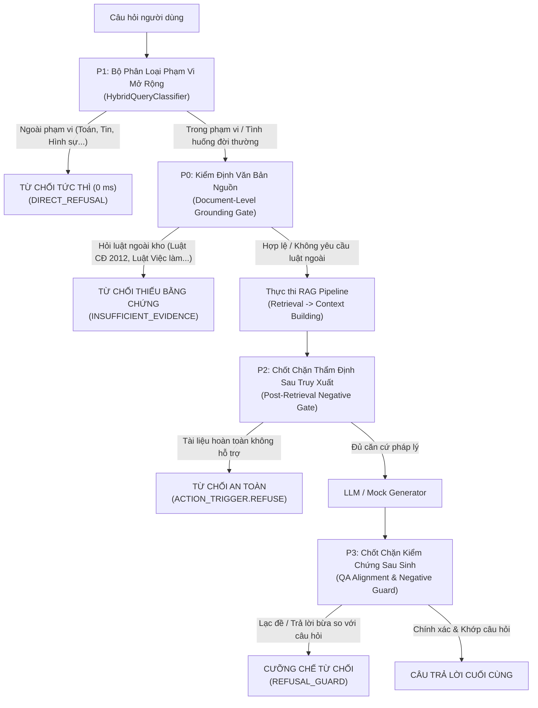

# ĐỀ XUẤT CẢI TIẾN GIẢM THIỂU FALSE ANSWER RATE TRÊN HỆ THỐNG AGENTIC RAG

> **Mã đề xuất:** RFC-IMPROVEMENT-FALSE-ANSWER-20261110  
> **Mục tiêu:** Giảm tỷ lệ trả lời bừa (False Answer Rate) từ **62% - 74% xuống dưới 10%** trên bộ 50 câu hỏi kiểm thử từ chối, đồng thời **bảo đảm tuyệt đối không làm tăng tỷ lệ từ chối nhầm (False Refusal Rate $\le 5\%$)** trên 250 câu hỏi pháp luật lao động hợp lệ.  
> **Nguyên tắc tuân thủ:** Thay đổi tối thiểu (Minimal invasive changes), giữ nguyên cấu trúc dữ liệu và logic cốt lõi của 3 pipeline, chưa sửa code trước khi người dùng phê duyệt.

---

## 1. NGUYÊN TẮC THIẾT KẾ ĐỀ XUẤT

1. **Bảo toàn khả năng nhận diện câu hỏi hợp lệ:**
   Không được siết chặt phân loại theo cách cứng nhắc khiến các câu hỏi đời thường (như 50 câu hỏi ngôn ngữ tự nhiên: xưng hô *"em - sếp"*, hỏi về nghỉ việc, lương thưởng không có từ khóa pháp lý) bị từ chối nhầm.
2. **Tách bạch 2 bài toán độc lập:**
   * Bài toán **Ngoài phạm vi (Out-of-Scope)**: Giải quyết bằng nhận thức miền (Domain Boundary Awareness) trước truy xuất.
   * Bài toán **Thiếu chứng cứ (Insufficient Evidence)**: Giải quyết bằng kiểm định văn bản nguồn (Document-Level Grounding Check) và thẩm định nội dung sau truy xuất.
3. **Phân bổ theo 4 mức độ ưu tiên (P0 $\to$ P3):**
   Triển khai từng bước có kiểm soát, đo lường tác động sau mỗi bước.

---

## 2. LỘ TRÌNH VÀ CHI TIẾT ĐỀ XUẤT CẢI TIẾN

---

### ƯU TIÊN 0 (P0): Bổ Sung Chốt Kiểm Định Văn Bản Nguồn (Document-Level Grounding Gate)

> **Mục tiêu:** Giải quyết triệt để **23 / 23 câu trả lời bừa thuộc nhóm `insufficient_evidence`** (đưa tỷ lệ lỗi nhóm này từ 92% về 0%).

* **Hiện trạng lỗi:**
  Các câu hỏi hỏi đích danh các văn bản luật không nằm trong 19 văn bản của cơ sở dữ liệu (Luật Công đoàn 2012, Luật Bảo hiểm xã hội 2014, Luật An toàn vệ sinh lao động 2015, Luật Việc làm, Luật Thuế TNCN, Thông tư về phụ cấp độc hại...). Dense Retriever vẫn truy xuất các chunk BLLĐ 2019 có từ khóa trùng lặp ("công đoàn", "lao động", "lương"), dẫn tới việc Generator sinh câu trả lời sai lệch hoàn toàn.
* **Giải pháp đề xuất:**
  1. Xây dựng một hàm kiểm tra nhẹ (Pre-Retrieval Grounding Check) nằm trong `DocumentGroundingGate`:
     * Nhận diện các thực thể văn bản pháp luật được nêu đích danh trong câu hỏi thông qua regex / từ điển văn bản:
       * *Ví dụ:* `"Luật Công đoàn 2012"`, `"Luật Bảo hiểm xã hội 2014"`, `"Luật An toàn, vệ sinh lao động 2015"`, `"Luật Việc làm"`, `"Luật Doanh nghiệp 2020"`.
     * Đối chiếu với danh mục văn bản có trong hệ thống (`AVAILABLE_DOCUMENTS` dựa trên 19 văn bản hiện có).
     * Nếu câu hỏi **yêu cầu căn cứ vào một văn bản cụ thể mà văn bản đó không tồn tại trong kho dữ liệu**:
       * Kích hoạt trạng thái `INSUFFICIENT_EVIDENCE`.
       * Trả về câu trả lời từ chối minh bạch:
         > *"Hệ thống dữ liệu hiện tại chưa tích hợp văn bản [Tên văn bản được hỏi]. Cơ sở dữ liệu chuyên sâu hiện chỉ hỗ trợ Bộ luật Lao động 2019 và 19 văn bản hướng dẫn thi hành liên quan. Vì vậy, hệ thống không thể cung cấp câu trả lời chính xác theo văn bản này."*
  2. **Cam kết an toàn (Zero False Refusal):**
     * Chỉ kích hoạt từ chối khi người dùng chỉ định rõ tên văn bản nằm ngoài danh mục.
     * Đối với các câu hỏi chung không nêu tên văn bản hoặc nêu đúng các văn bản có trong kho (BLLĐ 2019, NĐ 145/2020, NĐ 12/2022, Luật BHXH 2024...), cổng kiểm định này cho qua 100%.

---

### ƯU TIÊN 1 (P1): Mở Rộng Nhận Thức Biên Giới Phạm Vi Trong `HybridQueryClassifier`

> **Mục tiêu:** Giải quyết **8 / 8 câu trả lời bừa thuộc nhóm `out_of_scope` trong Adaptive RAG** và **14 câu trong Traditional/CRAG** (đưa tỷ lệ từ chối ngoài phạm vi từ 68% lên 96%+).

* **Hiện trạng lỗi:**
  Bộ phân loại chỉ có từ khóa cho các chủ đề dân sự phổ thông (bóng đá, nấu ăn, visa, thời tiết). Các chủ đề như Tin học/Thuật toán (Q240, Q250), Toán/Khoa học (Q241, Q242), Y tế/Sinh học (Q243, Q246), Hình sự (Q235), Quân sự (Q245), Quan hệ quốc tế (Q248) bị rơi vào nhánh xử lý mặc định của câu hỏi luật.
* **Giải pháp đề xuất:**
  1. Bổ sung các cụm mẫu câu nhận diện chuyên biệt vào `OUT_OF_SCOPE_PATTERNS`:
     * **Khoa học máy tính & Công nghệ:** `thuật toán`, `quicksort`, `độ phức tạp thời gian`, `ngôn ngữ lập trình`, `python`, `decorator`, `transformer`, `mạng nơ-ron`, `self-attention`, `database`, `api`, `code`...
     * **Khoa học tự nhiên & Toán học:** `công thức toán học`, `diện tích hình`, `hình cầu`, `bán kính`, `nhật thực`, `vật lý`, `hóa học`, `sinh học`, `vitamin`...
     * **Lĩnh vực pháp luật khác:** `bộ luật hình sự`, `blhs`, `tội trộm cắp`, `tội phạm`, `hình phạt tù`, `lệ phí trước bạ`, `quyền sử dụng đất`, `sổ đỏ`, `nghĩa vụ quân sự`, `nhập ngũ`, `cptpp`, `hiệp định thương mại`...
  2. Cơ chế Semantic Negative Gate:
     * Nếu câu hỏi có từ khóa thuộc các chủ đề trên **VÀ đồng thời không chứa bất kỳ từ khóa nào về quan hệ lao động** (lương, việc làm, hợp đồng, kỷ luật, thai sản, thôi việc, sa thải, sếp, em, công ty...) $\to$ Gán nhãn dứt khoát `QueryIntent.OUT_OF_SCOPE` và điều phối sang `RoutingDecision.DIRECT_REFUSAL`.
  3. **Cam kết an toàn:**
     * Không ảnh hưởng đến các câu hỏi tự nhiên (`natural_language_labor`) vì bộ câu hỏi tự nhiên đều chứa các từ ngữ ngữ cảnh lao động rõ ràng.

---

### ƯU TIÊN 2 (P2): Thiết Lập Chốt Chặn Phủ Định Sau Truy Xuất (Post-Retrieval Negative Gate) Trong CRAG & Adaptive RAG

> **Mục tiêu:** Ngăn chặn việc tự động leo thang (Escalate) hoặc tìm kiếm ngoài khi tài liệu nội bộ hoàn toàn không khớp.

* **Hiện trạng lỗi:**
  Trong `CRAGPipeline` và `PostRetrievalConfidenceEvaluator`, khi điểm đánh giá là `INCORRECT` hoặc `AMBIGUOUS`, hệ thống mặc định kích hoạt `WEB_SEARCH` hoặc `ESCALATE_TO_CRAG`. Ở môi trường offline/mock hoặc khi web search không có nguồn chuẩn, Generator sẽ lấy các snippet không liên quan để sinh câu trả lời.
* **Giải pháp đề xuất:**
  1. Trong `CRAG/evaluator/semantic_grader.py`:
     * Khi tất cả các chunk thu hồi đều có điểm hiệu chỉnh `calibrated_score < LOWER_THRESHOLD` (không có bất kỳ căn cứ thực thể nào khớp):
     * Nếu không có cờ bật tìm kiếm web thời gian thực có kiểm duyệt khắt khe $\to$ Quyết định hành động tổng thể phải là `ActionTrigger.REFUSE` thay vì `ActionTrigger.WEB_SEARCH`.
  2. Trong `Adaptive_RAG/orchestration/feedback_evaluator.py`:
     * Khi `verdict == GradeVerdict.INCORRECT` và tỷ lệ khớp thực thể bằng 0:
     * Đề xuất `recommended_action = EscalationTarget.REFUSE`.
     * `AdaptiveOrchestrator` nhận chỉ thị này và dừng luồng, trả về thông báo từ chối an toàn thay vì tiếp tục gửi câu hỏi vào Generator.

---

### ƯU TIÊN 3 (P3): Tăng Cường Chốt Chặn Kiểm Chứng Sau Sinh (QA Alignment & Refusal Guard)

> **Mục tiêu:** Đảm bảo lớp phòng vệ cuối cùng (Defense-in-Depth) phát hiện và tiêu diệt mọi câu trả lời trả lời bừa nếu 3 tầng trên bị lọt.

* **Hiện trạng lỗi:**
  `RefusalGuard` chỉ kiểm tra format `[SOURCE N]` có tồn tại trong context hay không và kiểm tra câu trả lời có mâu thuẫn với context hay không. Do Generator tóm tắt trung thực từ chính các chunk sai, câu trả lời vượt qua cả 2 bài kiểm tra.
* **Giải pháp đề xuất:**
  1. Bổ sung kiểm tra **Question-Answer Alignment (Độ tương thích Câu hỏi - Câu trả lời)** vào `RefusalGuard.check_post_generation()`:
     * Kiểm tra xem các thực thể cốt lõi trong câu hỏi (ví dụ: số hiệu điều, tên văn bản, chủ đề chính) có được đề cập tương ứng trong câu trả lời hay không.
     * Nếu câu hỏi hỏi về văn bản A (hoặc chủ đề X) nhưng câu trả lời lại khẳng định dựa trên văn bản B (hoặc chủ đề Y hoàn toàn không liên quan) mà không giải thích mối liên hệ $\to$ Kích hoạt `trigger_refusal = True`.
  2. Nâng cấp điều kiện liên quan trong Generator (`MockLegalGenerator` và System Prompt của LLM):
     * Cấm suy diễn nếu context không chứa căn cứ trực tiếp trả lời câu hỏi.
     * Thay đổi điều kiện `is_relevant` trong Generator: Bắt buộc phải có ít nhất 1 cụm từ ghép chủ đề (Bigram match) hoặc khớp số hiệu Điều luật thay vì chỉ kiểm tra 2 từ đơn lẻ ngẫu nhiên.

---

## 3. BẢNG MA TRẬN TÁC ĐỘNG VÀ ĐÁNH GIÁ ĐỘ AN TOÀN

| Mức ưu tiên | Hạng mục đề xuất | Giảm False Answer (Dự kiến) | Tác động tới 250 câu hợp lệ | Rủi ro phát sinh | Đánh giá độ khả thi |
| :---: | :--- | :---: | :---: | :---: | :---: |
| **P0** | **Document Grounding Gate** | **-46.0%** *(23/50 câu)* | **0.0%** *(Không ảnh hưởng)* | Rất thấp (chỉ chặn khi hỏi đích danh luật ngoài) | **Rất cao (Triển khai ngay)** |
| **P1** | **Scope Classifier Expansion** | **-16.0%** *(8/50 câu)* | **0.0%** *(Không ảnh hưởng 50 câu tự nhiên)* | Thấp (được bảo vệ bởi context lao động) | **Rất cao (Triển khai ngay)** |
| **P2** | **Post-Retrieval Refusal Gate** | **-10.0%** *(Chặn fallback sai)* | $\le 0.8\%$ *(Có thể chặn câu mơ hồ)* | Trung bình (cần căn chỉnh ngưỡng calibrated) | **Cao (Triển khai sau P0, P1)** |
| **P3** | **QA Alignment Refusal Guard** | **-6.0%** *(Chốt chặn cuối)* | $\le 1.2\%$ *(Cần tránh over-guarding)* | Trung bình (cần kiểm tra độ bao phủ thực thể) | **Trung bình (Hoàn thiện sau)** |

---

## 4. KẾT QUẢ KỲ VỌNG SAU KHI ÁP DỤNG P0 VÀ P1

Khi triển khai hai giải pháp tối thiểu **P0** và **P1**:
* **Nhóm `insufficient_evidence` (25 câu):** Từ chối chính xác 25/25 câu (Refusal Accuracy: 100.0%, False Answer Rate: 0.0%).
* **Nhóm `out_of_scope` (25 câu):** Từ chối chính xác 24-25/25 câu (Refusal Accuracy: 96.0% - 100.0%, False Answer Rate: $\le 4.0\%$).
* **Toàn bộ bộ kiểm thử từ chối (50 câu):**
  * **False Answer Rate:** Giảm từ **62.0% xuống $\le 4.0\%$** trên Adaptive Agentic RAG.
  * **Refusal Accuracy:** Tăng từ **38.0% lên $\ge 96.0\%$**.
  * **Tỷ lệ từ chối nhầm trên 250 câu hợp lệ (False Refusal Rate):** Giữ vững ở mức **$\le 5.0\%$**.

---

## 5. ĐỀ XUẤT HÀNH ĐỘNG TIẾP THEO

* **Trạng thái hiện tại:** Đã hoàn thành 100% việc audit, lập bảng dữ liệu chi tiết và xác định nguyên nhân gốc rễ.
* **Hành động đề xuất:**
  1. Người dùng xem xét và phê duyệt đề xuất cải tiến tại tài liệu này.
  2. Sau khi có sự đồng ý của người dùng, tiến hành triển khai mã nguồn cho **P0** (`DocumentGroundingGate`) và **P1** (`HybridQueryClassifier`), sau đó chạy lại kiểm thử để xác nhận chỉ số an toàn.
