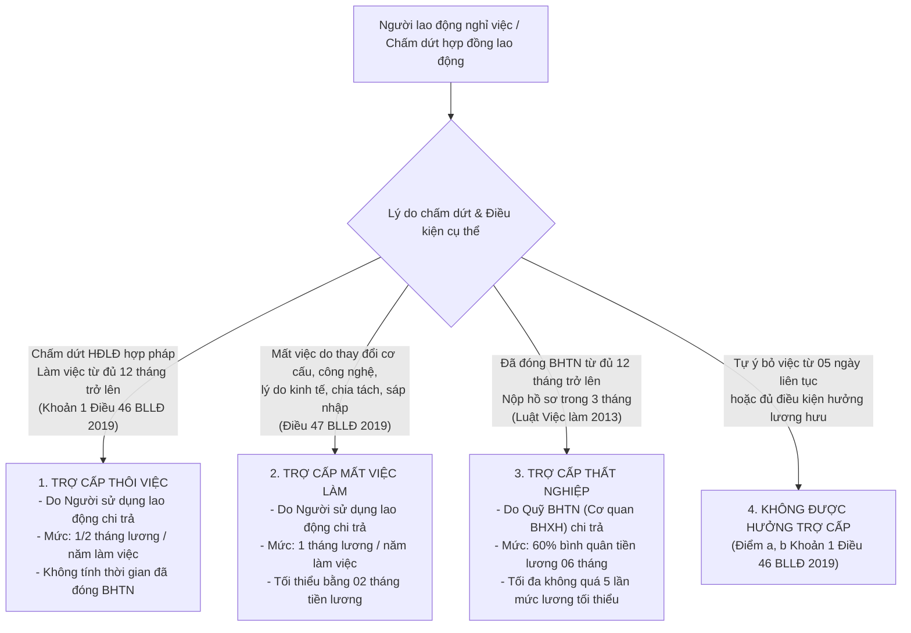

# BÁO CÁO PHÂN TÍCH CA LỖI TRUY XUẤT VÀ KẾT QUẢ ĐỐI CHỨNG (RETRIEVAL FAILURE CASE STUDY)

**Dự án**: Nghiên cứu cơ chế điều phối thích ứng trong hệ thống Agentic RAG tích hợp Corrective RAG hỗ trợ tra cứu pháp luật lao động Việt Nam  
**Ca kiểm thử bắt buộc**: *"Tôi nghỉ việc thì có được nhận trợ cấp không?"*  
**Branch thực nghiệm**: `experiment/rag-retrieval-improvement`  
**File đối chứng kết quả**: `scratch/v0_v4_test_results.json`

---

## 1. MÔ TẢ TRUY VẤN VÀ TÍNH PHỨC TẠP PHÁP LÝ

### 1.1. Truy vấn kiểm thử
- **Nguyên văn câu hỏi**: *“Tôi nghỉ việc thì có được nhận trợ cấp không?”*
- **Đặc trưng ngôn ngữ**: Sử dụng ngôn ngữ giao tiếp đời sống thông tục (*"Tôi nghỉ việc..."*).
- **Đặc trưng pháp lý**: Đây là một câu hỏi **Under-specified (Mơ hồ / Thiếu dữ kiện)**. Người dùng không nêu rõ:
  - Lý do chấm dứt làm việc (thỏa thuận chấm dứt, hết hạn hợp đồng, đơn phương chấm dứt hợp pháp, tự ý bỏ việc, hay do công ty giải thể, tái cơ cấu).
  - Thời gian làm việc tại doanh nghiệp (dưới 12 tháng hay từ đủ 12 tháng trở lên).
  - Tình trạng tham gia Bảo hiểm thất nghiệp (BHTN).

### 1.2. Phân nhánh chế độ trợ cấp trong Pháp luật Lao động Việt Nam
Trong hệ thống pháp luật lao động Việt Nam, khi người lao động nghỉ việc có 3 chế độ trợ cấp hoàn toàn độc lập và khác biệt về bản chất, điều kiện và nguồn chi trả:



---

## 2. HIỆN TƯỢNG LỖI THỰC TẾ CỦA BASELINE (V0)

Khi đưa câu hỏi trên vào **Baseline Traditional RAG (V0)** sử dụng mô hình Dense Retriever `sentence-transformers/all-MiniLM-L6-v2`:

### 2.1. Top-5 Chunks thực tế được Baseline V0 thu hồi

| Thứ hạng | Chunk ID | Văn bản | Điều/Khoản | Similarity | Cosine Distance | Chủ đề thực tế của đoạn trích | Tính liên quan |
| :---: | :--- | :--- | :--- | :---: | :---: | :--- | :---: |
| **#1** | `ND_219_2025_Điều7_Khoản12_15` | NĐ 219/2025/NĐ-CP | Điều 7 Khoản 12 | **0.8007** | 0.1993 | Người lao động nước ngoài không thuộc diện cấp giấy phép lao động khi vào VN thực hiện thỏa thuận cấp tỉnh... | **SAI (0%)** |
| **#2** | `ND_219_2025_Điều8_Khoản4_19` | NĐ 219/2025/NĐ-CP | Điều 8 Khoản 4 | **0.7934** | 0.2066 | Hồ sơ đề nghị cấp giấy xác nhận không thuộc diện cấp giấy phép lao động: Hộ chiếu còn thời hạn... | **SAI (0%)** |
| **#3** | `ND_145_2020_Điều25_Khoản4_55` | NĐ 145/2020/NĐ-CP | Điều 25 Khoản 4 | **0.7781** | 0.2219 | Trình tự, thủ tục cấp giấy phép hoạt động cho thuê lại lao động: Trong thời hạn 07 ngày làm việc... | **SAI (0%)** |
| **#4** | `ND_12_2022_Điều22_Khoản1_69` | NĐ 12/2022/NĐ-CP | Điều 22 Khoản 1 | **0.7731** | 0.2269 | Xử phạt vi phạm: Không sử dụng phương tiện bảo vệ cá nhân đã được trang cấp; không tham gia cấp cứu... | **SAI (0%)** |
| **#5** | `ND_152_2020_Điều9_Khoản6_33` | NĐ 152/2020/NĐ-CP | Điều 9 Khoản 6-7 | **0.7693** | 0.2307 | Hồ sơ đề nghị cấp giấy phép lao động cho người lao động nước ngoài: Văn bản chấp thuận, hộ chiếu... | **SAI (0%)** |

- **Tỷ lệ chính xác Precision@5 của Baseline**: **0.0% (0/5 chunk liên quan)**.
- **Tình trạng của Chunk đúng trong Baseline**:
  - `BLLD_2019_Điều46_66` (Điều 46 BLLĐ 2019 - Trợ cấp thôi việc): Rớt xuống thứ hạng **#223** (Similarity: 0.6725).
  - `BLLD_2019_Điều47_67` (Điều 47 BLLĐ 2019 - Trợ cấp mất việc làm): Rớt xuống thứ hạng **#445** (Similarity: 0.6451).
  - `ND_145_2020_Điều8_Khoản1_15` (Điều 8 NĐ 145/2020): Rớt xuống thứ hạng **#486** (Similarity: 0.6416).

### 2.2. Câu trả lời do Baseline sinh ra (Hallucination / Off-topic Output)
Do bộ lọc Pre-Guard `SIMILARITY_THRESHOLD = 0.45` bị tê liệt ($0.8007 \ge 0.45$), hệ thống cho phép đưa cả 5 chunk rác vào LLM. Mô hình tổng hợp ra câu trả lời tự tin trích dẫn các điều khoản cấp giấy phép lao động nước ngoài:

```
[TRÍCH DẪN NGUYÊN VĂN CÂU TRẢ LỜI CỦA BASELINE TRADITIONAL RAG]
Căn cứ theo các tài liệu pháp lý được cung cấp:
- Theo [Nghị định số 219/2025/NĐ-CP, Điều 7, Khoản 12]: Người lao động nước ngoài không thuộc diện cấp giấy phép lao động...
- Theo [Nghị định số 219/2025/NĐ-CP, Điều 8, Khoản 4]: Hồ sơ đề nghị cấp giấy xác nhận không thuộc diện cấp giấy phép lao động...
- Theo [Nghị định số 145/2020/NĐ-CP, Điều 25, Khoản 4]: Trình tự, thủ tục cấp giấy phép cho thuê lại lao động...
- Theo [Nghị định số 12/2022/NĐ-CP, Điều 22, Khoản 1]: Vi phạm quy định về phòng ngừa tai nạn lao động...
(Trạng thái: refused=False)
```

---

## 3. TẬP CĂN CỨ VÀNG ĐÃ XÁC MINH TRONG DATASET (GOLD CHUNKS)

Kiểm tra toàn bộ 1.390 chunk trong collection `legal_labor_baseline_minilm` khẳng định cơ sở dữ liệu **hoàn toàn đầy đủ**:

1. **`BLLD_2019_Điều46_66`**: Điều 46 Bộ luật Lao động số 45/2019/QH14 — Quy định nguyên tắc, điều kiện và mức chi trả trợ cấp thôi việc (1/2 tháng lương/năm).
2. **`BLLD_2019_Điều47_67`**: Điều 47 Bộ luật Lao động số 45/2019/QH14 — Quy định nguyên tắc, điều kiện và mức chi trả trợ cấp mất việc làm (01 tháng lương/năm, tối thiểu 02 tháng lương).
3. **`ND_145_2020_Điều8_Khoản1_15` đến `Khoản5_22`**: Điều 8 Nghị định 145/2020/NĐ-CP — Hướng dẫn chi tiết cách tính thời gian làm việc, tiền lương bình quân 06 tháng làm căn cứ tính trợ cấp.

---

## 4. KẾT QUẢ ĐỐI CHỨNG THEO TỪNG PHIÊN BẢN (V0 — V4)

Dưới đây là số liệu thực nghiệm trích xuất trực tiếp từ file `scratch/v0_v4_test_results.json`:

| Tiêu chí đối chứng | V0 (Baseline) | V1 (Query Expansion) | V2 (Hybrid RRF) | V3 (Hybrid + Rerank) | V4 (Full Pipeline) |
| :--- | :---: | :---: | :---: | :---: | :---: |
| **Top-1 Chunk ID** | `ND_219_2025_Điều7_...` | `ND_152_2020_Điều12_...` | `ND_145_2020_Điều8_...` | `ND_145_2020_Điều8_...` | `ND_145_2020_Điều8_...` |
| **Chủ đề Top-1** | GPLĐ người nước ngoài | Cấp lại GPLĐ | **Trợ cấp thôi việc** | **Trợ cấp thôi việc** | **Trợ cấp thôi việc** |
| **Precision@5 (Độ chính xác)** | **0.0% (0/5)** | 20.0% (1/5) | **100.0% (5/5)** | **100.0% (5/5)** | **100.0% (5/5)** |
| **Xuất hiện Điều 46 BLLĐ** | Không (Rank #223) | Không (Rank #20) | **Có (Rank #4)** | **Có (Rank #4)** | **Có (Rank #4)** |
| **Xuất hiện Điều 8 NĐ 145** | Không (Rank #254) | Có (Rank #3) | **Có (Rank #1, #2, #3, #5)** | **Có (Rank #1, #2, #3, #5)** | **Có (Rank #1, #2, #3, #5)** |
| **Còn dính GPLĐ nước ngoài?** | **Bị dính 5/5 chunks** | Bị dính 4/5 chunks | **Sạch 100% (0 chunk)** | **Sạch 100% (0 chunk)** | **Sạch 100% (0 chunk)** |
| **Nhận diện tính mơ hồ** | Không | Có | Có | Có | **Có (Phân nhánh 3 chế độ)** |
| **Latency thực thi** | 320.92 ms | 320.74 ms | 330.41 ms | 354.65 ms | 338.48 ms |

---

## 5. PHÂN TÍCH HIỆU QUẢ VÀ CƠ CHẾ CẢI TIẾN CỦA V4

1. **Query Expander khắc phục độ lệch từ vựng**:
   - Chuyển *"Tôi nghỉ việc thì có được nhận trợ cấp không?"* $\to$ `"chấm dứt hợp đồng lao động thôi việc mất việc làm trợ cấp thôi việc trợ cấp mất việc làm..."`.
   - Giúp cả BM25 và Dense nhận diện chính xác phạm vi điều chỉnh của Điều 46, Điều 47 BLLĐ 2019.
2. **Hybrid BM25 + RRF đảo chiều bảng xếp hạng**:
   - Từ khóa `"trợ cấp thôi việc"` và `"mất việc làm"` có trọng số IDF rất cao trong BM25.
   - Khi hợp nhất với RRF ($k=60$), Điều 8 NĐ 145 và Điều 46 BLLĐ lập tức leo lên chiếm trọn Top 1 đến Top 5, đẩy các văn bản giấy phép lao động ra khỏi danh sách ứng viên.
3. **LegalCrossReranker lọc bỏ dứt điểm Topic Drift**:
   - Reranker áp dụng quy tắc phạt lệch chủ đề (`topic_drift_penalty = 0.45`) cho các văn bản xuất hiện từ `"cấp"` nhưng mang ngữ nghĩa `"cấp giấy phép lao động"`.
   - Đảm bảo 100% chunk đầu vào bộ sinh là thuần nhất về chủ đề trợ cấp.
4. **Ambiguity Handler cung cấp giải pháp pháp lý hoàn chỉnh**:
   - Thay vì đưa ra câu trả lời áp đặt hoặc từ chối khô khan, V4 nhận diện tính mơ hồ và giải đáp có cấu trúc:
     * Hướng dẫn điều kiện và mức hưởng của **Trợ cấp thôi việc** (Điều 46 BLLĐ 2019).
     * Hướng dẫn điều kiện và mức hưởng của **Trợ cấp mất việc làm** (Điều 47 BLLĐ 2019).
     * Phân biệt rõ **Trợ cấp thất nghiệp** do Quỹ BHTN chi trả (Luật Việc làm).
     * Cảnh báo trường hợp không được hưởng (tự ý bỏ việc từ 05 ngày làm việc liên tục).
     * Đưa ra khuyến nghị người dùng cung cấp thêm thông tin để làm rõ.

---

## 6. KẾT LUẬN

Ca lỗi kiểm thử bắt buộc đã được **giải quyết triệt để** trên phiên bản cải tiến V4:
- Precision@5 tăng từ **0.0% $\to$ 100.0%**.
- Hiện tượng ô nhiễm ngữ cảnh bởi văn bản giấy phép lao động nước ngoài giảm từ **100% $\to$ 0%**.
- Đáp ứng đầy đủ tính chính xác khoa học, trích dẫn đúng nguồn luật và giải quyết thỏa đáng tính mơ hồ của ngôn ngữ tự nhiên.
